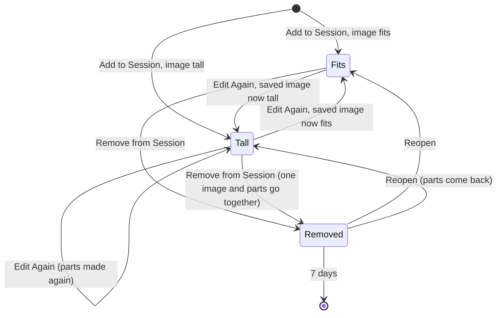

# Information Architecture

Kept short: this change adds no screen and no route. The M preset skip for `ia` ("no route, object or name changes") was not taken because one object is new: the **part** of a tall screenshot, with a file of its own and a word in `session.md`.

## Objects

| Object          | Definition                                                                                                                                  | Status  | Need       |
| --------------- | ------------------------------------------------------------------------------------------------------------------------------------------- | ------- | ---------- |
| session         | a folder under the sessions folder holding `session.md`, `img/` and `.edit/`                                                                | exists  | J3         |
| screenshot      | one entry in `session.md` ("## 007 · 14:32"), one number, one image `img/007.png`, its marks in `.edit/007.json`                            | exists  | J1, J2, J3 |
| tall screenshot | a screenshot that fitting whole would leave less than two-thirds as wide as its parts (rule below)                                          | new     | J1         |
| part            | one horizontal band of a tall screenshot, `img/007/01.png`, cut top to bottom, overlapping the band before                                  | new     | J1, J2     |
| parts line      | value: one plain sentence in the entry telling the agent that the parts are one screenshot, top to bottom                                   | new     | J1         |
| one image       | attribute of the screenshot: `img/007.png`. For a tall screenshot it is the whole page at the parts' width, uncut (it was the shrunk strip) | changed | J3         |

### The rule, with the numbers

The limits are the ones in `src/main.ts`: 1568 px on the long edge, 1,150,000 pixels.

| Step                    | Rule                                                                                                                                          | 1280 × 8000 (1×) | 2560 × 16 000 (Retina) | 2560 × 1600 (normal Retina) |
| ----------------------- | --------------------------------------------------------------------------------------------------------------------------------------------- | ---------------- | ---------------------- | --------------------------- |
| Fitted whole (as today) | `fitForAI`: one image within both limits                                                                                                      | 251 × 1568       | 251 × 1568             | 1356 × 848                  |
| Part width              | the image's width, at most 1280 px                                                                                                            | 1280             | 1280                   | 1280                        |
| Tall?                   | fitted width < two-thirds of the part width                                                                                                   | yes (251 < 853)  | yes                    | no (1356): saved as today   |
| One image `img/NNN.png` | the whole image scaled to the part width                                                                                                      | 1280 × 8000      | 1280 × 8000            | as today                    |
| Part height             | at most 1568 px and at most 1,150,000 ÷ part width (898 px at 1280)                                                                           | ≤ 898            | ≤ 898                  | —                           |
| Overlap                 | a tenth of the part width, at least 40 px: more than a numbered diamond (about 8 % of the width, `src/editor.ts` `unit * 16` on a tall image) | 128 px           | 128 px                 | —                           |
| Parts                   | the fewest that cover the image; all the same height; the last one ends at the bottom edge                                                    | 11 × 844 px      | 11 × 844 px            | —                           |

More cases, to show the rule leaves normal screenshots alone:

| Image                         | Fitted whole | Part width | Tall?           | Parts |
| ----------------------------- | ------------ | ---------- | --------------- | ----- |
| 1000 × 1200 (1×, just over)   | 979 wide     | 1000       | no              | —     |
| 600 × 1600 (narrow, 1×)       | 588 wide     | 600        | no              | —     |
| 900 × 1700 (1×)               | 780 wide     | 900        | no              | —     |
| 2560 × 3200 (tall window)     | 959 wide     | 1280       | no              | —     |
| 2560 × 4000 (2.5 screens)     | 858 wide     | 1280       | no (858 ≥ 853)  | —     |
| 2160 × 3840 (portrait screen) | 804 wide     | 1280       | yes (804 < 853) | 3     |
| 600 × 3000 (phone page, 1×)   | 314 wide     | 600        | yes (314 < 400) | 2     |
| 2560 × 20 000 (the most)      | 201 wide     | 1280       | yes             | 13    |
| 1280 × 20 000 (the most, 1×)  | 100 wide     | 1280       | yes             | 26    |
| 4000 × 1000 (wide)            | 1568 wide    | 1280       | no              | —     |

Part file names have two digits (`01.png` … `26.png`): `MAX_HEIGHT` (20 000 px, `src/stitch.ts`) caps a scrolling capture at 26 parts. The layout test asserts at most 99 parts, so a later rise of `MAX_HEIGHT` cannot make names sort wrongly unnoticed.

## Alias Table

| Canonical       | Rejected                           | Reason                                                                                                    |
| --------------- | ---------------------------------- | --------------------------------------------------------------------------------------------------------- |
| part            | tile, slice, piece, page           | the plainest word for the agent; "tile" (A1, A4) suggests a grid; "page" clashes with the web page itself |
| screenshot      | entry, capture (noun), shot        | glossary proposal row "screenshot"; a part is never called a screenshot                                   |
| "part 1 of 11"  | "1/11", "tile 01"                  | spelled out in the alt text, read by the agent and by screen readers                                      |
| tall screenshot | scrolling capture, long screenshot | the rule is about shape, not about how it was captured: a tall area picked by hand qualifies too          |

## Nested Object Matrix

| Parent     | Child      | Cardinality             | Role name             | Rank |
| ---------- | ---------- | ----------------------- | --------------------- | ---- |
| session    | screenshot | 0..n                    | entries               | 1    |
| screenshot | one image  | 1                       | what people see       | 1    |
| screenshot | part       | 0 (fits) or 2..n (tall) | what the agent reads  | 2    |
| screenshot | parts line | 0 or 1, only with parts | how to read the parts | 3    |

A screenshot never has exactly one part: an image that fits in one part is not tall.

## CTA Inventory

No new control. Every action stays on the screenshot; none acts on a part.

| Object     | Verb                | Control                                                       | Type      | Contra-CTA                          |
| ---------- | ------------------- | ------------------------------------------------------------- | --------- | ----------------------------------- |
| screenshot | add to session      | editor Add to Session (⌘↩, ⌘S)                                | primary   | Discard (⌘W)                        |
| screenshot | edit again          | session window Edit Again (⌘O)                                | secondary | close the editor (Discarded)        |
| screenshot | remove from session | session window Remove from Session (⌘⌫), "…" menu             | overflow  | ⌘Z, Reopen in Discarded             |
| screenshot | export              | menu Export Session ▸ PDF / ZIP                               | secondary | none (a file in the session folder) |
| screenshot | save as / copy      | editor Save As… (⇧⌘S), Copy Image (⇧⌘C)                       | secondary | Cancel in the save panel            |
| part       | none                | parts are made and removed with their screenshot, never alone | —         | —                                   |

## Attribute Priority

| View                         | Attribute                           | Rank | Reason                                    |
| ---------------------------- | ----------------------------------- | ---- | ----------------------------------------- |
| `session.md` entry (agent)   | heading, parts line, parts in order | 1    | J1: read the page; the line says how      |
| `session.md` entry (agent)   | comment, notes, cards, text         | 2    | once per entry, after the parts, as today |
| Screenshots tab thumbnail    | one image (top of the page)         | 1    | J3: as today, sharper                     |
| Screenshots tab grid caption | "007 · 14:32", "3 notes"            | 1    | as today; parts are not counted           |
| PDF                          | one image                           | 1    | J3, scene 2: a person reads one page      |

## State Diagrams

The screenshot's shape decides whether it has parts. Edit Again re-decides from the new image.



No editor tool changes the image size, so a new screenshot never moves between Fits and Tall on Edit Again. An entry saved before this change can: an old tall entry (the 251 px strip, ``) becomes Tall with parts when Edit Again saves it again from `.edit/007.png`. Existing entries are never rewritten otherwise. The rule runs on every save, so it can never go stale.

## Sitemap

`omr-ux:sitemap-create diff` ran scoped to this change: [sitemap.md](sitemap.md). No route, window, tab, menu item or address changes. The one line that changes is the Finder line of the as-built sitemap: a tall screenshot adds a folder `img/NNN/` beside `img/NNN.png`. No redirects.

## Screen Inventory

| Screen                      | Route                          | Purpose                               | Job stories served | Arrive from                        | Go next to                      |
| --------------------------- | ------------------------------ | ------------------------------------- | ------------------ | ---------------------------------- | ------------------------------- |
| `session.md` (the agent's)  | file, read by the agent        | the hand-off to the agent             | J1, J2             | Copy Prompt for AI, the path       | the agent's work                |
| Editor                      | after a capture, Edit Again    | mark up one screenshot                | J2, J3             | ⌃⇧4, Capture Scrolling, Edit Again | session (Add to Session)        |
| Session window, Document    | Open Current Session           | read and edit `session.md`            | J1, J3             | menu, notification                 | Screenshots, Markdown app       |
| Session window, Screenshots | tab                            | one screenshot at a time              | J3                 | Document tab                       | Edit Again, Remove from Session |
| Session window, Discarded   | tab, when anything was removed | put a removed screenshot back         | J3                 | Screenshots tab                    | Reopen                          |
| PDF export                  | Export Session ▸ PDF           | hand the session to a person          | J3                 | menu                               | Finder                          |
| ZIP export                  | Export Session ▸ ZIP           | hand the session to a person or agent | J1, J3             | menu                               | Finder                          |

## Navigation Tree

Unchanged. What a tall screenshot adds, by place:

```
Session folder
├── session.md        entry: heading · parts line · part 1 … part n · comment · notes · cards · text
├── img/
│   ├── 007.png       the one image (the whole page at the parts' width)
│   └── 007/          01.png … 11.png, only for a tall screenshot
└── .edit/            007.png (clean capture, full size) · 007.json (marks), as today
Session window
├── Document          shows the entry as written: the parts line and the parts
├── Screenshots       shows 007.png: one thumbnail, one large view
└── Discarded         shows the removed screenshot's one image
```

## Journeys

| Job story | How often                        | Path                                                                         | Moves | Why this length                                     |
| --------- | -------------------------------- | ---------------------------------------------------------------------------- | ----- | --------------------------------------------------- |
| J1        | each scrolling capture           | Capture Scrolling → scroll → ↩ (Done) → mark → ⌘↩ Add to Session             | 5     | unchanged; parts are made on save, with no new step |
| J2        | most tall captures               | in the editor: Reference tool → click far down → type the note → ⌘↩          | 4     | unchanged; the overlap needs nothing from the owner |
| J3        | weekly (export), rarely (remove) | menu → Open Current Session → Screenshots → the thumbnail → Edit Again or ⌘⌫ | 5     | unchanged; one screenshot, one number               |

## Move Table

No move is added or changed. The moves J3 relies on, with what changes underneath:

| From            | Control                  | To                     | Type    | Why (job story or ask) | Back target      | Restores                                           |
| --------------- | ------------------------ | ---------------------- | ------- | ---------------------- | ---------------- | -------------------------------------------------- |
| Screenshots tab | Edit Again (⌘O)          | editor, "Save changes" | forward | J3                     | close the editor | the entry, its one image and its parts             |
| Screenshots tab | Remove from Session (⌘⌫) | Discarded (silent)     | lateral | J3                     | ⌘Z, Reopen       | the entry, its one image and its parts             |
| Discarded tab   | Reopen                   | entry back at the end  | lateral | J3                     | Remove again     | number kept unless taken; parts renumbered with it |
| menu            | Export Session ▸ PDF     | Finder, PDF selected   | forward | J3, scene 2            | none (Finder)    | —                                                  |

## Open Questions

| Question                                                         | Recommended answer                                                                   | Why it matters                                                           |
| ---------------------------------------------------------------- | ------------------------------------------------------------------------------------ | ------------------------------------------------------------------------ |
| Should the large view in the Screenshots tab scroll a tall page? | not now: the large view stays as today; it is sharper because the one image is wider | not asked; a follow-up issue if the owner wants to read tall pages there |
