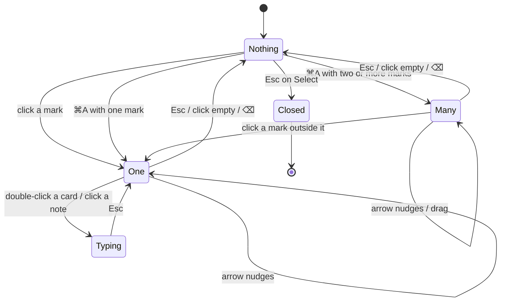

# Interaction

## Terms used below

- **Text has the cursor:** a note, the comment, the Document field, the rename field, or a card being typed in (Fabric's hidden textarea).
- **A field has focus:** a slider or the colour well, where arrows already do something. Today's editor check (`typing`, `src/editor.ts:954`) misses both; the new keys must treat them like text. A focused button or swatch does not count: arrows and ⌘A still act on the marks.
- **1 point:** `devicePixelRatio` image pixels of the editor's window (2 on Retina, 1 on a 1× display). The canvas holds the image at device resolution (`src/editor.ts:35`).
- **Mark:** any object on the canvas the owner can select. A cut piece's ghost and arrow are not marks; they follow their piece.
- **Busy:** the area picker is open, or Capture Scrolling is picking or grabbing. Today `picking` covers only the picker (`src/main.ts:184`); grabbing needs the same flag.

## Key map

Every key this change adds or moves, per surface and state. "Refused" means nothing happens: no beep, no message, no focus change.

### Anywhere (global keys, `src/main.ts:871`)

| #   | Key | State                                           | What happens                                                                                                                        | Focus                                    | Undo                |
| --- | --- | ----------------------------------------------- | ----------------------------------------------------------------------------------------------------------------------------------- | ---------------------------------------- | ------------------- |
| G1  | ⌃⇧4 | not busy                                        | Capture Screenshot…: macOS's capture overlay, as ⌃⇧1 did.                                                                           | the overlay, then the editor             | Esc in the overlay  |
| G1b | ⌃⇧4 | busy                                            | Refused. One capture at a time.                                                                                                     | stays                                    | none                |
| G1a | ⌃⇧4 | another app owns it                             | Not registered. Menu row reads "Capture Screenshot… (shortcut unavailable)". Startup notification as today.                         | none                                     | none                |
| G2  | ⌃⇧1 | any                                             | Refused. Snapmark no longer registers it; another app may use it.                                                                   | none                                     | none                |
| G3  | ⌃⇧3 | not busy                                        | Unchanged: Capture Last Area.                                                                                                       | as today                                 | as today            |
| G3a | ⌃⇧3 | busy                                            | Refused. Today it shoots at once when an area is set, even while busy.                                                              | stays                                    | none                |
| G4  | ⌃⇧5 | not busy                                        | Pops the capture options as a menu at the menu bar icon (see Popup).                                                                | the menu; the front app keeps its window | Esc closes the menu |
| G4a | ⌃⇧5 | busy                                            | Refused. A second picker over the first is never wanted. The popup's items check the same flag.                                     | stays on the picker                      | none                |
| G4b | ⌃⇧5 | the menu bar menu or this popup is already open | Refused. A menu-open flag (set on show, cleared on close) guards it; macOS may also swallow the key.                                | stays on the menu                        | none                |
| G4c | ⌃⇧5 | macOS's capture overlay is up (after ⌃⇧4)       | The overlay holds the keyboard. Snapmark adds no guard, as with ⌃⇧4 today.                                                          | the overlay                              | none                |
| G4d | ⌃⇧5 | a full-screen app is in front                   | Pops at the icon's place. If the build shows nothing there with the menu bar hidden, pop at the pointer instead (owner question 4). | the menu                                 | Esc                 |
| G4e | ⌃⇧5 | another app owns it                             | Not registered. The menu's row reads "Capture Options (shortcut unavailable)". Startup notification as today.                       | none                                     | none                |
| G5  | ⌃⇧N | any                                             | Unchanged: New Session.                                                                                                             | as today                                 | none (as today)     |

### Popup (⌃⇧5)

| State                         | What the owner sees                                                                                                                     | Keys                                                 | Exit                                     |
| ----------------------------- | --------------------------------------------------------------------------------------------------------------------------------------- | ---------------------------------------------------- | ---------------------------------------- |
| open                          | A native menu under the icon: Choose New Area…, Capture Window…, Capture Scrolling…, separator, One-Shot Capture…. No item highlighted. | ↑ ↓ move, ↩ chooses, Esc closes, type-ahead (native) | an item runs, or Esc / a click elsewhere |
| item chosen                   | Exactly what the same item does from Capture Options in the menu.                                                                       | as that flow                                         | that flow                                |
| Choose New Area…, no area yet | Same as the menu: the area picker.                                                                                                      | Esc cancels the picker                               | Editor, or nothing                       |

### Editor (`src/editor.ts:945`), session mode, Edit Again and one-shot

| #    | Key                           | State                                                      | What happens                                                                                                                                                                                   | Focus                | Undo                                                                                     |
| ---- | ----------------------------- | ---------------------------------------------------------- | ---------------------------------------------------------------------------------------------------------------------------------------------------------------------------------------------- | -------------------- | ---------------------------------------------------------------------------------------- |
| E1   | ⌘S                            | session mode, image loaded                                 | Same as the primary button and ⌘↵: Add to session (Save changes in Edit Again). Also while text has the cursor.                                                                                | the editor closes    | Discarded and Remove from Session, as for ⌘↵                                             |
| E1a  | ⌘S                            | a save is already running                                  | Refused. Also guards ⌘↵, which today calls `save()` again. A bug fix; ⌘↵ keeps its meaning.                                                                                                    | unchanged            | none                                                                                     |
| E1b  | ⌘S                            | the image has not loaded yet                               | Refused. `save()` gets the `background` check, so ⌘↵ is refused too (today it is not).                                                                                                         | unchanged            | none                                                                                     |
| E2   | ⌘S                            | one-shot mode                                              | Save As…, same as ⇧⌘S. Also while text has the cursor.                                                                                                                                         | the macOS save panel | Cancel in the panel                                                                      |
| E3   | ⌘↵                            | any                                                        | Unchanged.                                                                                                                                                                                     | as today             | as today                                                                                 |
| E4   | ⌘C                            | no text has the cursor; any mode; marks selected or not    | Copies the marked-up image, as ⇧⌘C. One-shot: the beautified image at full resolution, as today. The same marks are selected again after the copy (`flatten()` drops the selection to render). | unchanged            | none (a copy loses nothing)                                                              |
| E4a  | ⌘C                            | text has the cursor                                        | Native: copies the selected text.                                                                                                                                                              | unchanged            | none                                                                                     |
| E5   | ⇧⌘C                           | any                                                        | Unchanged: copies the image, also inside a note.                                                                                                                                               | unchanged            | none                                                                                     |
| E6   | ← ↑ → ↓                       | one or more marks selected; no text cursor; no field focus | Moves the selection 1 point. A cut piece's arrow and a card's pointer follow, as when dragging. The page does not scroll.                                                                      | unchanged            | one step per press; a held key adds one step per repeat                                  |
| E6a  | ⇧ + arrow                     | as E6                                                      | Moves 10 points.                                                                                                                                                                               | unchanged            | one step per press                                                                       |
| E6b  | arrow                         | the selection is one redaction                             | Refused. Redactions are pinned (guideline exception).                                                                                                                                          | unchanged            | none                                                                                     |
| E6c  | arrow                         | nothing selected                                           | Nothing happens to marks. A tall scrolling shot scrolls, as the browser does by default.                                                                                                       | unchanged            | none                                                                                     |
| E6d  | arrow                         | text has the cursor                                        | Native: the caret moves.                                                                                                                                                                       | unchanged            | none                                                                                     |
| E6e  | arrow                         | a slider has focus (one-shot Beautify)                     | Native: the slider changes. Marks stay.                                                                                                                                                        | unchanged            | as the slider today                                                                      |
| E6f  | arrow                         | the move would push a mark past the image edge             | Allowed, as dragging allows it. No clamp.                                                                                                                                                      | unchanged            | one step                                                                                 |
| E7   | ⌘A                            | no text cursor; at least one mark that is not a redaction  | Switches to Select if a drawing tool is on. Selects every mark except redactions. One mark: a normal single selection with handles.                                                            | unchanged            | none (selecting is not a step)                                                           |
| E7a  | ⌘A                            | no marks, or only redactions                               | Refused. The tool stays as it is.                                                                                                                                                              | unchanged            | none                                                                                     |
| E7c  | ⌘A                            | a tall scrolling shot, marks out of view                   | Selects them too. ⌫ then removes them unseen; one ⌘Z brings all back. No count is shown.                                                                                                       | unchanged            | one step                                                                                 |
| E7b  | ⌘A                            | text has the cursor                                        | Native: selects all the text in that field. Stops the stock Edit ▸ Select All otherwise.                                                                                                       | unchanged            | none                                                                                     |
| E8   | drag                          | multi-selection                                            | Moves every selected mark together.                                                                                                                                                            | unchanged            | one step; ⌘Z puts each mark back at its own place                                        |
| E8a  | ⌫ or Delete                   | multi-selection                                            | Removes every selected mark, with their ghosts and arrows.                                                                                                                                     | unchanged            | one step; ⌘Z restores all, in their old stacking order, so references keep their numbers |
| E8b  | click                         | multi-selection, on empty canvas                           | Deselects.                                                                                                                                                                                     | unchanged            | none                                                                                     |
| E8c  | click                         | multi-selection, on one of its marks                       | Starts a drag of the whole selection; a click without moving keeps it.                                                                                                                         | unchanged            | as E8                                                                                    |
| E8d  | click                         | multi-selection, on a mark outside it                      | Selects that mark only.                                                                                                                                                                        | unchanged            | none                                                                                     |
| E8e  | tool key                      | multi-selection                                            | Picks the tool and drops the selection, as today with one mark.                                                                                                                                | unchanged            | none                                                                                     |
| E8f  | ⇧-click, drag on empty canvas | Select tool                                                | Refused, as today (`selection: false`). ⌘A is the only way to a multi-selection.                                                                                                               | unchanged            | none                                                                                     |
| E9   | Esc                           | any                                                        | Unchanged: text, then the selection (one or many), then back to Select, then closes to Discarded.                                                                                              | as today             | Reopen Last Discarded                                                                    |
| E10  | ⌘Z / ⇧⌘Z                      | any                                                        | Unchanged. Nudges, group moves and group removals are ordinary steps.                                                                                                                          | as today             | itself                                                                                   |
| E10a | ⌘Z / ⇧⌘Z                      | several marks selected                                     | Drops the selection first, then undoes. Inside a selection Fabric keeps positions relative to it, so undoing first would put marks back at the wrong places.                                   | unchanged            | itself                                                                                   |
| E12  | ⌘W, close button, Esc, Quit   | several marks selected                                     | Drops the selection first, then writes the Discarded copy. Otherwise `stateOf()` stores positions relative to the selection, and Reopen and Edit Again show the marks moved.                   | the editor closes    | Reopen Last Discarded                                                                    |
| E11  | ⌘W, ⇧⌘S, ⌘1–⌘7, tool keys     | any                                                        | Unchanged.                                                                                                                                                                                     | as today             | as today                                                                                 |

### Session window (`src/viewer.ts:189`)

| #   | Key     | State                                                                                         | What happens                                                                                                                                  | Focus               | Undo                                             |
| --- | ------- | --------------------------------------------------------------------------------------------- | --------------------------------------------------------------------------------------------------------------------------------------------- | ------------------- | ------------------------------------------------ |
| S1  | ↩       | any view; focus on no button, link, field or editable text                                    | Starts renaming: the title becomes the name field, all selected, hint "↩ to save · Esc to cancel".                                            | the name field      | Esc cancels; a saved name has no undo (as today) |
| S1a | ↩       | a button has focus because the owner tabbed to it                                             | Native: that button acts. Rename does not start.                                                                                              | unchanged           | as that button                                   |
| S1b | ↩       | text has the cursor (Document field)                                                          | Native: a new line.                                                                                                                           | unchanged           | as typing                                        |
| S1d | ↩       | right after a pointer click on a button (Remove, ←, →, a tab)                                 | Starts renaming. Session window buttons do not keep focus after a pointer click, so ↩ never repeats a click (a second Remove, a second flip). | the name field      | Esc                                              |
| S1c | ↩       | the name field is open                                                                        | Unchanged: saves the name; a taken name keeps the field with the reason.                                                                      | as today            | as today                                         |
| S2  | ⌘⌫      | one screenshot shown large                                                                    | Remove from Session: it moves to Discarded. The next screenshot shows in its place; after the last, the one before.                           | stays in the window | ⌘Z (S5), or Discarded tab ▸ Reopen (7 days)      |
| S2a | ⌘⌫      | it was the only screenshot                                                                    | As S2, then the grid shows "No screenshots yet. Capture one with ⌃⇧4."                                                                        | stays in the window | as S2                                            |
| S2b | ⌘⌫      | grid, Document or Discarded view                                                              | Refused. No screenshot is open.                                                                                                               | unchanged           | none                                             |
| S2c | ⌘⌫      | key held (auto-repeat), or a removal still running                                            | Refused. One press removes one screenshot.                                                                                                    | unchanged           | none                                             |
| S2d | ⌘⌫      | text has the cursor                                                                           | Native: deletes to the start of the line.                                                                                                     | unchanged           | as typing                                        |
| S3  | ⌘O      | one screenshot shown large; Edit Again enabled                                                | Edit Again: opens it in the editor with its marks, or brings its open editor forward.                                                         | the editor          | the editor's Discard                             |
| S3a | ⌘O      | Edit Again disabled (saved before marks were kept)                                            | Refused. The greyed Edit Again button stays the only sign.                                                                                    | unchanged           | none                                             |
| S3b | ⌘O      | grid, Document or Discarded view                                                              | Refused.                                                                                                                                      | unchanged           | none                                             |
| S3c | ⌘O      | key held (auto-repeat)                                                                        | Refused after the first press.                                                                                                                | the editor          | none                                             |
| S4  | ← → Esc | as today                                                                                      | Unchanged.                                                                                                                                    | as today            | as today                                         |
| S5  | ⌘Z      | a screenshot was removed with ⌘⌫ or the Remove button since the window opened; no text cursor | Puts the last removed screenshot back, as Discarded ▸ Reopen does, and shows it large. One step only: a second ⌘Z does nothing.               | stays in the window | itself                                           |
| S5a | ⌘Z      | nothing removed since the window opened, or it left Discarded already                         | Refused.                                                                                                                                      | unchanged           | none                                             |
| S5b | ⌘Z      | text has the cursor (Document field, name field)                                              | Native: undoes the typing.                                                                                                                    | unchanged           | as typing                                        |

### Keyboard Shortcuts window

No key changes. Only its rows change (screens.md).

## Wireflows

### J1: capture with macOS's digits

| From control | Action                | To screen or state         | Notes                               |
| ------------ | --------------------- | -------------------------- | ----------------------------------- |
| ⌃⇧4          | press                 | macOS capture overlay      | G1                                  |
| overlay      | drag or Space + click | Editor                     | as today                            |
| ⌃⇧5          | press                 | Popup at the menu bar icon | G4                                  |
| Popup item   | click or ↩            | that option's flow         | same as Capture Options in the menu |
| Popup        | Esc                   | nothing                    |                                     |

### J2: save and copy as in Preview

| From control | Action | To screen or state                   | Notes                         |
| ------------ | ------ | ------------------------------------ | ----------------------------- |
| ⌘S           | press  | editor closes; screenshot in session | E1; one-shot: save panel (E2) |
| ⌘C           | press  | clipboard; notification              | E4                            |

### J3: nudge and select all

| From control     | Action       | To screen or state                 | Notes    |
| ---------------- | ------------ | ---------------------------------- | -------- |
| mark             | click        | single selection                   | as today |
| arrow key        | press        | mark moved 1 point                 | E6       |
| ⌘A               | press        | multi-selection, Select tool       | E7       |
| arrow / drag / ⌫ | press / drag | all moved / all removed            | E8       |
| ⌘Z               | press        | last nudge, move or removal undone | E10      |

### J4: tidy a session with Finder's keys

| From control        | Action  | To screen or state                  | Notes    |
| ------------------- | ------- | ----------------------------------- | -------- |
| ↩                   | press   | name field open                     | S1       |
| name field          | ↩ / Esc | saved / cancelled                   | as today |
| ⌘⌫ (one screenshot) | press   | next screenshot; Discarded count +1 | S2       |
| ⌘O (one screenshot) | press   | editor with the marks               | S3       |

## State Tables

### Editor canvas

| State                | Entry or trigger                       | What the owner sees                    | Words | Actions with key                                  | Exit                                           |
| -------------------- | -------------------------------------- | -------------------------------------- | ----- | ------------------------------------------------- | ---------------------------------------------- |
| empty                | no marks yet                           | the screenshot                         | none  | ⌘A refused (E7a); arrows nothing                  | a mark is drawn                                |
| nothing selected     | marks exist, none selected             | the marks                              | none  | ⌘A, tool keys, ⌘S, ⌘C                             | click or ⌘A                                    |
| one selected         | click a mark, or ⌘A with one mark      | handles on the mark                    | none  | arrows, ⇧arrows, ⌫, Esc                           | Esc, click empty, tool key                     |
| many selected        | ⌘A                                     | one border round all marks, no handles | none  | arrows, ⇧arrows, drag, ⌫, Esc                     | Esc, click empty, click another mark, tool key |
| typing               | a note, comment or card has the cursor | caret                                  | none  | ⌘S, ⇧⌘C, ⌘1–⌘7, ⌘Z; arrows and ⌘A act on the text | Esc (blur)                                     |
| saving               | ⌘S, ⌘↵ or the button                   | primary button disabled                | none  | all save keys refused                             | the editor closes, or the error as today       |
| disabled with reason | Redact selected                        | handles absent (pinned)                | none  | arrows refused; ⌫ removes                         | Esc                                            |

### Session window, one screenshot

| State               | Entry or trigger           | What the owner sees                          | Words                                       | Actions with key     | Exit                     |
| ------------------- | -------------------------- | -------------------------------------------- | ------------------------------------------- | -------------------- | ------------------------ |
| default             | a thumbnail clicked        | the screenshot, "2 of 3", Edit Again, Remove | as today                                    | ←, →, Esc, ↩, ⌘⌫, ⌘O | Esc or ‹ All Screenshots |
| Edit Again disabled | an old screenshot          | Edit Again greyed                            | as today (no reason, F143)                  | ⌘O refused           | as default               |
| removing            | ⌘⌫ or the button           | the old screenshot until the window reloads  | none                                        | ⌘⌫ refused           | the next one shows       |
| last one removed    | ⌘⌫ on the only screenshot  | the grid, empty                              | "No screenshots yet. Capture one with ⌃⇧4." | ↩                    | a capture                |
| renaming            | ↩, the title or the pencil | name field with the hint                     | "↩ to save · Esc to cancel"                 | ↩, Esc               | saved or cancelled       |

### Popup (⌃⇧5)

| State       | Entry or trigger     | What the owner sees | Words                    | Actions with key | Exit        |
| ----------- | -------------------- | ------------------- | ------------------------ | ---------------- | ----------- |
| open        | ⌃⇧5                  | the four options    | see screens.md           | ↑ ↓ ↩ Esc        | item or Esc |
| refused     | G4a to G4c           | nothing changes     | none                     | none             | none        |
| unavailable | another app owns ⌃⇧5 | menu row suffix     | "(shortcut unavailable)" | menu only        | none        |

Loading, partial and error states do not apply to a key press. Errors keep today's paths (Errors, below).

## State Diagrams

## Elements x Interactions

Only the elements whose behaviour this change touches. Every other cell keeps today's behaviour.

| Screen         | Element                    | Click             | Double-click        | Drag                | Drop onto | Hover                | Right-click / More      | Keys                                       | Selection                   | Rules                           |
| -------------- | -------------------------- | ----------------- | ------------------- | ------------------- | --------- | -------------------- | ----------------------- | ------------------------------------------ | --------------------------- | ------------------------------- |
| Editor         | mark                       | selects it        | card: edit its text | moves it            | nothing   | move cursor          | nothing                 | arrows, ⇧arrows, ⌫, Esc, ⌘A                | single; ⌘A for all          | Keyboard 5; Lists and selection |
| Editor         | multi-selection            | see E8b to E8d    | nothing             | moves all           | nothing   | move cursor          | nothing                 | arrows, ⇧arrows, ⌫, Esc                    | many, from ⌘A only          | Undo across the app             |
| Editor         | redaction                  | selects it        | nothing             | nothing (pinned)    | nothing   | default cursor       | nothing                 | ⌫, Esc; arrows refused                     | single; never in ⌘A         | Exception: redactions pinned    |
| Editor         | empty canvas               | deselects / draws | nothing             | draws with the tool | nothing   | ghost of the tool    | nothing                 | ⌘A, ⌘S, ⌘C, tool keys                      | none                        | Keyboard 3                      |
| Editor         | note, comment, card text   | caret             | selects a word      | selects text        | nothing   | text cursor          | native text menu        | native text keys; ⌘S, ⇧⌘C act              | text only                   | Keyboard 3                      |
| Editor         | Beautify slider            | sets value        | nothing             | sets value          | nothing   | nothing              | nothing                 | arrows change it (E6e)                     | none                        | Forms and validation            |
| Session window | header name                | starts renaming   | starts renaming     | nothing             | nothing   | tooltip "Rename (↩)" | nothing                 | ↩ (S1)                                     | none                        | Forms and validation            |
| Session window | one screenshot stage       | nothing           | nothing             | nothing             | nothing   | nothing              | nothing                 | ←, →, Esc, ⌘⌫, ⌘O                          | the shown one is the target | Lists and selection             |
| Session window | Edit Again button          | opens the editor  | nothing             | nothing             | nothing   | tooltip with ⌘O      | nothing                 | ⌘O; ↩ or Space when focused                | none                        | Lists and selection             |
| Session window | Remove from Session button | to Discarded      | nothing             | nothing             | nothing   | tooltip with ⌘⌫      | nothing                 | ⌘⌫; ↩ or Space when focused                | none                        | Confirmation and undo           |
| Session window | grid thumbnail             | opens it large    | nothing             | nothing             | nothing   | Edit Again, …        | … ▸ Remove from Session | ↩ or Space when focused; ⌘⌫ and ⌘O refused | none                        | Lists and selection             |
| Menu bar       | icon                       | opens the menu    | nothing             | nothing             | nothing   | "Snapmark"           | opens the menu          | ⌃⇧5 pops the capture options               | none                        | Dialogs, menus and popovers     |
| Popup          | item                       | runs it           | nothing             | nothing             | nothing   | highlight            | nothing                 | ↑ ↓ ↩ Esc                                  | none                        | Platform conventions            |

## Action Behaviour

| Action                 | Pointer route                   | Keyboard route      | Menu route                                    | Save                        | Leave              | Undo                           | Guideline                  |
| ---------------------- | ------------------------------- | ------------------- | --------------------------------------------- | --------------------------- | ------------------ | ------------------------------ | -------------------------- |
| Capture Screenshot…    | menu row                        | ⌃⇧4                 | Capture Screenshot…                           | n/a                         | Esc in the overlay | Discard in the editor          | Keyboard and focus, rule 1 |
| Capture options        | menu ▸ Capture Options          | ⌃⇧5                 | Capture Options ▸                             | n/a                         | Esc                | none needed                    | Keyboard and focus, rule 1 |
| Add to session         | primary button                  | ⌘S, ⌘↵              | none (Mac menu bar has no File ▸ Save)        | writes to the session       | the editor closes  | Remove from Session            | Saving and unsaved work    |
| Save As… (one-shot ⌘S) | Save As… button                 | ⌘S (one-shot), ⇧⌘S  | none                                          | a PNG where picked          | the panel closes   | none (a file outside Snapmark) | Saving and unsaved work    |
| Copy Image             | Copy Image button               | ⌘C, ⇧⌘C             | none                                          | clipboard                   | stays              | none                           | Copy and paste             |
| Nudge                  | drag                            | arrows, ⇧arrows     | none                                          | in the editor's state       | stays              | ⌘Z, one step per press         | Keyboard and focus, rule 5 |
| Select all marks       | none                            | ⌘A                  | none (stock Select All is not wired to marks) | none                        | stays              | none                           | Lists and selection        |
| Remove selected marks  | none                            | ⌫ after ⌘A          | none                                          | in the editor's state       | stays              | ⌘Z, one step                   | Undo across the app        |
| Rename session         | title, pencil                   | ↩                   | Session ▸ Rename Session…                     | the folder name             | ↩ or click away    | rename again                   | Forms and validation       |
| Remove from Session    | button; … ▸ Remove from Session | ⌘⌫ (one screenshot) | none                                          | moves the files             | stays              | Discarded ▸ Reopen             | Confirmation and undo      |
| Edit Again             | button                          | ⌘O (one screenshot) | none                                          | none until the editor saves | stays              | the editor's Discard           | Lists and selection        |

## Feedback

| Action           | Feedback                                                                                             | Reason                                | Where shown             |
| ---------------- | ---------------------------------------------------------------------------------------------------- | ------------------------------------- | ----------------------- |
| ⌃⇧4, ⌃⇧5         | visible: the overlay or the menu                                                                     | the result is the feedback            | screen, menu bar        |
| ⌘S               | visible: the editor closes and the menu's count goes up                                              | as ⌘↵ today                           | editor, menu            |
| ⌘C               | visible: notification "Marked-up image copied. It is not in the session." (one-shot "Image copied.") | the clipboard shows nothing           | notification (existing) |
| nudge, ⌘A        | visible: the marks move or show their border                                                         | direct manipulation                   | canvas                  |
| ⌘⌫               | visible: the next screenshot, the new count, the Discarded tab count                                 | the place it went is named in the tab | session window          |
| ⌘O               | visible: the editor opens                                                                            | the result is the feedback            | editor                  |
| ↩                | visible: the name field and its hint                                                                 | as clicking the name                  | session window header   |
| any refused key  | silent                                                                                               | nothing happened, nothing to report   | none                    |
| global key taken | notification at launch, menu row suffix                                                              | as today                              | notification, menu      |

## Errors

| Event                                           | Consequence                                     | Action                                                                                           |
| ----------------------------------------------- | ----------------------------------------------- | ------------------------------------------------------------------------------------------------ |
| Another app owns ⌃⇧4, ⌃⇧3, ⌃⇧5 or ⌃⇧N at launch | That key does nothing in Snapmark.              | The menu row says "(shortcut unavailable)"; use the menu, or quit that app and restart Snapmark. |
| ⌘S save fails                                   | The screenshot is not added; the editor stays.  | As ⌘↵ today: the button is enabled again; try again.                                             |
| ⌘O on a screenshot whose edit files are gone    | The editor does not open (as the button today). | None today. Same gap as the button; out of scope.                                                |
| ⌘⌫ on a screenshot already gone from disk       | As the button today.                            | As the button today.                                                                             |

## Open Questions

| Question                                                                                                | Recommended answer                                                     | Why it matters                                                   |
| ------------------------------------------------------------------------------------------------------- | ---------------------------------------------------------------------- | ---------------------------------------------------------------- |
| ⌘C with a mark selected: image now, mark later?                                                         | Image now. When mark copy is built, ⌘C on a selection copies the mark. | The Copy and paste guideline already reserves ⌘C on a selection. |
| Should holding an arrow add one undo step per repeat?                                                   | Yes, as asked ("one undo step per press"). Revisit if ⌘Z feels slow.   | A long hold fills the history.                                   |
| Owner questions 1 to 5 (⌃⇧1 notice, ⌘Z after ⌘⌫, ⌃⇧5 sublabel, full-screen popup, keys window headings) | see validation.md, Decisions Needed                                    | They change scope; the spec builds without them.                 |
