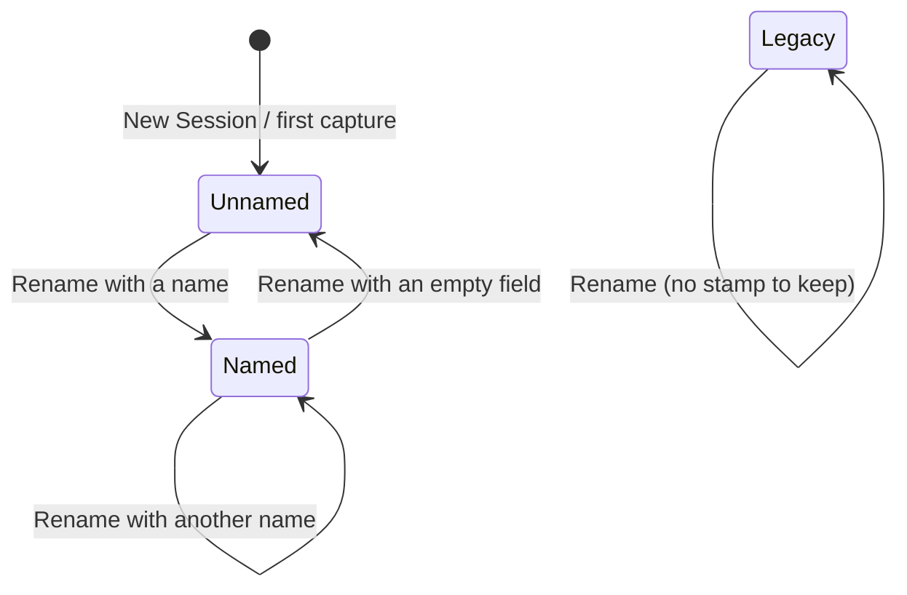

# Information Architecture

Kept short: this change adds no screen and no route. It changes how one object, the session, is named, and one menu label. The M preset skip for `ia` was not taken because a name and a label change.

## Objects

| Object       | Definition                                                                                    | Status  | Need       |
| ------------ | --------------------------------------------------------------------------------------------- | ------- | ---------- |
| session      | a folder under the sessions folder holding `session.md` and `img/`                            | exists  | J1, J2, J3 |
| date stamp   | attribute: the start of the folder name, `2026-10-24 23.38`, written when the session is made | exists  | J1, J2     |
| session name | attribute: the words the owner gave in Rename, after the stamp in the folder name             | changed | J2         |
| display name | value: how every screen names the session, built from stamp and name                          | changed | J1, J2     |

The stamp is `YYYY-MM-DD HH.MM`, with its same-minute suffix ` (2)` when there is one. Rename never changes the stamp. The folder name is the one source. Display name and rename-field text are derived from it, so nothing new is stored.

| Folder name                                    | Display name                    | Rename field starts with |
| ---------------------------------------------- | ------------------------------- | ------------------------ |
| `2026-10-24 23.38`                             | 2026-10-24, 23:38               | empty                    |
| `2026-10-24 23.38 (2)`                         | 2026-10-24, 23:38 (2)           | empty                    |
| `2026-10-24 23.38 Ledgerly Q4 review`          | 2026-10-24 · Ledgerly Q4 review | Ledgerly Q4 review       |
| `2026-10-24 23.38 (2) Ledgerly Q4 review`      | 2026-10-24 · Ledgerly Q4 review | Ledgerly Q4 review       |
| `Checkout review` (renamed before this change) | Checkout review                 | Checkout review          |

## Alias Table

| Canonical         | Rejected                                     | Reason                                                               |
| ----------------- | -------------------------------------------- | -------------------------------------------------------------------- |
| Older Sessions…   | Other Session…, Archive…                     | A3; owner chose "Older Sessions…" on 2026-10-25                      |
| 2026-10-24, 23:38 | 24 Oct 23.38, 2026-10-24 23.38, 28 Sep 14:32 | A2; owner's date decision 2026-10-25; replaces the glossary proposal |
| session name      | title, label                                 | the menu says "Rename Session…"; the name is what Rename changes     |

## Nested Object Matrix

| Parent          | Child      | Cardinality | Role name     | Rank |
| --------------- | ---------- | ----------- | ------------- | ---- |
| sessions folder | session    | 0..n        | sessions      | 1    |
| session         | date stamp | 0..1        | when it began | 1    |
| session         | name       | 0..1        | what it is    | 2    |

## CTA Inventory

| Object  | Verb              | Control                                         | Type      | Contra-CTA          |
| ------- | ----------------- | ----------------------------------------------- | --------- | ------------------- |
| session | rename            | Session ▸ Rename Session…; session window title | secondary | Cancel / Esc        |
| session | switch to         | Session ▸ Switch Session ▸ a row                | primary   | none                |
| session | find an older one | Session ▸ Switch Session ▸ Older Sessions…      | secondary | Cancel in the panel |

## Attribute Priority

| View                  | Attribute           | Rank | Reason                                 |
| --------------------- | ------------------- | ---- | -------------------------------------- |
| Switch Session row    | date, then name     | 1    | J1: the date tells sessions apart; J2  |
| Switch Session row    | time (unnamed only) | 2    | two sessions on one day differ by time |
| session window header | display name, count | 1    | as today                               |
| editor toolbar label  | display name, count | 1    | as today                               |

## State Diagrams



`Legacy` is a session renamed before this change: its folder has no stamp.

## Sitemap

`omr-ux:sitemap-create diff` was not run as a full pass: no address, window or route changes. The whole change to the sitemap, as built against proposed:

| Place                      | As built (docs/ux/sitemap.md)             | After this change                                                                      | Kind    |
| -------------------------- | ----------------------------------------- | -------------------------------------------------------------------------------------- | ------- |
| Session ▸ Switch Session ▸ | up to 20 sessions by last use, bare names | up to 10 sessions by last use, the current one always among them, display names        | changed |
| Switch Session ▸ last item | "Other Session…" → folder panel           | "Older Sessions…" → the same folder panel, shown only when more than 10 sessions exist | renamed |

No redirects: a desktop menu has no addresses. Feature PR 1 updates those two lines in `docs/ux/sitemap.md`.

## Screen Inventory

| Screen                  | Route                | Purpose                           | Job stories served | Arrive from                  | Go next to                      |
| ----------------------- | -------------------- | --------------------------------- | ------------------ | ---------------------------- | ------------------------------- |
| Menu ▸ Session          | menu bar icon        | act on sessions                   | J1, J2, J3         | menu bar icon                | Switch Session ▸, Rename dialog |
| Menu ▸ Switch Session ▸ | submenu              | make another session current      | J1, J3             | Session ▸                    | folder panel (Older Sessions…)  |
| Rename Session… dialog  | AppleScript dialog   | rename the current session        | J2                 | Session ▸ Rename Session…    | back to where the owner was     |
| Session window          | Open Current Session | read, edit and rename one session | J1, J2             | menu, notification           | rename field                    |
| Editor                  | after a capture      | mark up one screenshot            | J1                 | ⌃⇧1, ⌃⇧3                     | the session it adds to          |
| Notifications           | macOS                | say what happened to a session    | J1                 | New Session, reopen, missing | the menu                        |
| PDF export              | Export Session ▸ PDF | hand a session to a person        | J1                 | Session ▸ Export Session     | Finder                          |

## Navigation Tree

```
Menu bar icon
├── header "Adding screenshots to" · <display name> · N screenshots
└── Session ▸
    ├── Current Session · <display name>
    ├── New Session ⌃⇧2
    ├── Switch Session ▸
    │   ├── ✓ <display name>   (10 rows at most, by last use)
    │   ├── ──
    │   └── Older Sessions…  ──► folder panel
    ├── Rename Session…      ──► dialog: name only, the date stays
    └── …
Session window: header <display name> (click: rename field)
```

## Journeys

| Job story | How often           | Path                                                                       | Moves | Why this length                                           |
| --------- | ------------------- | -------------------------------------------------------------------------- | ----- | --------------------------------------------------------- |
| J1        | every review        | menu icon → Session ▸ → Switch Session ▸ → row                             | 4     | unchanged; only the row text changes                      |
| J2        | most sessions, once | session window title → type the name → ↩                                   | 3     | unchanged; the date is kept for the owner                 |
| J3        | weekly              | menu icon → Session ▸ → Switch Session ▸ → Older Sessions… → folder → Open | 6     | rare job; the 10 recent rows keep the frequent path short |

## Move Table

| From                  | Control         | To                   | Type    | Why (job story or ask) | Back target  | Restores        |
| --------------------- | --------------- | -------------------- | ------- | ---------------------- | ------------ | --------------- |
| Switch Session ▸      | a row           | that session current | lateral | J1, A2                 | Switch again | nothing to keep |
| Switch Session ▸      | Older Sessions… | folder panel         | forward | J3, A3                 | Cancel       | the menu closed |
| Session ▸             | Rename Session… | rename dialog        | forward | J2, A1                 | Cancel       | the old name    |
| session window header | click the title | rename field         | forward | J2, A1                 | Esc          | the old name    |

## Open Questions

| Question                                             | Recommended answer                                         | Why it matters                                                           |
| ---------------------------------------------------- | ---------------------------------------------------------- | ------------------------------------------------------------------------ |
| Should the folder panel open on the sessions folder? | yes, as today (`defaultPath: root`)                        | older sessions are all in there                                          |
| Should the panel say how folders are named?          | yes, its message: "Session folders start with their date." | the panel lists folder names, not display names (validation, 2026-10-25) |
