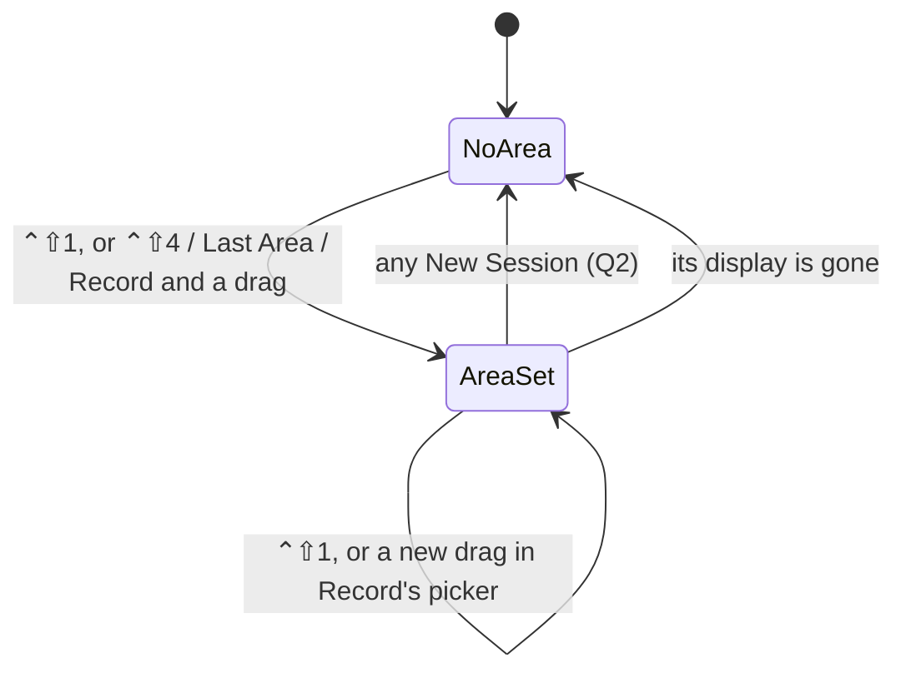
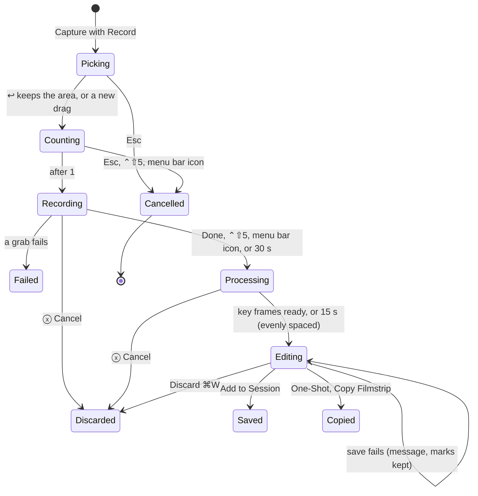
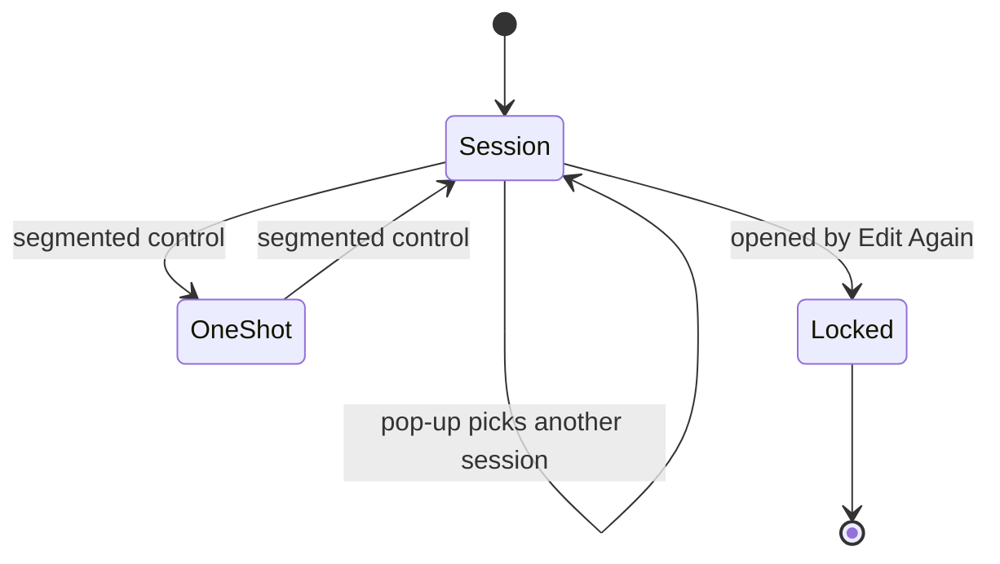

# Information Architecture

Snapmark has no routes. Its places are panels, windows, menus and global keys. The sitemap for this change is in [sitemap.md](sitemap.md) and [sitemap.json](sitemap.json).

## Objects

| Object       | Definition                                                                                          | Status   | Need                        |
| ------------ | --------------------------------------------------------------------------------------------------- | -------- | --------------------------- |
| Session      | A folder with `session.md` and its images; one is current                                           | exists   | J4                          |
| Screenshot   | One entry in a session: an image, its marks and notes                                               | exists   | J4, J8                      |
| Area         | The part of the screen that ⌃⇧4 captures again; one at a time                                       | exists   | J3                          |
| Capture mode | What the bar captures: 1 New Area, 2 Window, 3 Full Screen, 4 Last Area, 5 Scrolling, 6 Record (Q8) | changes  | J2                          |
| Destination  | Where a capture goes: Session (which one) or One-Shot                                               | new name | J4                          |
| Recording    | A capture of an area over time, up to 30 s, at one frame rate                                       | new      | J5, J6                      |
| Frame        | One picture of a recording, with its time from the start                                            | new      | J6                          |
| Key frame    | A frame kept because the screen changed, or because it has a mark; first and settled last always    | new      | J6                          |
| Filmstrip    | One PNG of the key frames in a grid, each labelled with its time, with marks                        | new      | J6, A8, Q10                 |
| GIF          | The recording at its real timing, for people; identical frames merged; no marks                     | new      | J5, A8, A11                 |
| Frame data   | The raw frames, their times and the marks as data, in the session's `.edit/`                        | new      | Edit Again, Show All Frames |
| Countdown    | 3, 2, 1 over the area before a recording or a timed capture                                         | new      | J5                          |
| Frame rate   | 15, 10, 5, 4 or 2 fps; 10 by default                                                                | new      | J5                          |

No broken object types. "One-Shot" was a ghost (it existed but could not be seen, A4); it becomes a visible Destination value.

## Alias Table

| Canonical                         | Rejected                                          | Reason                                                             |
| --------------------------------- | ------------------------------------------------- | ------------------------------------------------------------------ |
| One-Shot                          | one-shot, One-shot, single-shot, non-session mode | The owner's word; title case on controls (WRD-1)                   |
| Session \| One-Shot               | Save to, mode, tab                                | One control for the destination; "Save to" leaves Options          |
| Capture New Area…                 | Choose New Area, Set New Area, Set new Area       | It sets and captures (Q11); "…" because a drag follows (WRD-5)     |
| New Area (bar mode)               | Capture Area                                      | The mock's "Capture Area" read like ⌃⇧4; "New" says a drag follows |
| Capture Last Area                 | Capture Area, Capture selected area               | The glossary's accepted name; only its key moves to ⌃⇧4            |
| Capture Full Screen               | Entire Screen, Capture Screen                     | Short, says what it takes: every display, like macOS (Q7)          |
| Copy Filmstrip                    | Copy Image (for a recording), Copy Key Frames     | Names the marked PNG it copies (Q10)                               |
| Capture One-Shot…                 | Quick capture                                     | Names the destination, as CAP-5                                    |
| Record                            | Capture GIF, Record Video, Recording mode         | A verb, like the other modes; the result is a recording            |
| recording                         | GIF capture, video, animation                     | The object; GIF is one of its files                                |
| key frame                         | keyframe, changed frame, highlight                | Two words, as in film editing                                      |
| filmstrip                         | contact sheet, frame grid, sprite                 | The owner's pick ("Filmstrip + GIF")                               |
| frame rate, fps                   | frames per second (on controls)                   | "10 fps" fits a control; Options heads it "Frame Rate"             |
| Show All Frames / Show Key Frames | Expand, All 32                                    | Names what the canvas will show                                    |

## Nested Object Matrix

| Parent    | Child      | Cardinality                   | Role name              | Rank |
| --------- | ---------- | ----------------------------- | ---------------------- | ---- |
| Session   | Screenshot | 1 : 0..n                      | entries                | 1    |
| Session   | Recording  | 1 : 0..n                      | entries                | 1    |
| Recording | Frame      | 1 : 1..450                    | frames (30 s × 15 fps) | 3    |
| Recording | Key frame  | 1 : 1..24, plus marked frames | key frames             | 2    |
| Recording | Filmstrip  | 1 : 1                         | for the AI             | 1    |
| Recording | GIF        | 1 : 1                         | for people             | 2    |
| Key frame | Mark       | 1 : 0..n                      | marks                  | 1    |
| App       | Area       | 1 : 0..1                      | the set area           | 1    |
| App       | Session    | 1 : 0..1                      | current session        | 1    |

A screenshot and a recording are both "entries"; the session count counts both.

## CTA Inventory

| Object                  | Verb                   | Control                                            | Type      | Contra-CTA                 |
| ----------------------- | ---------------------- | -------------------------------------------------- | --------- | -------------------------- |
| Capture mode            | Capture                | bar: blue "Capture ↩"                              | primary   | Esc (close the bar)        |
| Capture mode            | choose                 | bar: mode buttons 1–6                              | secondary | —                          |
| Destination             | choose                 | bar and editor: Session \| One-Shot                | secondary | —                          |
| Session                 | make current / move to | bar and editor: session pop-up                     | secondary | pick the old one again     |
| Session                 | New Session            | pop-up item, ⌃⇧N                                   | overflow  | —                          |
| Session                 | Older Sessions…        | pop-up item                                        | overflow  | Cancel in the folder panel |
| Recording               | Done                   | recording control: blue "Done"; ⌃⇧5; menu bar icon | primary   | ⓧ Cancel (into Discarded)  |
| Recording               | Show All Frames        | recording editor, ⇧⌘F                              | secondary | Show Key Frames, ⇧⌘F       |
| Screenshot or recording | Add to Session         | editor: blue "Add to Session ⌘↩"                   | primary   | Discard ⌘W                 |
| Screenshot              | Copy Image             | editor, One-Shot: blue "Copy Image ⌘C"             | primary   | Discard ⌘W                 |
| Recording               | Copy Filmstrip         | editor, One-Shot: blue "Copy Filmstrip ⌘C"         | primary   | Discard ⌘W                 |
| Recording               | Copy GIF               | editor, One-Shot: Copy or Save menu                | overflow  | —                          |
| Recording               | Play / Pause           | session window: GIF, Space                         | secondary | —                          |
| Area                    | Capture New Area…      | ⌃⇧1, menu row, bar mode 1                          | primary   | Esc in the picker          |

## Attribute Priority

| View                    | Attribute                        | Rank | Reason                                   |
| ----------------------- | -------------------------------- | ---- | ---------------------------------------- |
| Session pop-up face     | session name                     | 1    | The one thing being chosen               |
| Session pop-up face     | entry count "(6)"                | 2    | Tells two sessions with near names apart |
| Recording editor header | key frames "4 key frames of 32"  | 1    | Says frames were dropped (J6)            |
| Recording editor header | length "3.2 s", "10 fps"         | 2    | Context for the times                    |
| Key frame               | time "0.4 s"                     | 1    | The AI reads when it happened            |
| Recording control       | elapsed "0:07 of 0:30"           | 1    | How long is left (Goal-Gradient)         |
| Recording control       | "10 fps"                         | 2    | Confirms the option                      |
| Scrolling control       | frames and height                | 1    | Progress (CAP-9)                         |
| Capture bar headline    | mode name                        | 1    | What Capture will do                     |
| Capture bar headline    | hint ("Drag to choose the area") | 2    | What comes after Capture                 |

## State Diagrams







## Sitemap

Written by `omr-ux:sitemap-create`, scoped to this change, in [sitemap.md](sitemap.md) and [sitemap.json](sitemap.json): As built, Proposed, Changes, Redirects (none; no addresses).

## Screen Inventory

| Screen             | Route or entry                                                  | Purpose                                            | Job stories    | Arrive from                       | Go next to                                                     |
| ------------------ | --------------------------------------------------------------- | -------------------------------------------------- | -------------- | --------------------------------- | -------------------------------------------------------------- |
| Global keys        | ⌃⇧1, ⌃⇧2, ⌃⇧3, ⌃⇧4, ⌃⇧5, ⌃⇧N                                    | Capture from any app                               | J3             | any app                           | area picker, macOS overlay, editor, bar                        |
| Menu bar menu      | menu bar icon                                                   | Every capture by pointer, with its key             | J3             | menu bar icon                     | same as the keys                                               |
| Capture bar        | ⌃⇧5; menu Capture Options…                                      | Choose mode, destination and options, then capture | J1, J2, J5, J7 | keys, menu                        | area picker, countdown, scrolling or recording control, editor |
| Area picker        | ⌃⇧1; ⌃⇧4, Last Area or Record with no area; New Area; Scrolling | Drag an area                                       | J3, J5, J7     | keys, bar                         | countdown, capture, scrolling control                          |
| Countdown overlay  | Record; any Timer                                               | Show 3, 2, 1 before it starts                      | J5             | bar, picker                       | recording control, capture                                     |
| Recording control  | after the countdown in Record                                   | Show time left; Done or cancel                     | J5             | countdown                         | recording editor; nothing (Esc)                                |
| Scrolling control  | Capture Scrolling after the area                                | Show progress; Done or cancel                      | J7             | area picker                       | editor; nothing (Esc)                                          |
| Editor             | after any capture; Edit Again                                   | Mark, note, choose destination, commit             | J4, J8         | every capture, session window     | closes; Session pop-up; folder panel                           |
| Recording editor   | after Record's Done; Edit Again on a recording                  | Mark key frames, note, commit                      | J6, J4         | recording control, session window | closes                                                         |
| Session pop-up     | editor toolbar; capture bar                                     | Choose the session, an older one, or a new one     | J4             | editor, bar                       | folder panel (Older Sessions…)                                 |
| Session window     | menu Open Current Session                                       | Read and fix the session, play a GIF               | J6, J8         | menu, notifications               | editor (Edit Again)                                            |
| Settings ▸ Capture | Settings… ▸ Capture                                             | See whether Capture Scrolling can scroll by itself | J7             | menu, ⌘,                          | System Settings ▸ Accessibility                                |

Every screen serves a job story.

## Navigation Tree

```
GLOBAL KEYS ─┬─ ⌃⇧1 Capture New Area… ──► Area picker ──► capture ──► Editor (Session)
             ├─ ⌃⇧2 Capture One-Shot… ──► macOS overlay (drag) ──► Editor (One-Shot)
             ├─ ⌃⇧3 Capture Full Screen ──► one Editor per display (Session), at once
             ├─ ⌃⇧4 Capture Last Area ──► [no area: Area picker] ──► Editor (Session)
             ├─ ⌃⇧5 Capture Options… ──► CAPTURE BAR
             └─ ⌃⇧N New Session (forgets the area)
MENU BAR MENU: the same five capture rows, then today's rows
CAPTURE BAR (lateral: modes 1–6, Session | One-Shot ⇧⌘O, session pop-up ⇧⌘P, Options ⌥O)
  └─ Capture ↩ ──► per mode ──► [Area picker] ──► [Countdown] ──► [Scrolling | Recording control] ──► Editor
EDITOR (forward from a capture)
  ├─ toolbar: … Undo · Redo · Copy or Save · Session | One-Shot · <session> (n) ⌄
  │     └─ pop-up ──► recent sessions ✓ · Older Sessions… (folder panel) · New Session ⌃⇧N
  └─ Add to Session ⌘↩ / Copy ⌘C / Discard ⌘W ──► closes
SESSION WINDOW: Document · Screenshots (recording entry: filmstrip, GIF Play) · Discarded
```

## Journeys

| Job | How often                     | Path (screen → control → screen …)                                                    | Moves | Why this length                                   |
| --- | ----------------------------- | ------------------------------------------------------------------------------------- | ----- | ------------------------------------------------- |
| J1  | daily                         | bar → Esc → closed                                                                    | 1     | One key out                                       |
| J2  | every bar capture             | ⌃⇧5 → digit 1–6 → ↩ → (picker) → editor                                               | 3–4   | Choose, then commit; the drag only when needed    |
| J3  | every capture, many a session | ⌃⇧4 → editor                                                                          | 1     | The most frequent job takes one chord             |
| J3  | once per page area            | ⌃⇧1 → drag → editor                                                                   | 2     | The drag is the input                             |
| J4  | a few times a session         | editor → pop-up → session → (closes on Add)                                           | 2     | Rare, so a menu, not a row of buttons             |
| J4  | rare                          | editor → One-Shot → Copy Image ⌘C → closed                                            | 2     | One switch, one commit                            |
| J5  | weekly                        | ⌃⇧5 → 6 → ↩ → ↩ keeps the area (or drag) → 3, 2, 1 → Done (or ⌃⇧5) → recording editor | 5     | Countdown gives time to set up the motion         |
| J6  | every recording               | recording editor shows key frames → (⇧⌘F all frames) → Add to Session                 | 1–2   | Key frames are the default; all frames on request |
| J7  | weekly                        | ⌃⇧5 → 4 → ↩ → drag → (scrolls by itself) → editor                                     | 4     | Same as today, minus the scrolling by hand        |
| J8  | every screenshot              | editor → notes → hex field paste                                                      | 1     | No new move; only spacing and parsing             |

## Move Table

| From              | Control                        | To                                        | Type    | Why          | Back target           | Restores                                                  |
| ----------------- | ------------------------------ | ----------------------------------------- | ------- | ------------ | --------------------- | --------------------------------------------------------- |
| any app           | ⌃⇧1                            | Area picker                               | forward | J3, A4       | Esc → the app         | nothing changed                                           |
| any app           | ⌃⇧2                            | macOS overlay (drag)                      | forward | J3, A4, Q1   | Esc → the app         | nothing changed                                           |
| any app           | ⌃⇧3                            | one Editor per display                    | forward | J3, A4, Q7   | Discard ⌘W → the app  | screenshot kept in Discarded                              |
| any app           | ⌃⇧4                            | Editor, or picker first                   | forward | J3, A4       | Esc / ⌘W → the app    | area kept                                                 |
| any app           | ⌃⇧5                            | Capture bar                               | forward | J2, A4       | Esc → the app         | the app keeps focus throughout                            |
| Capture bar       | 1–6, click                     | same bar, mode chosen                     | lateral | J2, Q8       | another digit         | —                                                         |
| Capture bar       | Session \| One-Shot, ⇧⌘O       | same bar                                  | lateral | J4, A6       | the other segment     | —                                                         |
| Capture bar       | session pop-up, ⇧⌘P            | menu → current session                    | lateral | J4, A6, Q13  | pick the old one      | —                                                         |
| Capture bar       | Options ⌥O                     | Options menu                              | lateral | J5           | Esc → bar             | bar focus                                                 |
| Capture bar       | Capture ↩                      | picker, countdown, control or editor      | forward | J2           | Esc at each step      | the app behind                                            |
| Countdown         | Esc, ⌃⇧5, menu bar icon        | nothing captured                          | back    | J5           | —                     | the app behind                                            |
| Recording control | Done, ⌃⇧5, menu bar icon, 30 s | Recording editor                          | forward | J5, A8, Q9   | Discard ⌘W            | recording kept in Discarded                               |
| Recording control | ⓧ Cancel                       | Discarded                                 | back    | J5, Q9       | Reopen Last Discarded | the recording                                             |
| Scrolling control | Done ↩, ⌃⇧5, icon, end of page | Editor                                    | forward | J7, A3       | Discard ⌘W            | capture kept in Discarded                                 |
| Scrolling control | Esc, ⓧ                         | nothing kept                              | back    | J7, CAP-9    | —                     | the app behind                                            |
| Editor            | Session \| One-Shot, ⇧⌘O       | same editor, other column                 | lateral | J4, A5, A12  | the other segment     | marks, notes and Beautify settings                        |
| Editor            | session pop-up (⇧⌘P) → session | same editor; that session current at once | lateral | J4, A6       | pick the old one      | —                                                         |
| Editor            | Older Sessions…                | folder panel                              | forward | J4, A6       | Cancel → editor       | the editor as it was                                      |
| Editor            | New Session ⌃⇧N                | same editor, new session                  | lateral | J4, A6       | pick the old one      | the old session; the area must be set again with ⌃⇧1 (Q2) |
| Recording editor  | Show All Frames ⇧⌘F            | same editor, every frame                  | lateral | J6, A11, Q12 | Show Key Frames ⇧⌘F   | marks on their frames                                     |
| Editor            | Add to Session ⌘↩ / Copy ⌘C    | closed                                    | forward | J4, A6       | Edit Again (session)  | —                                                         |
| Session window    | Space on a GIF                 | GIF plays                                 | lateral | J6, A11      | Space pauses          | —                                                         |

Up never exits the app; there is no Up. Every forward move has a way back.

## Open Questions

None. See [brief.md](brief.md), Answers.
