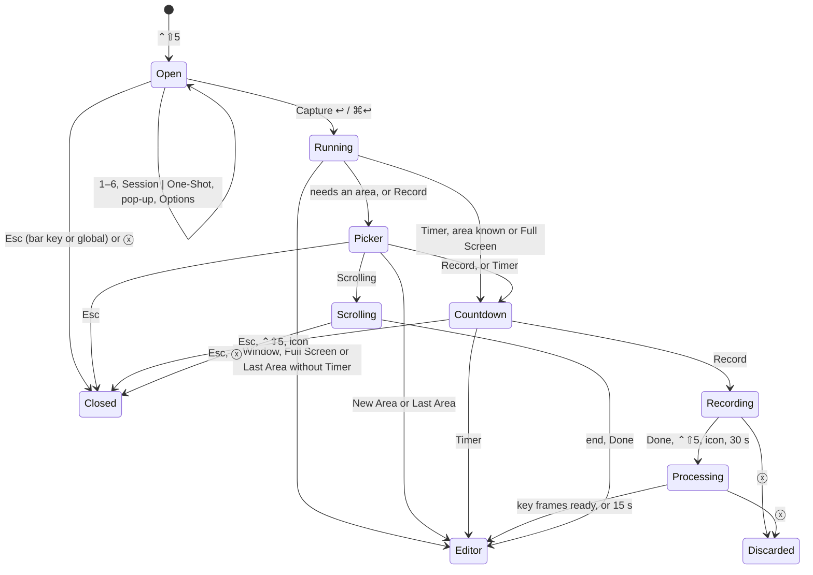
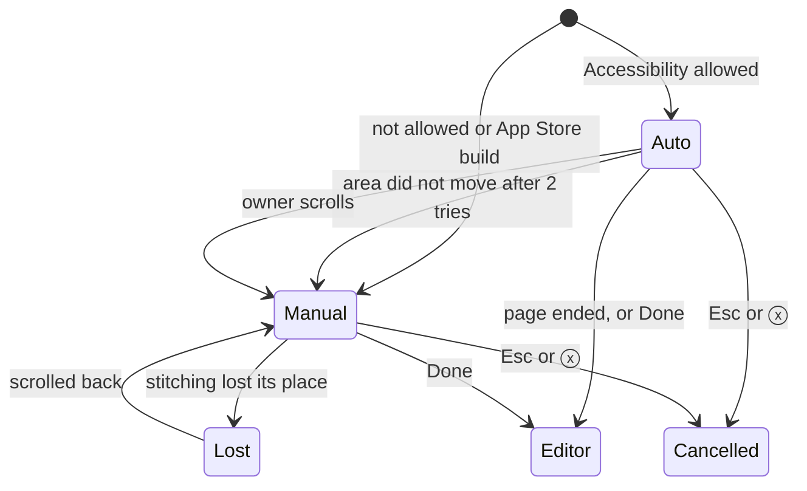

# Interaction

Rules cited by id are in `docs/ux/interaction-guidelines.md`. A rule marked (changes) is changed by this spec; conformance lists it. Fix pass 2026-10-26: the owner's answers (brief.md, Answers) are applied.

## Focus and keys while capturing

**The capture bar takes key focus.** It is a non-activating panel that becomes the key window. macOS lets such a panel take keystrokes without activating Snapmark, as Spotlight does. So the app in front stays active, but 1–6, ← →, Tab, ↩, ⌘↩, ⌥O, ⇧⌘O and ⇧⌘P reach the bar, never the app behind.

**Esc is also global while the bar is open.** This is the backup for A1: if the owner clicks another app, the bar loses focus but Esc still closes it. Only Esc is global. Taking digits, Tab or arrows from every app would break typing elsewhere. A click on the bar gives it focus back.

**Countdown:** Esc is global, as for today's Timer (CAP-10). ⌃⇧5 or a click on the menu bar icon also cancels.

**Recording:** no plain key is taken (Q9). The recorded app keeps ↩, Esc and every other key. The panel never takes focus. Done is the Done button, ⌃⇧5 or a click on the menu bar icon. Cancel is the panel's ⓧ button.

**Scrolling:** as today, the panel takes ↩ (Done) and Esc (cancel); the owner only scrolls. ⌃⇧5 and the menu bar icon also mean Done.

**Busy:** while the picker, a countdown, a recording, a scrolling capture or "Finding key frames…" runs, ⌃⇧1, ⌃⇧2, ⌃⇧3, ⌃⇧4 and ⌃⇧N do nothing (CAP-10: no other capture starts).

**Editor keys:** ⌘C copies and closes only when no text field has focus (KEY-2). In a note or a hex field, ⌘C copies text. ⌘↩ always commits. ⇧⌘O switches Session | One-Shot. ⇧⌘P opens the session pop-up. ⇧⌘F shows all frames or key frames in a recording. None of these types a character.

## Wireflows

### J1: close the bar with Esc

| From control | Action               | To screen or state | Notes                                             |
| ------------ | -------------------- | ------------------ | ------------------------------------------------- |
| ⌃⇧5          | press                | Capture bar, key   | The app in front stays active                     |
| Esc          | press, bar key       | bar closed         | The bar's own key                                 |
| Esc          | press, other app key | bar closed         | Global while the bar is open; the app gets no Esc |
| ⓧ (Esc)      | click                | bar closed         | Same as Esc                                       |

### J2: choose a mode and capture

| From control       | Action         | To screen or state                                      | Notes                                          |
| ------------------ | -------------- | ------------------------------------------------------- | ---------------------------------------------- |
| mode button or 1–6 | click / press  | bar, that mode chosen                                   | Only chooses (CAP-4). Headline and hint change |
| Capture ↩          | click / ↩ / ⌘↩ | bar closes, 200 ms, then the mode runs                  | CAP-2. ⌘↩ as A2 asked                          |
| 1 New Area         | runs           | area picker → (countdown if Timer) → editor             | Sets the area                                  |
| 2 Window           | runs           | macOS window picker → editor                            | Timer and pointer greyed (CAP-6)               |
| 3 Full Screen      | runs           | (countdown if Timer) → one editor per display           | Every display, as ⌃⇧3 (Q7)                     |
| 4 Last Area        | runs           | (picker if none) → (countdown if Timer) → editor        |                                                |
| 5 Scrolling        | runs           | area picker → scrolling control → editor                | J7                                             |
| 6 Record           | runs           | picker on the last area → countdown → recording control | J5                                             |

### J3: global keys

| From control | Action | To screen or state                                                          | Notes                                                                                                                |
| ------------ | ------ | --------------------------------------------------------------------------- | -------------------------------------------------------------------------------------------------------------------- |
| ⌃⇧1          | press  | area picker → capture → editor (Session)                                    | Sets the area and captures it (Q11)                                                                                  |
| ⌃⇧2          | press  | macOS overlay: drag an area → editor (One-Shot)                             | Q1. Space still picks a window                                                                                       |
| ⌃⇧3          | press  | every display captured at once → one editor per display (Session)           | Q7: like macOS ⇧⌘3. No picker, no bar, no choice. Editors open one on top of the other, the pointer's display on top |
| ⌃⇧4          | press  | area set: capture at once → editor. No area: picker first                   | Any New Session forgets the area (Q2)                                                                                |
| ⌃⇧5          | press  | capture bar; while recording or scrolling: Done; during a countdown: cancel | One key, "stop" while busy                                                                                           |
| ⌃⇧N          | press  | new session; the area is forgotten                                          | KEY-1 otherwise unchanged                                                                                            |

### J4: choose the destination in the editor

| From control              | Action                          | To screen or state                           | Notes                                                       |
| ------------------------- | ------------------------------- | -------------------------------------------- | ----------------------------------------------------------- |
| Session \| One-Shot       | click / ⇧⌘O                     | editor in the other destination              | A click returns focus to the canvas                         |
| Session \| One-Shot (Tab) | ← → / Space                     | as above                                     | Arrows act on the segments only after Tab reached them      |
| to One-Shot               | —                               | Beautify shows; marks stay; notes hidden     | With notes: "Notes stay with Session. They are not copied." |
| to Session                | —                               | notes and References come back as they were  | —                                                           |
| session pop-up            | click / ⇧⌘P / Space / ↓         | native menu                                  | Recent sessions ✓, Older Sessions…, New Session ⌃⇧N         |
| menu: a session           | click / ↩                       | moved; it becomes current at once            | As today's session label. Add saves into it                 |
| menu: Older Sessions…     | click / ↩                       | folder panel                                 | Same panel as the menu bar's                                |
| menu: New Session         | click / ⌃⇧N                     | new session, current at once; area forgotten | As ⌃⇧N. Kept if the editor is discarded, as today           |
| Add to Session            | click / ⌘↩ / ⌘S                 | saved; editor closes                         | FBK-1                                                       |
| Copy Image (One-Shot)     | click / ⌘↩ / ⌘C (no text focus) | copied; notification; editor closes          | A6. EX-9. Reference numbers are left out of the image       |

### J5: record a GIF

| From control         | Action                      | To screen or state                       | Notes                                                                   |
| -------------------- | --------------------------- | ---------------------------------------- | ----------------------------------------------------------------------- |
| bar: Record or 6     | click / press               | bar, Record chosen                       | Hint shows the area, cap and rate                                       |
| Options ▸ Frame Rate | choose                      | bar                                      | 15, 10 (default), 5, 4, 2 fps; remembered                               |
| Capture ↩            | click / ↩                   | picker showing the last area             | Q11: ↩ keeps it, a drag replaces it, Esc cancels. No area: plain picker |
| picker               | ↩ or release                | countdown                                | From the Timer's value when longer than 3                               |
| countdown            | 3, 2, 1, 1 s each           | overlay closes, 200 ms, recording starts | Esc, ⌃⇧5 or the menu bar icon cancels                                   |
| Done                 | click / ⌃⇧5 / menu bar icon | "Finding key frames…" → recording editor | Q9. No plain key                                                        |
| 30 s reached         | —                           | as Done                                  | A8                                                                      |
| ⓧ Cancel             | click                       | recording goes to Discarded; no message  | Recoverable for 7 days (FBK-4)                                          |

### J6: read the key frames

| From control        | Action      | To screen or state                      | Notes                                                |
| ------------------- | ----------- | --------------------------------------- | ---------------------------------------------------- |
| recording editor    | opens       | key frames, each labelled with its time | First, every changed frame, settled last; at most 24 |
| Show All Frames     | click / ⇧⌘F | every frame, same grid                  | Marks stay on their frames                           |
| Show Key Frames     | click / ⇧⌘F | key frames plus every marked frame      | A marked frame is a key frame                        |
| any tool on a frame | draw        | the mark belongs to that frame          | See Recording marks                                  |
| Add to Session      | click / ⌘↩  | filmstrip PNG + GIF saved; closes       | The view never changes what is saved                 |

### J7: Capture Scrolling scrolls by itself

| From control      | Action                          | To screen or state          | Notes                                                              |
| ----------------- | ------------------------------- | --------------------------- | ------------------------------------------------------------------ |
| bar: Scrolling, ↩ | click / ↩                       | area picker, scrolling hint | As today                                                           |
| area picker       | drag                            | scrolling control, auto     | Starts where the area is now; scrolls down                         |
| auto              | end of page                     | editor opens by itself      | Two grabs in a row match: the page ended                           |
| auto              | owner scrolls                   | manual                      | The owner took over                                                |
| auto              | area did not move after 2 tries | manual, with the reason     |                                                                    |
| no Accessibility  | —                               | manual from the start       | Direct build: reason once per launch. App Store build: manual only |
| Done              | click / ↩ / ⌃⇧5 / menu bar icon | editor                      | Stops early                                                        |
| ⓧ / Esc           | click / press                   | nothing kept                | As today (CAP-9); a page can be scrolled again                     |

### J8: notes, hex, window size

| From control                | Action          | To screen or state                        | Notes                                           |
| --------------------------- | --------------- | ----------------------------------------- | ----------------------------------------------- |
| hex field                   | paste "#2492ff" | field reads "2492ff"; colour applies      | A leading `#` is dropped at once                |
| hex field                   | type            | applies when 6 valid digits are in        | No error while typing                           |
| hex field                   | ↩ or blur       | 3 or 6 digits apply; else the error shows | The error clears as soon as the value is valid  |
| Beautify ▸ Custom hex field | as above        | custom backdrop applies                   | Same field and rules                            |
| session window              | opens           | 90 % of the work area, centred            | First time only                                 |
| session window              | resize          | the size is remembered                    | Next open uses it, never larger than the screen |

## Recording marks and storage

- A mark belongs to the frame where it starts. It is stored in that frame's coordinates.
- A mark is clipped to its frame. A drag that leaves the frame stops at its edge. A card and its tail stay inside.
- Changing the view (key frames, all frames) or the zoom reflows the grid. Marks move with their frames.
- A frame with a mark is a key frame. It is always shown and always saved.
- Automatic key frames: the first, every changed frame, the settled last; at most 24 (Q5). Identical frames go by hash; then a pixel-difference threshold on a downscaled copy. Above 24, the threshold rises until 24 remain. Marked frames join on top.
- Saved, whatever the view: the filmstrip PNG (key frames plus marked frames, by time, each labelled) and the GIF.
- The GIF merges identical frames in a row into one, with their delays summed. It keeps the real timing and has no marks.
- For Edit Again and Show All Frames, the session keeps the raw frames, their times and the marks as data. They live in `.edit/`, beside today's edit state. They expire with the entry's Discarded copy.
- Times: the live recording control is a clock ("0:07 of 0:30"). Everything saved and shown afterwards uses seconds ("3.2 s", "0.4 s").

## State Tables

### Capture bar

| State                | Entry or trigger                    | What the user sees                                                                                                                                                        | Words                                                        | Actions with key                         | Exit         |
| -------------------- | ----------------------------------- | ------------------------------------------------------------------------------------------------------------------------------------------------------------------------- | ------------------------------------------------------------ | ---------------------------------------- | ------------ |
| default              | ⌃⇧5, Capture Options…               | Two rows. Top: headline, hint, Session \| One-Shot, session pop-up. Bottom: Esc, modes 1–6, Options, blue Capture ↩. Chosen mode: grey fill, blue icon, accent-text label | "Capture Last Area" · "1280 × 720"                           | 1–6, ← →, Tab, ↩, ⌘↩, Esc, ⌥O, ⇧⌘O, ⇧⌘P  | Esc, Capture |
| lost focus           | owner clicks another app            | Bar stays; only Esc works globally                                                                                                                                        | —                                                            | Esc; a click on the bar gives focus back | Esc, Capture |
| loading              | none                                | The bar opens complete; nothing loads                                                                                                                                     | —                                                            | —                                        | —            |
| empty (no area)      | Last Area or Record chosen, no area | Hint says a drag comes first                                                                                                                                              | "No area yet: drag one after Capture"                        | as default                               | as default   |
| empty (no session)   | no session yet                      | Pop-up face says so                                                                                                                                                       | "No session yet"                                             | as default                               | as default   |
| One-Shot chosen      | segment, ⇧⌘O                        | One-Shot selected. Pop-up greyed                                                                                                                                          | Capture reads "Capture One-Shot ↩" (CAP-5)                   | as default                               | as default   |
| Full Screen chosen   | 3, click                            | Hint says what it takes                                                                                                                                                   | "Capture Full Screen" · "Every display, one screenshot each" | as default                               | as default   |
| Record chosen        | 6, click                            | Hint shows the area, cap and rate                                                                                                                                         | "Record" · "1280 × 720 · up to 30 seconds · 10 fps"          | as default                               | as default   |
| Scrolling, auto      | 5, click; Accessibility allowed     | Hint promises auto-scroll                                                                                                                                                 | "Capture Scrolling" · "Snapmark scrolls the area for you"    | as default                               | as default   |
| Scrolling, manual    | 5, click; no Accessibility          | Hint says scroll by hand                                                                                                                                                  | "Capture Scrolling" · "Scroll the area yourself, then Done"  | as default                               | as default   |
| Options open         | Options, ⌥O                         | Native menu: Frame Rate, Timer, Show Mouse Pointer                                                                                                                        | see screens.md                                               | ↑ ↓ ↩ Esc                                | Esc → bar    |
| disabled with reason | Window or Scrolling chosen          | Options ▸ Timer and Show Mouse Pointer greyed (CAP-6). Frame Rate greyed unless Record                                                                                    | Greyed items keep their names                                | —                                        | —            |
| disabled with reason | One-Shot chosen                     | Session pop-up greyed                                                                                                                                                     | face "Not in a session"                                      | —                                        | —            |
| error                | a key is taken by another app       | Not in the bar; the menu row reads "(shortcut unavailable)" as today                                                                                                      | —                                                            | —                                        | —            |
| busy                 | a capture runs                      | ⌃⇧5 means Done or cancel (Focus and keys)                                                                                                                                 | —                                                            | —                                        | —            |

### Area picker

Unchanged (CAP-8) except the hints and Record's start. Esc cancels; a click or sliver starts over.

| State             | Entry or trigger                 | What the user sees              | Words                                                                | Actions with key | Exit            |
| ----------------- | -------------------------------- | ------------------------------- | -------------------------------------------------------------------- | ---------------- | --------------- |
| default           | ⌃⇧1, bar New Area                | dimmed screen, hint             | "Drag over the area to capture. ⌃⇧4 captures it again. Esc cancels." | drag, Esc        | release, Esc    |
| first time        | ⌃⇧4 or Last Area, never an area  | as default                      | as default                                                           | drag, Esc        | release, Esc    |
| after New Session | ⌃⇧4 or Last Area, area forgotten | as default                      | "New session: drag the area. ⌃⇧4 captures it again. Esc cancels."    | drag, Esc        | release, Esc    |
| record, area set  | Record                           | the last area drawn, handles on | "↩ records this area. Drag to choose another. Esc cancels."          | ↩, drag, Esc     | ↩, release, Esc |
| record, no area   | Record, no area                  | as default                      | "Drag over the area to record. Esc cancels."                         | drag, Esc        | release, Esc    |
| scroll            | Scrolling                        | as today                        | today's hint                                                         | drag, Esc        | release, Esc    |
| display gone      | ⌃⇧4, the area's display gone     | as today                        | today's hint                                                         | drag, Esc        | release, Esc    |

### Countdown overlay

Shown for Record and for every Timer capture (area modes and Full Screen).

| State                                    | Entry or trigger                   | What the user sees                                                     | Words               | Actions with key                       | Exit                              |
| ---------------------------------------- | ---------------------------------- | ---------------------------------------------------------------------- | ------------------- | -------------------------------------- | --------------------------------- |
| default                                  | Record after the picker; any Timer | Area outline (no handles). A frosted square at its centre, large digit | "3" · "Esc cancels" | Esc (global), ⌃⇧5, menu bar icon click | after "1": closes, 200 ms, starts |
| counting                                 | each second                        | Digit becomes 2, then 1. Menu bar icon shows the same digit (CAP-10)   | "2", "1"            | as default                             | as default                        |
| timer, longer                            | Timer 5 or 10 s                    | Counts from 5 or 10                                                    | "10" … "1"          | as default                             | as default                        |
| Full Screen                              | Timer with Full Screen (bar only)  | Square centred on the pointer's display; no outline                    | as default          | as default                             | as default                        |
| small area                               | area under 240 × 240 pt            | Square centred on the area, may overflow it; never clipped             | as default          | as default                             | as default                        |
| Reduce Motion                            | system setting                     | Digits change without scale or fade (ACC-5)                            | as default          | as default                             | as default                        |
| cancelled                                | Esc, ⌃⇧5, icon                     | Overlay and outline gone; nothing captured; no message                 | —                   | —                                      | —                                 |
| loading, empty, partial, error, disabled | none                               | Not reachable: the overlay has no data                                 | —                   | —                                      | —                                 |

### Recording control

| State                | Entry or trigger        | What the user sees                                                                                                   | Words                             | Actions with key                  | Exit                |
| -------------------- | ----------------------- | -------------------------------------------------------------------------------------------------------------------- | --------------------------------- | --------------------------------- | ------------------- |
| default (recording)  | countdown ends          | Dark panel: ⓧ Cancel, red dot, clock of cap, fps, blue Done. Area outline, no handles. Menu bar icon shows the clock | "0:07 of 0:30 · 10 fps"           | Done: click, ⌃⇧5, icon. Cancel: ⓧ | Done, 30 s, ⓧ       |
| near the cap         | 25 s                    | Clock turns amber                                                                                                    | "0:25 of 0:30 · 10 fps"           | as default                        | as default          |
| processing (loading) | Done, 30 s              | Red dot becomes a spinner; Done greyed; ⓧ stays. Shown only past 400 ms (FBK-6)                                      | "Finding key frames…"             | ⓧ cancels into Discarded          | recording editor, ⓧ |
| processing, slow     | 15 s without a result   | Snapmark stops looking and opens the editor with evenly spaced frames, at most 24                                    | facts line ends "· evenly spaced" | —                                 | recording editor    |
| no room below        | area touches the bottom | Panel above the area; else at the display's bottom edge outside the area; else inside it                             | as default                        | as default                        | as default          |
| empty                | Done in under 0.5 s     | A recording of 1 frame                                                                                               | —                                 | —                                 | recording editor    |
| cancelled            | ⓧ                       | Panel and outline gone; the recording is in Discarded; no message                                                    | —                                 | —                                 | —                   |
| error                | grabbing fails          | Panel closes; notification (FBK-3)                                                                                   | see Errors                        | —                                 | —                   |
| disabled with reason | processing              | Done greyed while key frames are found                                                                               | —                                 | —                                 | —                   |

The panel and the outline never appear in a frame (CAP-2): content protection, outside the area when room allows. Inside the area it may cover content; that is accepted for a full-display area.

### Scrolling control

| State           | Entry or trigger                           | What the user sees                                    | Words                                                                         | Actions with key                   | Exit                      |
| --------------- | ------------------------------------------ | ----------------------------------------------------- | ----------------------------------------------------------------------------- | ---------------------------------- | ------------------------- |
| auto            | area picked, Accessibility allowed         | Same panel as the recording control; the page scrolls | "Scrolling · 12 frames · 4,200 px tall"                                       | ↩, ⌃⇧5, icon: Done. Esc, ⓧ: cancel | end of page, Done, cancel |
| starting        | first grab                                 | as auto                                               | "Starting…"                                                                   | as auto                            | as auto                   |
| manual          | no Accessibility, or auto fell back        | as auto, no auto-scroll                               | "Scroll down, then Done · 3 frames · 1,800 px tall"                           | as auto                            | Done, cancel              |
| fell back       | the area did not move after 2 tries        | manual, with the reason                               | "This area did not scroll. Scroll it yourself, then Done."                    | as auto                            | Done, cancel              |
| owner took over | the owner scrolls during auto              | manual                                                | "Scroll down, then Done · …"                                                  | as auto                            | Done, cancel              |
| no permission   | direct build, not allowed; once per launch | manual, with how to allow it                          | "Auto-scroll needs Accessibility. Turn it on in Snapmark Settings ▸ Capture." | as auto                            | Done, cancel              |
| lost (error)    | stitching lost its place                   | as today, amber                                       | "Lost the place: scroll back up a little"                                     | as auto                            | as manual                 |
| height limit    | as today                                   | as today                                              | today's notice                                                                | —                                  | editor                    |
| disabled        | none                                       | Done is never greyed; one frame is a valid capture    | —                                                                             | —                                  | —                         |

### Editor toolbar destination

| State                 | Entry or trigger                    | What the user sees                                                                       | Words                                                                                    | Actions with key            | Exit        |
| --------------------- | ----------------------------------- | ---------------------------------------------------------------------------------------- | ---------------------------------------------------------------------------------------- | --------------------------- | ----------- |
| Session (default)     | a session capture                   | Right end: grey segmented control, Session selected (fill-selected, accent-text); pop-up | "Session", "One-Shot", "Ledgerly Q4 review (6)"                                          | ⇧⌘O, ⇧⌘P, Tab then ← →      | —           |
| One-Shot              | ⌃⇧2; bar in One-Shot; ⇧⌘O           | One-Shot selected. Pop-up greyed. Beautify shows. Primary "Copy Image ⌘C"                | face "Not in a session"; with notes: "Notes stay with Session. They are not copied."     | as above                    | Copy closes |
| empty session         | the current session has no entries  | Pop-up without a count                                                                   | "Ledgerly Q4 review"                                                                     | as above                    | —           |
| long name             | name wider than the pop-up's 260 pt | Name ends in "…"; the count and chevron stay                                             | "Ledgerly Q4 rev… (6)"                                                                   | as above                    | —           |
| Edit Again (disabled) | Edit Again                          | Both controls greyed. The reason shows on hover of their wrapper                         | tooltip "Edit Again saves back into <session>."; primary "Save Changes ⌘↩"               | —                           | —           |
| recording, One-Shot   | a recording in One-Shot             | Beautify greyed with its reason; primary "Copy Filmstrip ⌘C"                             | "Beautify works on screenshots only."                                                    | ⌘C (no text focus), ⌘↩, ⇧⌘S | Copy closes |
| moving failed (error) | the chosen session's folder is gone | Pop-up keeps the old session. A message under the pop-up for 8 s, announced              | "Couldn't move to <session>: its folder is gone. Choose another session or New Session." | ⇧⌘P                         | —           |
| loading               | none                                | Controls are drawn with the window                                                       | —                                                                                        | —                           | —           |

### Session pop-up (destination menu)

A native menu, the same in the editor and in the capture bar.

| State                 | Entry or trigger          | What the user sees                                                                   | Words                                    | Actions with key | Exit       |
| --------------------- | ------------------------- | ------------------------------------------------------------------------------------ | ---------------------------------------- | ---------------- | ---------- |
| default               | click, ⇧⌘P, Space, ↓      | Up to 10 recent sessions, ✓ on this one; separator; Older Sessions…; New Session ⌃⇧N | "Checkout redesign (14)"                 | ↑ ↓ ↩ Esc        | pick, Esc  |
| one session           | only one exists           | That session ✓; Older Sessions…; New Session                                         | as default                               | as default       | as default |
| current not in top 10 | an old session is current | It takes the last of the 10 rows, ✓ (as the menu bar)                                | as default                               | as default       | as default |
| empty session in list | a session with no entries | Name without a count                                                                 | "Pricing page v2"                        | as default       | as default |
| disabled with reason  | One-Shot, Edit Again      | The pop-up does not open; its face is greyed                                         | "Not in a session" / the entry's session | —                | —          |
| bar tooltip           | hover in the bar          | Says the scope (Q13)                                                                 | "Current session: <name>"                | —                | —          |
| loading, error        | none                      | Native menus build at once; Older Sessions… errors are the folder panel's own        | —                                        | —                | —          |

### Recording editor (key frames)

| State                | Entry or trigger                        | What the user sees                                                                  | Words                                             | Actions with key   | Exit         |
| -------------------- | --------------------------------------- | ----------------------------------------------------------------------------------- | ------------------------------------------------- | ------------------ | ------------ |
| default              | Done in the recording control           | Today's editor. Canvas: a facts line, then key frames in a grid, each with its time | "Recording · 3.2 s · 10 fps · 4 key frames of 32" | tools, ⇧⌘F, ⌘↩, ⌘W | Add, Discard |
| all frames           | Show All Frames, ⇧⌘F                    | Every frame in the same grid; marks stay on their frames; canvas scrolls            | "32 of 32 frames" · button "Show Key Frames"      | ⇧⌘F                | as default   |
| one key frame        | nothing changed                         | The first frame only (the last is the same picture)                                 | "1 key frame of 32"                               | as default         | as default   |
| capped               | over 24 changed frames                  | 24 frames, the threshold raised (Q5)                                                | "24 key frames of 180"                            | as default         | as default   |
| marked extra frame   | a mark on a non-key frame in all frames | That frame joins the key frames                                                     | "5 key frames of 32"                              | as default         | as default   |
| evenly spaced        | processing took over 15 s               | Up to 24 evenly spaced frames                                                       | "… · evenly spaced"                               | as default         | as default   |
| with references      | Reference on a frame                    | Note shows the frame's time before its text                                         | "0.4 s" · placeholder "What about 1?"             | as default         | as default   |
| One-Shot             | segment, ⇧⌘O                            | Beautify greyed with reason; "Copy Filmstrip ⌘C"                                    | "Beautify works on screenshots only."             | ⌘C, ⌘↩, ⇧⌘S        | Copy closes  |
| loading              | key frames not ready                    | Not reachable: the editor opens after processing                                    | —                                                 | —                  | —            |
| disabled with reason | every frame is a key frame              | Show All Frames greyed, reason on its wrapper                                       | "All 4 frames are key frames"                     | —                  | —            |
| error                | saving fails                            | Editor stays open; message (Errors)                                                 | —                                                 | —                  | —            |

### Editor notes column

| State           | Entry or trigger | What the user sees                                                                    | Words                                           | Actions with key | Exit |
| --------------- | ---------------- | ------------------------------------------------------------------------------------- | ----------------------------------------------- | ---------------- | ---- |
| no references   | default          | "General comment" with more room above than below; no hairline                        | "General comment"                               | as today         | —    |
| with references | first Reference  | A hairline, then "References", same spacing                                           | "References"                                    | as today         | —    |
| One-Shot        | segment          | Beautify as today, plus a hex field beside Custom. One line above it when notes exist | "Notes stay with Session. They are not copied." | as today         | —    |

### Annotation colour and Beautify hex fields

| State   | Entry or trigger             | What the user sees                              | Words                                 | Actions with key | Exit          |
| ------- | ---------------------------- | ----------------------------------------------- | ------------------------------------- | ---------------- | ------------- |
| default | palette or Beautify opens    | "#" drawn, digits in the field                  | "#" · "e5484d"                        | type, ↩          | ↩, blur       |
| pasted  | paste "#2492ff" or "2492ff"  | Field reads "2492ff"; colour applies at once    | —                                     | —                | —             |
| typing  | digits typed                 | No error; applies at 6 valid digits             | —                                     | type             | ↩, blur       |
| error   | ↩ or blur, not 3 or 6 digits | Red outline, message under the field, announced | "Use 3 or 6 hex digits, like e5484d." | type             | a valid value |

### Session window

| State                      | Entry or trigger                 | What the user sees                                                              | Words                                                        | Actions with key         | Exit  |
| -------------------------- | -------------------------------- | ------------------------------------------------------------------------------- | ------------------------------------------------------------ | ------------------------ | ----- |
| first open                 | Open Current Session, first time | Window at 90 % of the work area of the display with the pointer, centred        | today's words                                                | today's keys             | ⌘W    |
| later opens                | any open after a resize          | The remembered size, never larger than that display                             | —                                                            | —                        | ⌘W    |
| recording entry            | Screenshots tab, a recording     | Badge, facts, "Filmstrip · for the AI" with marks, "GIF · for people" with Play | "Recording" · "3.2 s · 10 fps · 4 key frames of 32" · "Play" | ← →, Space plays, ⌘O, ⌘⌫ | —     |
| GIF playing                | Space, Play                      | GIF runs at its real timing, loops; button reads Pause                          | "Pause"                                                      | Space                    | Space |
| Document tab               | a recording entry                | The filmstrip image, then the GIF link                                          | see screens.md                                               | today's                  | —     |
| empty                      | no entries                       | as today                                                                        | "No screenshots yet. Capture one with ⌃⇧4."                  | —                        | —     |
| error                      | GIF file missing                 | Still image with a line                                                         | "The GIF is missing. The filmstrip is still in the session." | —                        | —     |
| loading, partial, disabled | as today                         | unchanged                                                                       | —                                                            | —                        | —     |

### Export (PDF and ZIP), recording entries

| Export | What a recording entry gets                                  |
| ------ | ------------------------------------------------------------ |
| PDF    | The filmstrip, the facts line and the notes, as a screenshot |
| ZIP    | The same, plus the GIF. Raw frames stay out                  |

## Announcements (VoiceOver)

Every status below is a polite live region (`role="status"`), WCAG 4.1.3.

| Where              | Announced                                                   | When                               |
| ------------------ | ----------------------------------------------------------- | ---------------------------------- |
| Countdown          | "Recording starts in 3 seconds. Esc cancels." then "2", "1" | each second                        |
| Recording control  | "Recording, 10 seconds of 30"; "Recording stopped"          | every 10 s; on stop                |
| Recording control  | "Finding key frames…"                                       | when shown                         |
| Scrolling control  | the status line                                             | every 5 frames, and each new state |
| Editor destination | "One-Shot. Notes are not copied." / "Session"               | on switch                          |
| Editor destination | the move error                                              | when shown                         |
| Hex fields         | the error                                                   | on ↩ or blur                       |
| Capture bar        | the headline and hint                                       | on mode change                     |

## State Diagrams

## Elements x Interactions

| Screen            | Element           | Click                                           | Double-click   | Drag                                | Drop onto              | Hover                        | Right-click / More | Keys                        | Selection | Rules           |
| ----------------- | ----------------- | ----------------------------------------------- | -------------- | ----------------------------------- | ---------------------- | ---------------------------- | ------------------ | --------------------------- | --------- | --------------- |
| Capture bar       | mode button       | chooses                                         | chooses        | nothing                             | nothing                | soft fill                    | nothing            | 1–6, ← →                    | single    | CAP-3, CAP-4    |
| Capture bar       | Capture button    | captures                                        | captures once  | nothing                             | nothing                | darker blue                  | nothing            | ↩, ⌘↩                       | —         | CAP-5           |
| Capture bar       | Esc button        | closes                                          | closes         | nothing                             | nothing                | soft fill                    | nothing            | Esc                         | —         | WIN-4 (changes) |
| Capture bar       | segmented control | chooses segment                                 | chooses        | nothing                             | nothing                | soft fill                    | nothing            | ⇧⌘O; Tab then ← →, Space    | single    | DST-1           |
| Capture bar       | session pop-up    | opens menu                                      | opens menu     | nothing                             | nothing                | tooltip "Current session: …" | nothing            | ⇧⌘P, Space, ↓               | —         | DST-2           |
| Capture bar       | Options           | opens menu                                      | opens menu     | nothing                             | nothing                | soft fill                    | nothing            | ⌥O, Space                   | —         | CAP-6           |
| Countdown overlay | square            | nothing (clicks pass through)                   | nothing        | nothing                             | nothing                | nothing                      | nothing            | Esc, ⌃⇧5                    | —         | CAP-2, CAP-10   |
| Menu bar icon     | icon, while busy  | Done (recording, scrolling); cancel (countdown) | as click       | nothing                             | nothing                | tooltip names the action     | as click           | —                           | —         | CAP-10          |
| Recording control | Done              | stops, opens editor                             | once           | nothing                             | nothing                | darker blue                  | nothing            | ⌃⇧5                         | —         | FBK-6           |
| Recording control | ⓧ Cancel          | into Discarded                                  | once           | nothing                             | nothing                | soft fill                    | nothing            | —                           | —         | FBK-4           |
| Scrolling control | Done              | stops, opens editor                             | once           | nothing                             | nothing                | darker blue                  | nothing            | ↩, ⌃⇧5                      | —         | CAP-9           |
| Scrolling control | ⓧ Cancel          | nothing kept                                    | once           | nothing                             | nothing                | soft fill                    | nothing            | Esc                         | —         | CAP-9           |
| Editor            | segmented control | chooses; focus back to canvas                   | chooses        | nothing                             | nothing                | soft fill                    | nothing            | ⇧⌘O; Tab then ← →, Space    | single    | DST-1           |
| Editor            | session pop-up    | opens menu                                      | opens menu     | nothing                             | nothing                | tooltip full name            | nothing            | ⇧⌘P, Space, ↓               | —         | DST-2, WIN-1    |
| Recording editor  | frame             | as the canvas (tools)                           | as the canvas  | as the canvas, clipped to the frame | nothing                | as the canvas                | nothing            | tools, ⇧⌘F                  | marks     | EDT-1–EDT-4     |
| Recording editor  | Show All Frames   | toggles                                         | toggles twice  | nothing                             | nothing                | underline                    | nothing            | ⇧⌘F                         | —         | new             |
| Editor notes      | hex field         | focus                                           | selects word   | selects                             | text drop, `#` dropped | nothing                      | text menu          | type, ↩, ⌘V, ⌘C copies text | text      | HEX-1           |
| Session window    | GIF               | plays / pauses                                  | plays / pauses | nothing                             | nothing                | Play button shows            | nothing            | Space                       | —         | WIN-6           |

The segmented control and pop-up behave the same in the bar and the editor.

## Action Behaviour

| Action                          | Pointer route       | Keyboard route            | Menu route                          | Save                          | Leave              | Undo                                          | Guideline          |
| ------------------------------- | ------------------- | ------------------------- | ----------------------------------- | ----------------------------- | ------------------ | --------------------------------------------- | ------------------ |
| Close the bar                   | ⓧ                   | Esc (bar key, or global)  | —                                   | choices remembered            | bar closes         | ⌃⇧5 reopens it as it was                      | WIN-4 (changes)    |
| Choose mode                     | click               | 1–6, ← →                  | —                                   | remembered                    | —                  | choose again                                  | CAP-3, CAP-4       |
| Choose Session / One-Shot (bar) | click               | ⇧⌘O                       | —                                   | remembered, bar only (CAP-7)  | —                  | choose again                                  | CAP-7, DST-1       |
| Choose session (bar)            | pop-up              | ⇧⌘P, ↩                    | menu bar ▸ Session ▸ Switch Session | becomes current (Q13)         | —                  | pick the old one                              | DST-2              |
| Capture                         | Capture             | ↩, ⌘↩                     | menu bar capture rows               | opens editor                  | bar closes         | Discard ⌘W in the editor                      | CAP-4, CAP-5       |
| Capture New Area                | —                   | ⌃⇧1                       | Capture New Area…                   | area remembered               | —                  | ⌃⇧1 again                                     | KEY-1 (changes)    |
| Capture Full Screen             | bar mode 3          | ⌃⇧3                       | Capture Full Screen                 | opens editor                  | —                  | Discard ⌘W                                    | KEY-1 (changes)    |
| Capture Last Area               | bar mode 4          | ⌃⇧4                       | Capture Last Area                   | opens editor                  | —                  | Discard ⌘W                                    | KEY-1 (changes)    |
| Capture One-Shot                | —                   | ⌃⇧2                       | Capture One-Shot…                   | opens editor in One-Shot      | —                  | Discard ⌘W                                    | KEY-1 (changes)    |
| Record                          | bar mode 6, Capture | 6, ↩                      | Capture Options… then 6             | editor after Done             | —                  | Discard ⌘W                                    | CAP-2              |
| Stop recording                  | Done; menu bar icon | ⌃⇧5                       | —                                   | keeps it                      | —                  | Discard ⌘W in the editor                      | FBK-6, Q9          |
| Cancel countdown                | menu bar icon       | Esc, ⌃⇧5                  | —                                   | nothing made                  | —                  | none needed                                   | CAP-10             |
| Cancel recording                | ⓧ                   | —                         | —                                   | into Discarded                | —                  | Reopen Last Discarded                         | FBK-4, Q9          |
| Cancel finding key frames       | ⓧ                   | —                         | —                                   | into Discarded                | —                  | Reopen Last Discarded                         | FBK-4              |
| Choose destination (editor)     | segment             | ⇧⌘O                       | —                                   | on Add or Copy                | —                  | choose again; notes kept                      | DST-1              |
| Move to another session         | pop-up              | ⇧⌘P, ↩                    | —                                   | current at once; saved on Add | —                  | pick the old one                              | DST-2              |
| New Session (editor)            | pop-up item         | ⌃⇧N                       | menu bar ▸ Session ▸ New Session    | current at once               | —                  | pick the old one; set the area again with ⌃⇧1 | KEY-1, Q2          |
| Copy Image (One-Shot)           | Copy Image          | ⌘↩; ⌘C without text focus | Copy or Save ▸ Copy Image           | clipboard                     | editor closes (A6) | Reopen Last Discarded ("Copied One-Shot")     | FBK-1, EX-9, KEY-2 |
| Copy Filmstrip (One-Shot)       | Copy Filmstrip      | ⌘↩; ⌘C without text focus | Copy or Save ▸ Copy Filmstrip       | clipboard: the marked PNG     | editor closes      | Reopen Last Discarded                         | EX-9, Q10          |
| Copy GIF (One-Shot)             | —                   | —                         | Copy or Save ▸ Copy GIF             | clipboard: the GIF file       | editor stays open  | —                                             | EX-9               |
| Show All Frames                 | button              | ⇧⌘F                       | —                                   | not saved (a view)            | —                  | ⇧⌘F again                                     | new                |
| Paste a hex colour              | paste               | ⌘V                        | Edit ▸ Paste                        | applies at once               | —                  | ⌘Z in the field                               | HEX-1              |
| Resize session window           | drag edge           | —                         | Window ▸ Zoom                       | remembered                    | —                  | resize again                                  | WIN-6              |
| Play a GIF                      | Play                | Space                     | —                                   | —                             | —                  | Space pauses                                  | WIN-6              |

A One-Shot that Copy closes stays in Discarded for 7 days, listed as "Copied One-Shot", so it is not mistaken for a discard (FBK-4).

## Feedback

| Action                       | Feedback | Reason                                         | Where shown                                                        |
| ---------------------------- | -------- | ---------------------------------------------- | ------------------------------------------------------------------ |
| Choose mode                  | visible  | Fill, blue icon, headline and hint change      | bar                                                                |
| Capture                      | silent   | The editor opening is the result (FBK-1)       | —                                                                  |
| Countdown                    | visible  | Each second shows (CAP-10)                     | overlay and menu bar icon                                          |
| Recording                    | visible  | The clock, every 100 ms                        | recording control, menu bar icon                                   |
| Finding key frames           | visible  | Over 400 ms shows progress (FBK-6)             | recording control                                                  |
| Auto-scroll fell back        | visible  | The owner must act                             | scrolling control                                                  |
| Add to Session               | silent   | Editor closes, count rises (FBK-1)             | menu, pop-up count                                                 |
| Copy Image / Filmstrip / GIF | visible  | Clipboard shows no change (EX-9)               | notification "Image copied." / "Filmstrip copied." / "GIF copied." |
| Switch destination           | visible  | Column, primary button and window title change | editor                                                             |
| Move to a session            | visible  | Pop-up face changes                            | editor                                                             |
| Hex paste                    | visible  | The colour changes                             | swatch, backdrop                                                   |
| Recording cancelled          | silent   | The owner's own act; Discarded keeps it        | —                                                                  |

## Errors

| Event                                        | Consequence                                | Action                                                                                                                    |
| -------------------------------------------- | ------------------------------------------ | ------------------------------------------------------------------------------------------------------------------------- |
| Screen grab failed while recording           | The recording stopped. Nothing was added.  | Notification: "Recording failed: <reason>. Nothing was added. Click to try again."                                        |
| Writing the GIF or filmstrip failed (on Add) | The recording is not in the session.       | Editor stays open: "Couldn't save the recording: <reason>. Your marks are still here. Try Add to Session again."          |
| The area's display is gone (⌃⇧4, Record)     | The last area cannot be captured.          | Picker opens with today's "gone" hint                                                                                     |
| Auto-scroll: the area did not move           | Snapmark stops scrolling.                  | "This area did not scroll. Scroll it yourself, then Done."                                                                |
| Auto-scroll: no Accessibility                | Snapmark cannot scroll.                    | Once per launch: "Auto-scroll needs Accessibility. Turn it on in Snapmark Settings ▸ Capture."                            |
| Moving to a session failed (folder gone)     | It stays in the old session.               | In the editor, under the pop-up: "Couldn't move to <session>: its folder is gone. Choose another session or New Session." |
| Copy Filmstrip or Copy GIF failed            | Nothing was copied; the editor stays open. | "Couldn't copy the filmstrip: <reason>. Try Save As… (⇧⌘S)."                                                              |
| Finding key frames took over 15 s            | Snapmark stopped looking.                  | The editor opens with evenly spaced frames; the facts line says so                                                        |
| ⌃⇧1, ⌃⇧2 or ⌃⇧3 taken by another app         | The key does nothing.                      | Menu row "(shortcut unavailable)", as today                                                                               |
| Hex field: not 3 or 6 digits                 | The colour does not change.                | "Use 3 or 6 hex digits, like e5484d."                                                                                     |

## Open Questions

None. See brief.md, Answers.
