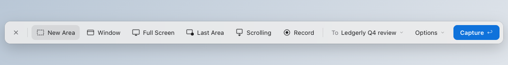
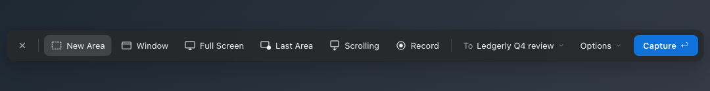

# Snapmark style: calm, system colours, one blue button

Replaces `decisions.md`. Your words of 2026-10-27 settle most of it.

## The look

- One row, about 48 pt tall. Today's bar is 2 rows, about 135 pt.
- No outlines and no boxes. Grey fill and spacing do the grouping.
- The chosen mode is a soft grey pill, as in HeroUI tabs.
- Capture is the only blue thing.

## The rules, from your words

1. **Surfaces use system colours.** Panels, windows, sidebars and text use macOS's own material and colours. No app colours.
2. **Your blue is for buttons only.** One filled button per window: Capture, Done, Copy. No blue icons, labels, tabs or borders.
3. **No blue outlines.** The focus ring shows only when you move with Tab, in macOS's focus colour. It never shows when a window opens.
4. **Calm.** Fewer words, no boxes, one size for controls. Shortcuts show in tooltips and menus. Only ↩ on the main button.
5. **Clear intent.** The main button names what happens: Capture, Record, Done. The chosen option is always the grey pill.

## Why it looks loud today

- Every window opens with focus on a button, and that button gets a 2 pt blue ring.
- Blue is hard-coded in 6 windows, instead of coming from the system or the brand button.
- The chosen mode has blue text and a blue icon.
- Save to and Session sit in bordered boxes.
- Every button shows its shortcut underneath, so each button is 2 lines.

## What I picked (cheap to change, say if not)

- **Text:** 13 pt, the macOS size.
- **Recording and scrolling panels:** system material, following light and dark mode.
- **Settings tabs:** a grey pill segmented control, no blue tile.
- **Editor at its smallest:** tools that don't fit go into a More menu.
- **Settings window:** it grows with its content.
- **Largest zoom:** 130 %.
- **Session or One-Shot:** one pop-up, "To Ledgerly Q4 review ▾". One-Shot is its first item.
- **The design system:** the starter's tokens, with system colours for the surfaces and the HeroUI-calm values.

## Your call

1. **The bar mock above.** Is it this, or what's different?
2. **Shortcut captions.** Hidden, shown in tooltips (my pick), or small grey text next to the label?
