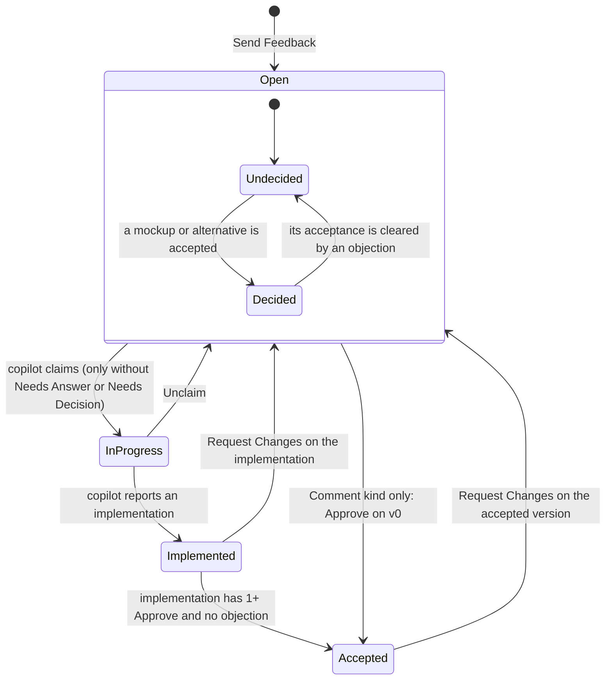
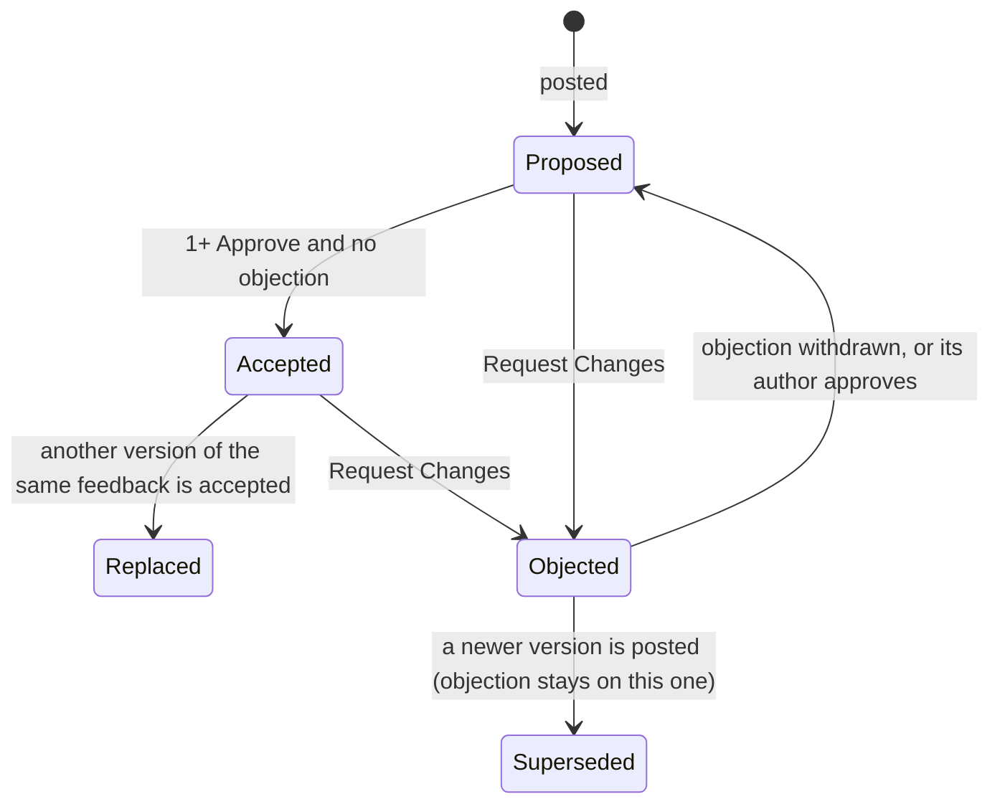
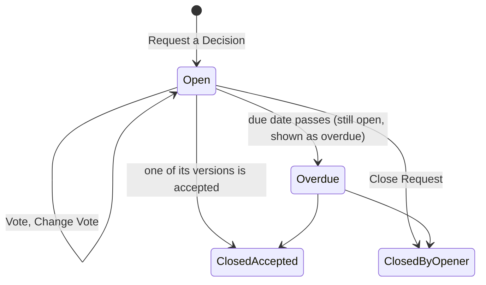
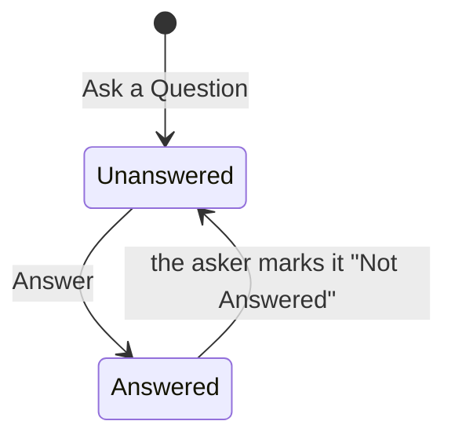
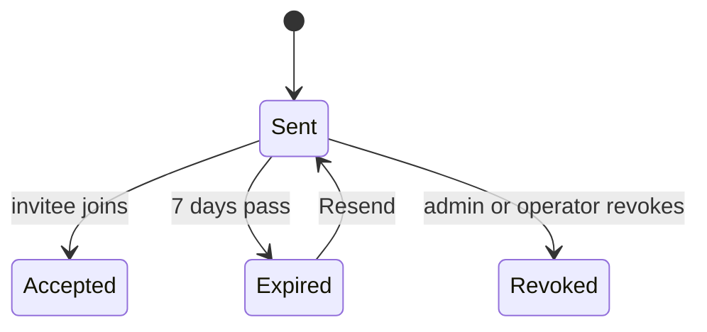
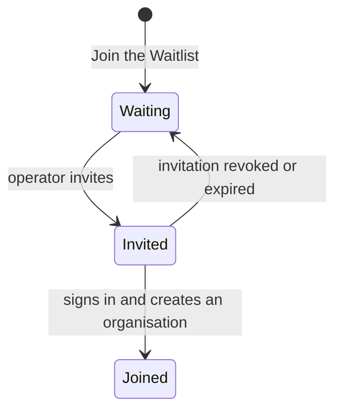
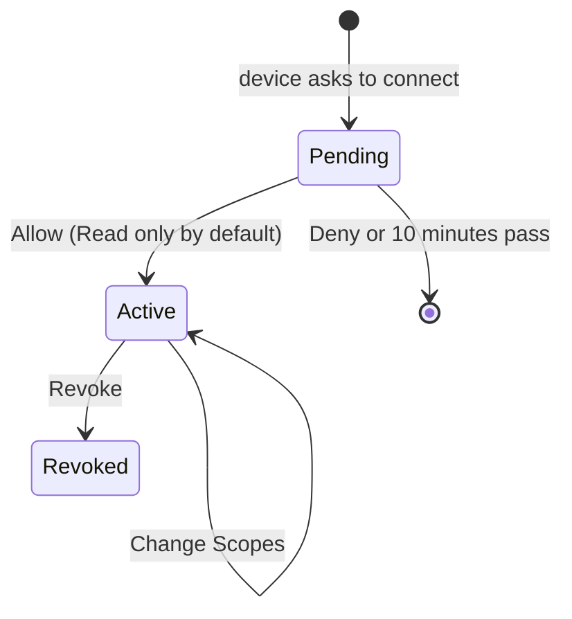
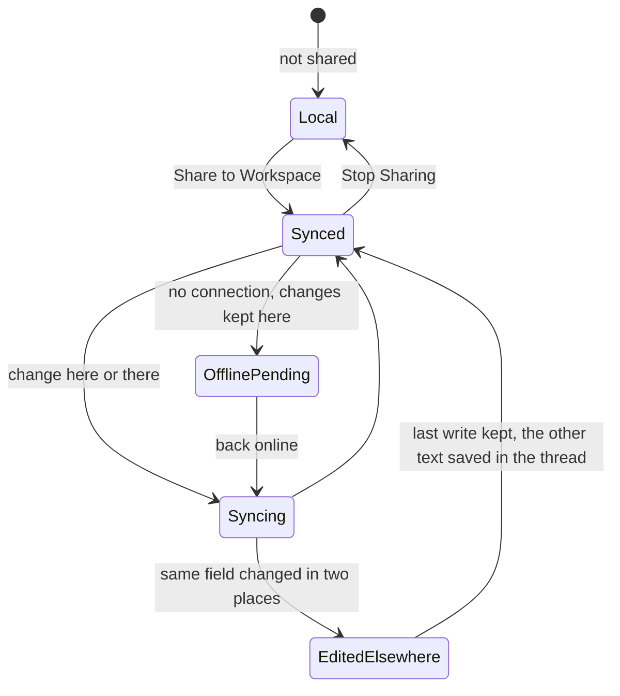
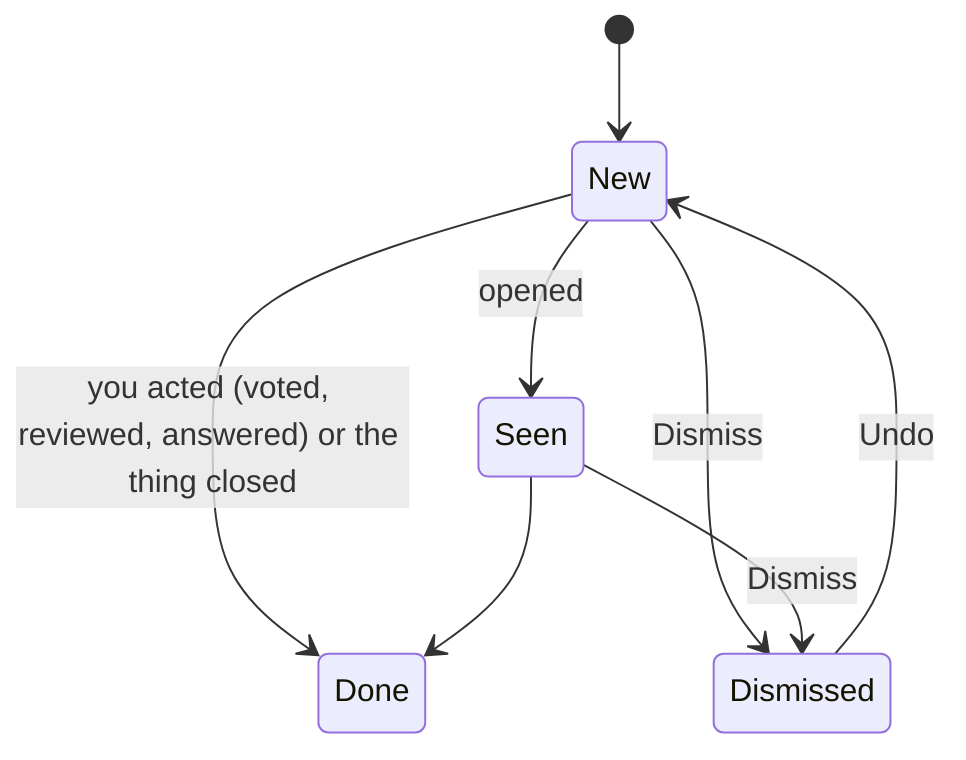

# Information Architecture

**Scope: mixed.** The object model, alias table, state diagrams, sitemap, navigation tree and Back rules are **product-level, lasting, and move to `snapmark-web/docs/ux/sitemap.md`** (aliases to `glossary.md`) in milestone 1. The screen inventory, journeys and move table are release-scoped (release 1).

Sources: the design (sections 3, 4, 5, 8.0, 9), `intent.md` asks and job stories, `brief.md`. The repo `snapmark-web` has no routes yet (a README only), so there is no as-built sitemap: every route below is **new**. `omr-ux:sitemap-create proposed` formalises this file into `sitemap.md` and `sitemap.json` later; this file is its source.

## Objects

Product-level, lasting.

| Object                    | Definition                                                                                                                                                  | Status                                            | Need             |
| ------------------------- | ----------------------------------------------------------------------------------------------------------------------------------------------------------- | ------------------------------------------------- | ---------------- |
| User                      | A person. One account, any number of sign-in methods.                                                                                                       | object                                            | A7, J11          |
| Sign-in method            | Email link (release 1), GitHub or Google (release 2), linked to one user.                                                                                   | object (child of User)                            | A7               |
| Organisation              | Holds seats, members, workspaces and settings. A user can belong to many.                                                                                   | object                                            | J10, design 5    |
| Membership                | A user's role in one organisation: owner, admin, member or guest.                                                                                           | object (join)                                     | J10              |
| Invitation                | An email link that adds a person to an organisation with a role (sent by an admin), or lets a waitlist person create an organisation (sent by an operator). | object                                            | J8, J10          |
| Seat                      | A paid place for a member or admin. Shown as "3 of 5 seats used".                                                                                           | attribute of Organisation                         | J10              |
| Workspace                 | A product inside an organisation, e.g. "Web Shop". Holds repos, environments, route rules, modules, feedback and sessions.                                  | object                                            | all              |
| Workspace access          | Which workspaces a guest may see.                                                                                                                           | attribute of Membership                           | J10, A12         |
| Repo                      | A GitHub repository linked to a workspace, entered by hand in release 1 (`pokbytes/snapmark-web`).                                                          | object (child of Workspace)                       | J3, J5           |
| Environment               | Where the product runs: kind (local, preview, staging, production), name and address patterns (`omr.com` → Production).                                     | object (child of Workspace)                       | A16, J5          |
| Route rule                | Maps an address path to a repo for microfrontends: `/reviews/*` → `omr-reviews-web`.                                                                        | object (child of Workspace)                       | J5               |
| Module                    | A named part of the product, e.g. "Checkout Summary". A list per workspace.                                                                                 | object (child of Workspace)                       | A13              |
| Region                    | Where on the page: a landmark such as `main-content-area`.                                                                                                  | attribute of Anchor (filter value)                | A13              |
| Page                      | The address path a screenshot was taken on. A filter now; a sub-navigation later (A27).                                                                     | attribute of Anchor                               | A27              |
| Screenshot (API: capture) | The image plus its anchor and version stamp. Never changes once taken.                                                                                      | object (child of Version)                         | A1, A15          |
| Anchor                    | What a screenshot points at: URL, selector, DOM path, text, box, viewport, region, module, component, `file:line`, repo, branch, worktree.                  | attribute group of Screenshot                     | A5, A13, A22     |
| Version stamp             | Environment, commit, deployment, release tag and PR known at capture time.                                                                                  | attribute group of Screenshot                     | A15              |
| Mark                      | Anything drawn on a screenshot: box, ellipse, arrow, pen, cross, hatched area, highlighter, spotlight, redaction, card. Vector data.                        | attribute of Screenshot or Thread entry           | A4               |
| Reference                 | A numbered circle on a screenshot. In a Mac session, each reference becomes one feedback.                                                                   | attribute of Screenshot                           | A1, A26          |
| Feedback                  | One request about one anchored thing. Kind (Change request or Comment), status, flags, module, thread, versions.                                            | object                                            | all              |
| Version                   | One state of what a feedback is about: v0 Original; later Mockup, Alternative or Implementation.                                                            | object (child of Feedback)                        | A12, A14, J2, J4 |
| Thread entry              | One entry in a feedback's thread: comment, question, answer, review (Approve, Request Changes) or vote. May carry marks and point at a version.             | object (child of Feedback)                        | A3, A12, A14     |
| Question                  | A thread entry that blocks claiming until answered. Shown with the "Needs Answer" flag.                                                                     | object (thread entry kind with its own lifecycle) | A12              |
| Decision request          | Asks named people to vote between two or more versions, optionally by a date. At most one open per feedback.                                                | object (child of Feedback)                        | A12, J2          |
| Inbox item                | One thing that needs you: a decision request, review request, question, mention or answer.                                                                  | object (per user)                                 | J6, design 9.4   |
| Session                   | A Mac app session shared to a workspace: its screenshots, and the feedback made from their references.                                                      | object (child of Workspace)                       | A26, J7          |
| Device                    | A client signed in for a user: the extension, the Mac app, or an MCP client. Has scopes and a last use.                                                     | object (child of User)                            | A28, J11         |
| Scope                     | What a device may do: Read (always), Reply, Post Versions, Report Implementations.                                                                          | attribute of Device                               | A28              |
| Copilot                   | The coding agent acting for a user, shown as "Ben via Claude". Not a member, not an object in the UI.                                                       | attribute of Thread entry and Version ("via")     | A14              |
| Waitlist entry            | An email (and optional role) asking for early access.                                                                                                       | object (operator)                                 | J8               |
| Feature flag              | A switch on for everyone, or per organisation.                                                                                                              | object (operator)                                 | A17              |
| Audit event               | Append-only record of every state change and operator action. Read in release 1 only through the thread and operator pages.                                 | set aside as a screen (data only)                 | design 15        |
| Notification setting      | Per user: email at once for mentions, decision requests, review requests, answers; daily digest.                                                            | attribute of User                                 | design 9.4       |

**Object checks.**

- **Thread entry is a shapeshifter** (the design stores decision requests as a thread-entry kind). The UI splits it: a decision request has its own card, lifecycle and URL fragment; the thread shows a one-line entry "Dana requested a decision between v1 and v2" that jumps to the card.
- **Screenshot is a composite, not a frankenobject.** Image, anchor and version stamp are taken together and never change; the UI shows them in one place (the Details tab).
- **Inbox item could be a ghost** (a view of other objects). It passes: it has its own lifecycle (new, done, dismissed) and is searchable per user.
- **Session is a zombie risk** once a Mac folder stops syncing. The Session view shows the last sync time and the device, so a stale session reads as stale.
- **Copilot is not an object** (design 3: "Not a member"). No list, no page, no settings; it appears only as "via" on entries and versions, and through Devices.

## Alias Table

Lasting; moves to `glossary.md`.

| Canonical                                             | Rejected                             | Reason                                                                                                                       |
| ----------------------------------------------------- | ------------------------------------ | ---------------------------------------------------------------------------------------------------------------------------- |
| Screenshot (noun, on screen)                          | Capture (noun), shot, image, entry   | Accepted guideline WRD-4 and the Mac glossary. `capture` stays the API and table name. Owner question in brief.md            |
| Capture (verb, button)                                | Screenshot (verb), Snap, Grab        | Mac glossary: "Capture" stays a verb                                                                                         |
| Reference                                             | Marker, pin, number                  | The owner's own word (Mac glossary). Design 9.1's "markers" read as references                                               |
| Mark                                                  | Drawing, annotation, shape           | Mac glossary and WRD-4. "Draw" stays the verb                                                                                |
| Mark colour                                           | Marker colour, colour                | Mac glossary ("mark color" in macOS spelling; British "colour" on the web follows the design's spelling, see open questions) |
| Feedback                                              | Issue, ticket, request, item         | Design 3. "Item" only in "Inbox item"                                                                                        |
| Change request (feedback kind)                        | Change, bug, task                    | Design 4.1 "request a change". The compose choice reads "Request a Change"                                                   |
| Request Changes (review action)                       | Reject, Object, Decline              | Owner (design 9.1). Its open state is called an "objection" in summaries only                                                |
| Comment (review and feedback kind)                    | Note, remark, reply                  | Owner (design 9.1). "Note" stays the Mac word for a reference's text                                                         |
| Reply (verb, thread)                                  | Respond, Answer (for comments)       | Plain verb for adding a comment to a thread; "Answer" only for a question                                                    |
| Approve                                               | Accept, LGTM, Sign off               | Owner (design 9.1). "Accepted" is the resulting status                                                                       |
| Accepted (status)                                     | Approved, Done, Closed               | Design 4.4. "Done" is the list name (see deliberate inconsistency)                                                           |
| In Review (list)                                      | Implemented (as a list name)         | Owner's sidebar (design 9.1). The status chip in the list reads "Implemented"                                                |
| Done (list)                                           | Accepted (as a list name), Closed    | Owner's sidebar. The status chip reads "Accepted"                                                                            |
| Decision request                                      | Poll, vote, survey                   | Design 3                                                                                                                     |
| Vote                                                  | Like, +1, prefer                     | Design 3                                                                                                                     |
| Version                                               | Variant, option, revision, iteration | Design 3                                                                                                                     |
| Mockup, Alternative, Implementation (version kinds)   | Design, proposal, fix                | Design 8.2                                                                                                                   |
| Original (v0)                                         | Before, initial                      | Design 3 ("v0 is the original capture")                                                                                      |
| Question                                              | Ask, query                           | Design 3. The verb on the button is "Ask a Question"                                                                         |
| Copilot / "Ben via Claude"                            | Bot, AI, agent user, assistant       | Design 3. "Agent" in running text only                                                                                       |
| Organisation                                          | Org, team, company, account          | Design 3. URL segment stays short (`/<org>`)                                                                                 |
| Workspace                                             | Project, product, space, board       | Design 3                                                                                                                     |
| Member, Guest, Admin, Owner                           | Collaborator, viewer, editor         | Design 5                                                                                                                     |
| Operator                                              | Admin, staff, superuser              | Design 3: "admin" always means an organisation's admin                                                                       |
| Sign In / Sign Out                                    | Log in, Login, Log out               | One pair everywhere, web, extension and Mac app                                                                              |
| Email link (sign-in method)                           | Magic link, passwordless             | Plain; "magic link" is developer talk                                                                                        |
| Device                                                | Token, client, app, integration      | A device has a token; people see devices                                                                                     |
| Session (Mac)                                         | Folder, project                      | Design 3 and Mac glossary                                                                                                    |
| Share to Workspace (Mac session)                      | Link, Sync, Upload, Publish          | Design 3 "can be shared to a workspace"; sync is what follows                                                                |
| Edited elsewhere                                      | Conflict, overwritten                | Design 7                                                                                                                     |
| Environment kind: Local, Preview, Staging, Production | Prod, Dev, Stage                     | Design 3                                                                                                                     |

**Deliberate inconsistencies, for conformance and the owner:**

- List names say what the team does next (Open, Needs Decision, In Review, Done; owner's sidebar). Status chips say what happened (Open, In Progress, Implemented, Accepted; design 4.4). "In Review" shows "Implemented" items; "Done" shows "Accepted" items.
- "Comment" names both a feedback kind and a review action. Both mean "say something without asking for work"; kept as one word for one meaning applied to two objects.

## Nested Object Matrix

| Parent                    | Child                                | Cardinality                                 | Role name               | Rank |
| ------------------------- | ------------------------------------ | ------------------------------------------- | ----------------------- | ---- |
| User                      | Sign-in method                       | 1..n (last one cannot be removed)           | methods                 | 3    |
| User                      | Membership                           | 0..n                                        | organisations           | 1    |
| User                      | Device                               | 0..n                                        | devices                 | 2    |
| User                      | Inbox item                           | 0..n                                        | inbox                   | 1    |
| Organisation              | Membership                           | 1..n (at least one owner)                   | members                 | 1    |
| Organisation              | Invitation                           | 0..n                                        | invitations             | 2    |
| Organisation              | Workspace                            | 1..n                                        | workspaces              | 1    |
| Membership (guest)        | Workspace access                     | 1..n                                        | invited workspaces      | 2    |
| Workspace                 | Feedback                             | 0..n                                        | feedback                | 1    |
| Workspace                 | Module                               | 0..n                                        | modules                 | 2    |
| Workspace                 | Session                              | 0..n                                        | sessions                | 3    |
| Workspace                 | Repo                                 | 0..n                                        | repos                   | 3    |
| Workspace                 | Environment                          | 0..n                                        | environments            | 3    |
| Workspace                 | Route rule                           | 0..n                                        | route rules             | 4    |
| Module                    | Feedback                             | 0..n                                        | feedback in this module | 2    |
| Session                   | Screenshot                           | 0..n                                        | screenshots             | 1    |
| Screenshot (in a session) | Feedback                             | 0..n (one per reference)                    | feedback                | 1    |
| Feedback                  | Version                              | 1..n (v0 always)                            | versions                | 1    |
| Feedback                  | Thread entry                         | 0..n                                        | thread                  | 1    |
| Feedback                  | Decision request                     | 0..n, at most 1 open                        | decision requests       | 2    |
| Version                   | Screenshot                           | 0..1 (an implementation may have none)      | screenshot              | 1    |
| Version                   | Thread entry (review, vote, comment) | 0..n                                        | reviews and comments    | 1    |
| Decision request          | Vote                                 | 0..n, one per person, changeable while open | votes                   | 1    |
| Thread entry (question)   | Thread entry (answer)                | 0..n                                        | answers                 | 1    |
| Operator area             | Waitlist entry                       | 0..n                                        | waitlist                | 1    |
| Operator area             | Feature flag                         | 0..n                                        | flags                   | 3    |

## CTA Inventory

Primary = the one filled accent button in its region. Secondary = default buttons. Overflow = in the More menu (Dropdown). Contra-CTA = the action that undoes it.

| Object                                | Verb                     | Control                                           | Type                                                                | Contra-CTA                                          |
| ------------------------------------- | ------------------------ | ------------------------------------------------- | ------------------------------------------------------------------- | --------------------------------------------------- |
| Waitlist entry (public)               | Join the Waitlist        | Button                                            | primary                                                             | none (operator removes)                             |
| Waitlist entry (operator)             | Invite                   | Button (row and bulk)                             | primary when rows are selected                                      | Revoke Invitation                                   |
| Session (sign-in)                     | Send Sign-In Link        | Button                                            | primary                                                             | none                                                |
| Invitation (invitee)                  | Join <Organisation>      | Button                                            | primary                                                             | Leave Organisation (Settings)                       |
| Organisation                          | Create Organisation      | Button (Welcome)                                  | primary                                                             | none in release 1                                   |
| Organisation                          | Switch Organisation      | Dropdown in sidebar                               | secondary                                                           | switch back                                         |
| Invitation (admin)                    | Invite People            | Button (Members)                                  | primary                                                             | Revoke (row overflow)                               |
| Invitation (admin)                    | Resend                   | row overflow                                      | overflow                                                            | none                                                |
| Membership                            | Change Role              | row Select                                        | secondary                                                           | change back                                         |
| Membership                            | Remove from Organisation | row overflow                                      | overflow, asks first                                                | Invite again                                        |
| Workspace                             | New Workspace            | Button (Settings › Workspaces)                    | primary                                                             | Delete Workspace (asks first, release 1 owner only) |
| Repo, Environment, Route rule, Module | Add <Object>             | Button                                            | primary on its settings page                                        | Delete (row overflow, Undo)                         |
| Feedback                              | Capture                  | Extension and Mac app                             | primary in the popup                                                | Delete Feedback (overflow, Undo)                    |
| Feedback                              | Send Feedback            | Compose panel                                     | primary                                                             | Delete Feedback                                     |
| Feedback                              | Reply (Comment)          | Composer button                                   | primary when nothing else is the next move                          | Delete Comment (own, overflow, Undo)                |
| Version                               | Approve                  | Footer button                                     | primary when the shown version is an implementation awaiting review | Withdraw Approval                                   |
| Version                               | Request Changes          | Footer button                                     | secondary                                                           | Withdraw Objection                                  |
| Version                               | Post Version             | Footer overflow, version tab "+"                  | overflow                                                            | Delete Version (own, not v0, Undo)                  |
| Version                               | Compare                  | Toolbar toggle                                    | secondary                                                           | Exit Compare                                        |
| Screenshot                            | Draw on Screenshot       | Toolbar button                                    | secondary                                                           | Undo (⌘Z), Discard Marks                            |
| Question                              | Ask a Question           | Footer overflow                                   | overflow                                                            | Delete (own, unanswered, Undo)                      |
| Question                              | Answer                   | Entry button                                      | secondary                                                           | Edit Answer                                         |
| Decision request                      | Request a Decision       | Footer overflow                                   | overflow                                                            | Close Request                                       |
| Decision request                      | Vote                     | Decision card                                     | primary in the card while you have not voted                        | Change Vote                                         |
| Decision request                      | Close Request            | Decision card overflow                            | overflow (opener)                                                   | none (open a new one)                               |
| Feedback                              | Unclaim                  | Header overflow (person whose copilot claimed it) | overflow                                                            | the copilot claims again                            |
| Feedback                              | Move to Module           | Header overflow, Details tab                      | overflow                                                            | move back                                           |
| Feedback                              | Copy Link                | Header overflow; ⌘⇧C                              | overflow                                                            | none                                                |
| Inbox item                            | Open                     | Row click, ↩                                      | row                                                                 | none                                                |
| Inbox item                            | Dismiss                  | Row button on hover and focus; E                  | secondary                                                           | Undo (toast)                                        |
| Session (Mac)                         | Share to Workspace…      | Mac session window and menu                       | primary in the sheet                                                | Stop Sharing                                        |
| Device                                | Allow                    | Consent screen                                    | primary                                                             | Revoke                                              |
| Device                                | Change Scopes            | Devices row switches                              | secondary                                                           | switch back                                         |
| Device                                | Revoke                   | Devices row                                       | secondary, asks first                                               | sign in again from the device                       |
| Feature flag                          | Turn On / Turn Off       | Switch                                            | secondary                                                           | switch back                                         |
| Organisation (operator)               | Change Seats             | Button on organisation page                       | primary there                                                       | change back                                         |

No object has an Approve CTA for the copilot (design 10).

## Attribute Priority

| View                       | Attribute                                                      | Rank | Reason                                                                  |
| -------------------------- | -------------------------------------------------------------- | ---- | ----------------------------------------------------------------------- |
| Workspace list row         | Thumbnail (64 px)                                              | 1    | Recognition rather than recall: people know the feedback by the picture |
| Workspace list row         | Title (first line of the body if none)                         | 1    | What it is                                                              |
| Workspace list row         | Status chip and flags (Needs Answer, Needs Decision, Decided)  | 1    | What happens next                                                       |
| Workspace list row         | Module · Page                                                  | 2    | Where (A13)                                                             |
| Workspace list row         | Author avatar (Guest chip when a guest)                        | 2    | Who asked                                                               |
| Workspace list row         | Claimed by ("Ben via Claude")                                  | 2    | Only In Progress; who works on it (J3)                                  |
| Workspace list row         | Thread count, last activity time                               | 3    | Liveliness                                                              |
| Workspace list row         | Environment                                                    | 3    | Hidden below 1024 px                                                    |
| Inbox row                  | Kind icon and reason line ("Dana asked you to decide")         | 1    | Why it is here                                                          |
| Inbox row                  | Feedback title and thumbnail                                   | 1    | What it is about                                                        |
| Inbox row                  | Workspace                                                      | 2    | Context across workspaces                                               |
| Inbox row                  | Due date (decision requests)                                   | 2    | Urgency                                                                 |
| Inbox row                  | Time                                                           | 3    | Order                                                                   |
| Feedback view, header      | Title, number, status, flags                                   | 1    | Where am I, what state                                                  |
| Feedback view, centre      | Screenshot of the chosen version with references and marks     | 1    | The centre (owner, design 9.1)                                          |
| Feedback view, centre      | Version tabs (kind, number, author, PR)                        | 1    | A14                                                                     |
| Feedback view, right panel | Acceptance line ("Approved by Dana · 1 objection open")        | 1    | The rule at a glance (design 4.2)                                       |
| Feedback view, right panel | Open decision card                                             | 1    | J2                                                                      |
| Feedback view, right panel | Thread entries                                                 | 1    | The conversation                                                        |
| Feedback view, Details tab | Region, module, component, `file:line`                         | 1    | J5                                                                      |
| Feedback view, Details tab | Repo, branch, worktree, environment, commit, PR, captured at   | 2    | A15                                                                     |
| Feedback view, Details tab | URL, selector, viewport, text                                  | 3    | Fallback for the agent                                                  |
| Phone feedback view        | Screenshot, title, status, acceptance line, thread, action bar | 1    | A18: react, approve                                                     |
| Phone feedback view        | Details                                                        | 3    | Behind a "Details" row that opens a sheet                               |
| Session view               | Screenshot, its references, the feedback rows                  | 1    | A26                                                                     |
| Session view               | Device, last sync                                              | 2    | Stale or fresh                                                          |
| Waitlist row               | Email, Role, Joined, Status                                    | 1    | Who and whether invited                                                 |
| Waitlist row               | Source                                                         | 3    | Where they came from                                                    |
| Device row                 | Name, kind, scopes, last used                                  | 1    | A28                                                                     |

## State Diagrams

Product-level, lasting.

### Feedback status (design 4.4) and flags



Flags sit on top of any status: **Needs Answer** (an open question), **Needs Decision** (an open decision request). A feedback with either flag cannot be claimed; the copilot's `claim` returns the reason, and the UI shows it on the row.

### Version acceptance (design 4.2)



### Decision request



### Question



### Invitation



### Waitlist entry



### Device



### Mac session sync (design 7)



### Inbox item



## Sitemap

Product-level, lasting; moves to `snapmark-web/docs/ux/sitemap.md`. Refines design 9.3. All routes are new.

**Conventions**

- Every route sits under `/[locale]` (next-intl). English is the default and only locale, so its prefix is hidden (`localePrefix: as-needed`); `/de/...` works later without moving anything.
- Release 1 serves everything from one local host. Release 2 moves public pages to the apex domain and the app and operator area to `app.`; the paths stay the same, so a path never changes meaning.
- **Reserved first segments** (no organisation may take them as its slug): `blog`, `privacy`, `terms`, `imprint`, `waitlist`, `sign-in`, `sign-out`, `invite`, `authorize`, `device`, `welcome`, `account`, `operator`, `api`, `mcp`, `internal`, `help`, `settings`, `new`.
- **Every list's filters live in the URL** (nuqs), so a link, a reload and Back show the same list. Defaults are omitted from the URL.
- **Every object has one canonical URL** (table below). A renamed organisation, workspace or module slug keeps redirecting from its old slug.
- Feedback numbers count per workspace (`#42`), as GitHub and Linear do (Jakob's Law).
- No access and not found look the same (404), so a link never reveals that something exists.

### Public

| Route                   | Page                          | Query                               | Notes                                                                          |
| ----------------------- | ----------------------------- | ----------------------------------- | ------------------------------------------------------------------------------ |
| `/`                     | Landing with waitlist sign-up | `ref` (source, kept with the entry) | Static. Header: Sign In                                                        |
| `/waitlist/joined`      | Waitlist confirmation         | none                                | Reached only after joining; direct visits show the same page without the email |
| `/privacy`              | Privacy                       | none                                | Plain page                                                                     |
| `/terms`                | Terms                         | none                                | Plain page                                                                     |
| `/imprint`              | Imprint                       | none                                | Plain page                                                                     |
| `/blog`, `/blog/<slug>` | Blog                          | none                                | Reserved; release 2. 404 until then                                            |

### App: signing in and joining

| Route             | Page                                                     | Query                                                                | Notes                                                                                                  |
| ----------------- | -------------------------------------------------------- | -------------------------------------------------------------------- | ------------------------------------------------------------------------------------------------------ |
| `/sign-in`        | Sign in (email)                                          | `next` (path to return to), `error` = `expired` · `used` · `invalid` | A signed-in visitor is sent to `next`, or their last organisation's Inbox                              |
| `/sign-in/check`  | Check your email                                         | none (the email is kept server-side for 10 minutes)                  | Reload keeps the state                                                                                 |
| `/sign-in/verify` | Verifying the link                                       | `token`                                                              | No UI beyond a spinner; on success to `next`, `/welcome` or the Inbox; on failure to `/sign-in?error=` |
| `/invite/<token>` | Invitation                                               | none                                                                 | Works signed in or out                                                                                 |
| `/authorize`      | Device consent (extension, MCP clients; OAuth with PKCE) | OAuth parameters                                                     | Sends to `/sign-in?next=` first when signed out                                                        |
| `/device`         | Device code (Mac app device flow)                        | `user_code`                                                          | Prefilled from the Mac app; then the same consent                                                      |
| `/welcome`        | First run: create organisation and first workspace       | none                                                                 | Only for a user with no organisation                                                                   |
| `/sign-out`       | none (a form action)                                     | none                                                                 | Then `/sign-in`                                                                                        |

### App: organisation and workspace

| Route                               | Page                                | Query (filters in the URL)                                                                                                                                  | Notes                                                        |
| ----------------------------------- | ----------------------------------- | ----------------------------------------------------------------------------------------------------------------------------------------------------------- | ------------------------------------------------------------ |
| `/<org>`                            | redirect                            |                                                                                                                                                             | 308 to `/<org>/inbox`                                        |
| `/<org>/inbox`                      | Inbox                               | `kind` = `decision` · `review` · `question` · `mention` · `answer` (default all)                                                                            | Across all workspaces of the organisation                    |
| `/<org>/my-work`                    | My Work                             | `tab` = `asked` (default) · `claimed`; `status`                                                                                                             | Asked: feedback you sent. Claimed: what your copilot claimed |
| `/<org>/<ws>`                       | redirect                            |                                                                                                                                                             | 308 to `/<org>/<ws>/open`                                    |
| `/<org>/<ws>/open`                  | Open                                | `q`, `module`, `page`, `kind`, `author`, `env`, `status` = `open` · `in-progress`, `sort` = `updated` (default) · `newest` · `oldest`                       | Status Open or In Progress                                   |
| `/<org>/<ws>/needs-decision`        | Needs Decision                      | same, plus `due` = `overdue`                                                                                                                                | Feedback with an open decision request                       |
| `/<org>/<ws>/in-review`             | In Review                           | same                                                                                                                                                        | Status Implemented                                           |
| `/<org>/<ws>/done`                  | Done                                | same, plus `since`                                                                                                                                          | Status Accepted                                              |
| `/<org>/<ws>/modules`               | Modules                             | `q`                                                                                                                                                         | Every module with its counts                                 |
| `/<org>/<ws>/modules/<module>`      | One module                          | `status` = `open` (default) · `needs-decision` · `in-review` · `done`, plus the list filters                                                                | The first sub-navigation level (A27)                         |
| `/<org>/<ws>/feedback/<n>`          | Feedback view                       | `version` (default: the accepted one, else the newest), `compare` = `<a>,<b>`, `tab` = `thread` (default) · `details`, `from` = the list it was opened from | Fragments: `#entry-<id>`, `#decision-<id>`                   |
| `/<org>/<ws>/sessions`              | Sessions                            | `q`                                                                                                                                                         | Shown in the sidebar once the workspace has a session        |
| `/<org>/<ws>/sessions/<id>`         | Session view                        | `screenshot` = `<n>`                                                                                                                                        |                                                              |
| `/<org>/<ws>/settings`              | redirect                            |                                                                                                                                                             | to `general`                                                 |
| `/<org>/<ws>/settings/general`      | Workspace: name, slug               |                                                                                                                                                             | admins and owner                                             |
| `/<org>/<ws>/settings/repos`        | Workspace: repos                    |                                                                                                                                                             |                                                              |
| `/<org>/<ws>/settings/environments` | Workspace: environments             |                                                                                                                                                             | A16                                                          |
| `/<org>/<ws>/settings/route-rules`  | Workspace: route rules              |                                                                                                                                                             |                                                              |
| `/<org>/<ws>/settings/modules`      | Workspace: modules                  |                                                                                                                                                             | Members may add; admins rename and delete                    |
| `/<org>/settings`                   | redirect                            |                                                                                                                                                             | to `general`                                                 |
| `/<org>/settings/general`           | Organisation: name, slug            |                                                                                                                                                             | owner and admins                                             |
| `/<org>/settings/members`           | Members and invitations             | `tab` = `members` (default) · `invitations`; `role`; `q`                                                                                                    | Seats shown here                                             |
| `/<org>/settings/workspaces`        | Workspaces                          |                                                                                                                                                             |                                                              |
| `/<org>/settings/billing`           | reserved, release 2                 |                                                                                                                                                             | Not in the release-1 navigation                              |
| `/<org>/settings/integrations`      | reserved, release 2 (GitHub, Slack) |                                                                                                                                                             | Not in the release-1 navigation                              |

### App: account (per user, outside any organisation)

| Route                      | Page                  | Notes                                                                               |
| -------------------------- | --------------------- | ----------------------------------------------------------------------------------- |
| `/account`                 | redirect to `profile` |                                                                                     |
| `/account/profile`         | Name, avatar, email   |                                                                                     |
| `/account/sign-in-methods` | Sign-in methods       | Release 1: Email link only; the list takes GitHub and Google rows in release 2 (A7) |
| `/account/devices`         | Devices and tokens    | A28                                                                                 |
| `/account/notifications`   | Notifications         | Email at once and daily digest                                                      |

### Operator (separate layout)

| Route                          | Page                                       | Query                                                                              |
| ------------------------------ | ------------------------------------------ | ---------------------------------------------------------------------------------- |
| `/operator`                    | redirect to `waitlist`                     |                                                                                    |
| `/operator/waitlist`           | Waitlist                                   | `status` = `waiting` (default) · `invited` · `joined` · `all`, `role`, `q`, `sort` |
| `/operator/invitations`        | Invitations sent                           | `status` = `sent` · `accepted` · `expired` · `revoked` · `all`, `q`                |
| `/operator/organisations`      | Organisations                              | `q`, `sort`                                                                        |
| `/operator/organisations/<id>` | One organisation (read-only, Change Seats) |                                                                                    |
| `/operator/users`              | Users                                      | `q`                                                                                |
| `/operator/users/<id>`         | One user (read-only)                       |                                                                                    |
| `/operator/flags`              | Feature flags                              |                                                                                    |
| `/operator/usage`              | Usage                                      | `range` = `7d` (default) · `30d`                                                   |

Operator access is a platform role on the user, not an organisation role. Release 1 grants it from the seed script; release 2 adds the Google sign-in requirement (design 8.0). Non-operators get 404 on `/operator/*`.

### Canonical URL per object

| Object                                                 | Canonical URL                                             |
| ------------------------------------------------------ | --------------------------------------------------------- |
| Organisation                                           | `/<org>`                                                  |
| Workspace                                              | `/<org>/<ws>`                                             |
| Feedback                                               | `/<org>/<ws>/feedback/<n>`                                |
| Version                                                | `/<org>/<ws>/feedback/<n>?version=<v>`                    |
| Thread entry (comment, question, answer, review, vote) | `/<org>/<ws>/feedback/<n>#entry-<id>`                     |
| Decision request                                       | `/<org>/<ws>/feedback/<n>#decision-<id>`                  |
| Module                                                 | `/<org>/<ws>/modules/<module>`                            |
| Session                                                | `/<org>/<ws>/sessions/<id>`                               |
| Screenshot in a session                                | `/<org>/<ws>/sessions/<id>?screenshot=<n>`                |
| Repo, environment, route rule                          | `/<org>/<ws>/settings/<page>#<kind>-<id>`                 |
| Membership                                             | `/<org>/settings/members#member-<id>`                     |
| Invitation (invitee)                                   | `/invite/<token>`                                         |
| Invitation (admin)                                     | `/<org>/settings/members?tab=invitations#invitation-<id>` |
| Device                                                 | `/account/devices#device-<id>`                            |
| Waitlist entry                                         | `/operator/waitlist?q=<email>`                            |
| Organisation (operator)                                | `/operator/organisations/<id>`                            |
| User (operator)                                        | `/operator/users/<id>`                                    |

### Room for release 2 and later

- Sign-in: GitHub and Google buttons on `/sign-in`; account linking rows on `/account/sign-in-methods` (A7).
- Organisation settings: `billing`, `integrations` (GitHub, Slack), `domains`.
- Workspace: `/<org>/<ws>/pages/<page>` as the page sub-navigation (A27, owner: "later down the road").
- Public: `/blog`, `/blog/<slug>`, an agencies page.
- Operator: an audit page.
- The sidebar keeps its order; new items join under Settings, never between Inbox and the workspaces.

## Screen Inventory

Release-scoped.

| Screen                                                                  | Route                               | Purpose                                                     | Job stories served | Arrive from                                                      | Go next to                            |
| ----------------------------------------------------------------------- | ----------------------------------- | ----------------------------------------------------------- | ------------------ | ---------------------------------------------------------------- | ------------------------------------- |
| Landing                                                                 | `/`                                 | Make a prospect want early access and join the waitlist     | J8                 | search, a shared link                                            | Waitlist confirmation; Sign In        |
| Waitlist confirmation                                                   | `/waitlist/joined`                  | Say they are on the list and what happens next              | J8                 | Landing                                                          | Landing                               |
| Privacy, Terms, Imprint                                                 | `/privacy` etc.                     | Legal pages                                                 | J8                 | footer of every public page                                      | footer links                          |
| Sign in                                                                 | `/sign-in`                          | Send a sign-in link                                         | all                | Landing header, any app link when signed out, extension, consent | Check your email                      |
| Check your email                                                        | `/sign-in/check`                    | Say where the link went                                     | all                | Sign in                                                          | the link (email or terminal)          |
| Invitation                                                              | `/invite/<token>`                   | Join an organisation                                        | J10                | invitation email                                                 | Inbox or the invited workspace        |
| Welcome                                                                 | `/welcome`                          | Name the organisation and the first workspace               | J10                | first sign-in from a waitlist invitation                         | workspace Open (empty)                |
| Device consent                                                          | `/authorize`, `/device`             | Allow a device with chosen scopes                           | J11, J9, J3        | extension Sign In, Mac app Sign In, MCP client                   | back to the device; Account › Devices |
| App shell (sidebar, ⌘K)                                                 | every app route                     | Move between Inbox, My Work, workspaces and settings        | all                |                                                                  |                                       |
| Inbox                                                                   | `/<org>/inbox`                      | See what needs you, act, empty it                           | J2, J4, J6         | sidebar (G I), email links, sign-in                              | Feedback view                         |
| My Work                                                                 | `/<org>/my-work`                    | Follow what you asked for and what your copilot claimed     | J3, J4             | sidebar (G M)                                                    | Feedback view                         |
| Workspace lists (Open, Needs Decision, In Review, Done)                 | `/<org>/<ws>/…`                     | Scan and filter a workspace's feedback by status            | J1, J2, J4         | sidebar, ⌘K                                                      | Feedback view                         |
| Modules, one module                                                     | `/<org>/<ws>/modules…`              | Find feedback by part of the product                        | J1, J5             | sidebar Modules                                                  | Feedback view                         |
| Feedback view                                                           | `/<org>/<ws>/feedback/<n>`          | Read, compare, discuss, decide, review one feedback         | J1, J2, J4, J5, J9 | every list, Inbox, email, extension "Open", MCP links            | Previous/Next, its list, module       |
| Request a Decision (dialog)                                             | on Feedback view                    | Ask named people to vote                                    | J2                 | Feedback view footer More                                        | decision card                         |
| Post Version (dialog)                                                   | on Feedback view                    | Add a mockup or alternative                                 | J2                 | Feedback view footer More, version tab "+"                       | the new version tab                   |
| Sessions, Session view                                                  | `/<org>/<ws>/sessions…`             | See a Mac session as the team sees it                       | J7                 | sidebar Sessions, a feedback's Details                           | Feedback view                         |
| Workspace settings (General, Repos, Environments, Route Rules, Modules) | `/<org>/<ws>/settings/…`            | Tell Snapmark where the product runs and what it is made of | J10, J5            | sidebar workspace More › Workspace Settings, ⌘K                  | sibling tabs                          |
| Organisation settings (General, Members, Workspaces)                    | `/<org>/settings/…`                 | Invite people, set roles, see seats, add workspaces         | J10                | sidebar Settings, ⌘K                                             | sibling tabs                          |
| Account (Profile, Sign-In Methods, Devices, Notifications)              | `/account/…`                        | Manage yourself and your devices                            | J11, J6            | avatar menu, ⌘K                                                  | sibling tabs                          |
| Phone inbox, phone feedback view                                        | same routes, compact layout         | React and approve away from the desk                        | J6                 | email link, Inbox                                                | Back                                  |
| Desktop-only message                                                    | settings routes and Draw on a phone | Say this needs a computer                                   | J6                 | phone                                                            | Back                                  |
| Extension popup                                                         | toolbar icon                        | Sign in, pick the workspace, start a capture                | J1, J5             | Chrome toolbar, shortcut                                         | picker overlay                        |
| Extension picker overlay                                                | on the page                         | Point at an element or an area                              | J1, J5             | popup Capture, shortcut                                          | drawing and compose                   |
| Extension drawing and compose                                           | on the page                         | Mark up and say what you expect                             | J1                 | picker                                                           | sent confirmation                     |
| Extension sent confirmation                                             | on the page                         | Confirm with a link                                         | J1                 | compose                                                          | Feedback view, next capture           |
| Mac app: Settings › Online tab                                          | Mac Settings window                 | Sign in to Snapmark online, bridge on or off                | J7, J5, J11        | Mac menu › Settings…                                             | device consent in the browser         |
| Mac app: Share to Workspace sheet, sync status                          | session window, menu bar menu       | Link a session and see its sync                             | J7                 | session window, menu                                             | web Session view                      |
| Operator: Waitlist                                                      | `/operator/waitlist`                | Invite people from the waitlist                             | J8                 | operator sidebar                                                 | Invitations                           |
| Operator: Invitations                                                   | `/operator/invitations`             | Track and resend invitations                                | J8                 | operator sidebar                                                 | Waitlist                              |
| Operator: Organisations, one organisation                               | `/operator/organisations…`          | See organisations; grant seats by hand                      | J10, J8            | operator sidebar                                                 | one user                              |
| Operator: Users, one user                                               | `/operator/users…`                  | Look a person up                                            | J8                 | operator sidebar, organisation page                              | organisation                          |
| Operator: Flags                                                         | `/operator/flags`                   | Turn features on per organisation                           | J8                 | operator sidebar                                                 |                                       |
| Operator: Usage                                                         | `/operator/usage`                   | See whether the beta is used                                | J8                 | operator sidebar                                                 |                                       |

Every screen serves a job story; none is orphaned.

## Navigation Tree

```
PUBLIC
/ Landing ──forward──► /waitlist/joined
  footer (lateral): /privacy · /terms · /imprint
  header: Sign In ──► /sign-in

APP (signed out)
/sign-in ──► /sign-in/check ──(link)──► /sign-in/verify ──► next | /welcome | /<org>/inbox
/invite/<token> ──► /<org>/inbox
/authorize · /device ──► back to the device

APP SHELL (signed in): left sidebar, lateral moves
├── Organisation switcher ▾  (lateral: another /<org>/inbox)
├── Search ⌘K               (command menu: jump anywhere)
├── Inbox            n      /<org>/inbox ──forward──► feedback view
├── My Work                 /<org>/my-work ──forward──► feedback view
├── <Workspace> ▾           (collapsible; one block per workspace you can see)
│   ├── Open         n      /<org>/<ws>/open ──forward──► feedback view
│   ├── Needs Decision n    /<org>/<ws>/needs-decision ──► feedback view
│   ├── In Review    n      /<org>/<ws>/in-review ──► feedback view
│   ├── Done                /<org>/<ws>/done ──► feedback view
│   ├── Modules ▸           expands: up to 7 modules by activity + All Modules
│   │                       /<org>/<ws>/modules/<module> ──► feedback view
│   └── Sessions            (shown once the workspace has one) ──► session view ──► feedback view
├── <Workspace> ▾ …
├── Settings                /<org>/settings/general  (tabs: General · Members · Workspaces)
│                           workspace settings: workspace header More › Workspace Settings
│                           (tabs: General · Repos · Environments · Route Rules · Modules)
└── Avatar ▾                Profile · Sign-In Methods · Devices and Tokens · Notifications · Sign Out
                            /account/* (tabs)

FEEDBACK VIEW (forward from any list)
  lateral: version tabs (?version), Compare (?compare), Thread | Details (?tab), Previous/Next (J/K within ?from)
  up: breadcrumb Workspace › List › #n

OPERATOR (own layout, own sidebar)
Waitlist · Invitations · Organisations ──► organisation ──► user · Users ──► user · Flags · Usage
  header: "Back to App" ──► /<last org>/inbox

EXTENSION
popup ──Capture──► picker overlay ──click──► drawing + compose ──Send──► sent ──Open──► feedback view (new tab)

MAC APP
Settings › Online ──Sign In…──► browser /device ──► back to the Mac app
session window ──Share to Workspace…──► sheet ──► Synced status ──View Online──► /<org>/<ws>/sessions/<id>
```

## Journeys

Release-scoped. Moves count every click, tap or key that changes the screen or state.

| Job story                   | How often                                     | Path (screen → control → screen …)                                                                                                                | Moves                         | Why this length                                                                                                                           |
| --------------------------- | --------------------------------------------- | ------------------------------------------------------------------------------------------------------------------------------------------------- | ----------------------------- | ----------------------------------------------------------------------------------------------------------------------------------------- |
| J1 Point and say            | many times per review session (most frequent) | any page → toolbar icon or ⌘⇧K → picker → click element → draw (optional) → type → ⌘↩ Send → sent confirmation                                    | 4 (shortcut, click, type, ⌘↩) | The core loop; the shortcut skips the popup, the module and code location fill themselves (Tesler's Law: the product carries the context) |
| J2 Decide                   | weekly per feedback with options              | Inbox → ↩ on "Dana asked you to decide" → feedback view with the decision card → pick v1 → Vote                                                   | 3                             | The Inbox item opens the feedback with the card in view; Vote is the card's primary                                                       |
| J2 Request a decision       | weekly                                        | feedback view → More › Request a Decision → tick versions, add people → Request Decision                                                          | 3                             | Overflow because it is rarer than Reply or Approve (Pareto principle)                                                                     |
| J3 Agent fetches            | every engineer session                        | (MCP) list → claim; UI: row shows "In Progress · Ben via Claude" live                                                                             | 0 in the UI                   | The copilot works outside the app; the UI only reflects it                                                                                |
| J4 Review an implementation | daily                                         | Inbox → ↩ on "Ben via Claude implemented #42" → feedback view opens on the new version → C Compare (optional) → A Approve                         | 2 to 3                        | Opening on the newest version and making Approve the primary keeps the most common review at two moves                                    |
| J5 Agent finds the code     | every feedback the agent reads                | (MCP) get_feedback; UI: Details tab when a person checks                                                                                          | 1 (Details tab)               | Details behind a tab keeps the thread calm; one click when needed                                                                         |
| J6 Phone approve            | several times a week                          | email link or Inbox → tap item → Approve (fixed bar)                                                                                              | 2 to 3                        | The bar never scrolls away (Fitts's Law, thumb reach)                                                                                     |
| J6 Phone reply              | several times a week                          | Inbox → tap item → tap reply field → type → Send                                                                                                  | 3 plus typing                 |                                                                                                                                           |
| J7 Mac session shared       | once per session                              | Mac session window → Share to Workspace… → pick workspace → Share                                                                                 | 3                             | Once; afterwards sync is silent (FBK-1)                                                                                                   |
| J8 Join the waitlist        | once per prospect                             | Landing → email → Join the Waitlist → confirmation                                                                                                | 2                             | The form sits in the first screen (Goal-Gradient Effect: the goal is visible)                                                             |
| J8 Invite from the waitlist | weekly (operator)                             | Waitlist → tick rows → Invite 3 → confirm                                                                                                         | 3                             | Bulk, because invitations go out in batches                                                                                               |
| J9 Guest text stays data    | every guest entry                             | no path; the Guest chip shows on every guest entry                                                                                                | 0                             | Safety is not a step people take                                                                                                          |
| J10 Set up                  | once per organisation                         | invitation email → Sign In → Welcome → two names → Create Organisation → workspace Open (empty) → Invite People → emails, role → Send Invitations | 6                             | First run; the empty state offers the next step each time (Zeigarnik effect)                                                              |
| J10 Add an environment      | rarely                                        | ⌘K "Environments" → Add Environment → kind, name, patterns → Save                                                                                 | 3                             | Rare, so behind settings; ⌘K reaches it in one move                                                                                       |
| J11 Connect a device        | once per device                               | extension Sign In → consent (Read only preset) → Allow → back in the extension                                                                    | 2                             | Read only needs no choice (Cognitive Bias: the safe default)                                                                              |
| J11 Revoke a device         | rarely                                        | avatar › Devices and Tokens → Revoke → confirm                                                                                                    | 3                             | Rare and destructive, so it asks first (FBK-5)                                                                                            |

The most frequent job (J1) has the fewest moves. Rare jobs (J10, J11) are longer and reached by ⌘K.

## Move Table

Release-scoped.

| From                   | Control                                     | To                                                                         | Type                     | Why (job story or ask)           | Back target                                                                                              | Restores                         |
| ---------------------- | ------------------------------------------- | -------------------------------------------------------------------------- | ------------------------ | -------------------------------- | -------------------------------------------------------------------------------------------------------- | -------------------------------- |
| Landing                | Join the Waitlist                           | Waitlist confirmation                                                      | forward                  | J8                               | Landing                                                                                                  | the form empty (submitted)       |
| Landing                | Sign In (header)                            | Sign in                                                                    | forward                  | all                              | Landing                                                                                                  | scroll                           |
| any public page        | footer link                                 | Privacy · Terms · Imprint                                                  | lateral                  | J8 (trust)                       | previous page                                                                                            | scroll                           |
| Sign in                | Send Sign-In Link                           | Check your email                                                           | forward                  | all                              | Sign in                                                                                                  | the email typed                  |
| Check your email       | Use Another Email                           | Sign in                                                                    | back                     | all                              |                                                                                                          | the email typed                  |
| sign-in link           | (email or terminal)                         | `next`, Welcome or Inbox                                                   | forward                  | all                              | none (fresh session)                                                                                     |                                  |
| Invitation             | Join <Organisation>                         | Inbox (or the only invited workspace for a guest)                          | forward                  | J10                              | none                                                                                                     |                                  |
| Welcome                | Create Organisation                         | workspace Open (empty)                                                     | forward                  | J10                              | none (Welcome is done)                                                                                   |                                  |
| any app page           | Organisation switcher                       | other organisation's Inbox                                                 | lateral                  | design 5 (freelancers)           | previous page                                                                                            | everything, per URL              |
| any app page           | ⌘K, choose a result                         | that page                                                                  | lateral                  | all (Flexibility and efficiency) | previous page                                                                                            | scroll, filters                  |
| sidebar                | Inbox (G I)                                 | Inbox                                                                      | lateral                  | J6, J2, J4                       | previous page                                                                                            |                                  |
| sidebar                | My Work (G M)                               | My Work                                                                    | lateral                  | J3, J4                           | previous page                                                                                            |                                  |
| sidebar                | Open · Needs Decision · In Review · Done    | that list                                                                  | lateral                  | J1, J2, J4                       | previous page                                                                                            |                                  |
| sidebar                | Modules ▸                                   | expands in place                                                           | none                     | A13                              |                                                                                                          | expanded state remembered        |
| sidebar                | a module                                    | one module                                                                 | lateral                  | A13                              | previous page                                                                                            |                                  |
| list | filter Popover, search field | same list, new URL | none (the URL is replaced, not pushed) | J1 | the page before the list (filter changes add no history entry) | filters (URL) |
| list                   | row click or ↩                              | Feedback view `?from=<list>`                                               | forward                  | J1, J2, J4                       | that list                                                                                                | filters, scroll, focused row     |
| Inbox                  | row click or ↩                              | Feedback view `?from=inbox`, opened at the item's version or decision card | forward                  | J2, J4, J6                       | Inbox                                                                                                    | scroll, focused row, kind filter |
| Inbox                  | Dismiss (E)                                 | same Inbox, row gone                                                       | none                     | J6                               |                                                                                                          | Undo in toast                    |
| Feedback view          | J / K, Previous / Next                      | next or previous feedback in `from`                                        | lateral                  | J4 (review a batch)              | the list (not each item)                                                                                 |                                  |
| Feedback view          | version tab, [ / ]                          | same view `?version=`                                                      | lateral (replace)        | A14                              |                                                                                                          |                                  |
| Feedback view          | Compare (C)                                 | same view `?compare=a,b`                                                   | lateral (push)           | J2, J4                           | view without Compare                                                                                     | version, scroll                  |
| Feedback view          | Thread / Details tab                        | same view `?tab=`                                                          | lateral (replace)        | J5                               |                                                                                                          |                                  |
| Feedback view          | breadcrumb List                             | its list                                                                   | up                       | all                              |                                                                                                          | filters from `from`              |
| Feedback view          | Esc (after composer and Compare are closed) | its list                                                                   | back                     | KEY-5 web binding                |                                                                                                          | as Back                          |
| Feedback view          | module chip                                 | one module                                                                 | lateral                  | A13                              | Feedback view                                                                                            |                                  |
| Feedback view          | session link (Details)                      | Session view                                                               | lateral                  | J7                               | Feedback view                                                                                            |                                  |
| Feedback view          | More › Request a Decision                   | dialog                                                                     | forward (modal)          | J2                               | Feedback view (Esc)                                                                                      | composer draft                   |
| Feedback view          | More › Post Version                         | dialog                                                                     | forward (modal)          | J2, A12                          | Feedback view (Esc)                                                                                      |                                  |
| Feedback view          | Draw on Screenshot (D)                      | drawing mode in place                                                      | none                     | A4                               | Esc steps out                                                                                            | marks kept in the draft          |
| Session view           | feedback row                                | Feedback view `?from=session`                                              | forward                  | J7                               | Session view                                                                                             | scroll, chosen screenshot        |
| Settings tab           | tab                                         | sibling settings page                                                      | lateral                  | J10                              | previous page                                                                                            |                                  |
| sidebar Settings       |                                             | Organisation settings › General                                            | lateral                  | J10                              | previous page                                                                                            |                                  |
| workspace header More  | Workspace Settings                          | Workspace settings › General                                               | lateral                  | J10, A16                         | previous page                                                                                            |                                  |
| avatar menu            | Profile, Devices…                           | Account page                                                               | lateral                  | J11                              | previous page                                                                                            |                                  |
| Account › Devices      | Revoke → confirm                            | same page, row gone                                                        | none                     | J11, A28                         |                                                                                                          |                                  |
| Extension popup        | Sign In                                     | browser tab `/authorize`                                                   | forward                  | J11                              | the tab closes itself after Allow                                                                        |                                  |
| Extension popup        | Capture                                     | picker overlay                                                             | forward                  | J1                               | Esc closes the overlay                                                                                   | the page as it was               |
| picker                 | click element or drag area                  | drawing and compose                                                        | forward                  | J1, A13                          | Esc back to picker                                                                                       | the picked element               |
| compose                | Send Feedback (⌘↩)                          | sent confirmation                                                          | forward                  | J1                               | none (sent)                                                                                              |                                  |
| sent confirmation      | Open                                        | Feedback view in a new tab                                                 | forward                  | J1                               | the page (other tab)                                                                                     |                                  |
| sent confirmation      | Capture Another                             | picker                                                                     | forward                  | J1                               |                                                                                                          |                                  |
| Mac Settings › Online  | Sign In…                                    | browser `/device`                                                          | forward                  | J7, J11                          | the Mac app (comes to front after Allow)                                                                 |                                  |
| Mac session window     | Share to Workspace…                         | sheet                                                                      | forward (sheet)          | J7                               | session window (Esc)                                                                                     |                                  |
| Mac session window     | View Online                                 | web Session view                                                           | forward                  | J7                               | the Mac app                                                                                              |                                  |
| Operator Waitlist      | Invite (bulk) → confirm                     | same page, rows "Invited"                                                  | none                     | J8                               |                                                                                                          | filters, selection cleared       |
| Operator Organisations | row                                         | one organisation                                                           | forward                  | J10                              | Organisations                                                                                            | filters, scroll                  |
| one organisation       | Change Seats → Save                         | same page                                                                  | none                     | J10                              |                                                                                                          |                                  |
| operator header        | Back to App                                 | last organisation's Inbox                                                  | lateral                  |                                  | operator page                                                                                            |                                  |
| 404                    | Go to Inbox                                 | Inbox                                                                      | up                       | checklist "helpful not-found"    |                                                                                                          |                                  |

## What Back restores

Product-level, lasting.

| Where you return           | Restored                                                             | How                                                                                             |
| -------------------------- | -------------------------------------------------------------------- | ----------------------------------------------------------------------------------------------- |
| Any list                   | filters, search, sort                                                | the URL (nuqs)                                                                                  |
| Any list                   | scroll position and the focused row                                  | history state (Next.js scroll restoration plus the focused row id)                              |
| Inbox                      | the kind filter, scroll, focused row; dismissed items stay dismissed | URL and history state                                                                           |
| Feedback view              | version, Compare pair, panel tab                                     | the URL                                                                                         |
| Feedback view              | the unsent composer text and its marks                               | a local draft per feedback, kept until sent or cleared (nothing is lost; guideline principle 5) |
| Feedback view              | thread scroll position                                               | history state                                                                                   |
| Settings and account pages | the tab                                                              | the route                                                                                       |
| Sidebar                    | which workspace sections and Modules are collapsed or open           | per user, kept between sessions                                                                 |
| Phone                      | the list and its scroll after Back from a feedback                   | history state                                                                                   |

Up (the breadcrumb) never leaves the app and never lands on a public page. A dialog never adds a history entry; Esc and Back close it the same way.

## Open Questions

| Question                                                                                | Recommended answer                                                                                                                                    | Why it matters                                                               |
| --------------------------------------------------------------------------------------- | ----------------------------------------------------------------------------------------------------------------------------------------------------- | ---------------------------------------------------------------------------- |
| Should the Open list also hold items with Needs Decision?                               | Yes: Open holds every Open and In Progress item with its flags as chips; Needs Decision is a cut across statuses.                                     | Lists overlap; counts must not surprise                                      |
| Can a Request Changes on an Accepted version reopen the feedback?                       | Yes, the same rule as everywhere (design 4.2: "the objection holds until resolved").                                                                  | Otherwise Done is a dead end and an objection after acceptance has no effect |
| Feedback numbers per workspace or per organisation?                                     | Per workspace (`#42`), as GitHub and Linear do.                                                                                                       | Fixes the canonical URL shape before the first link is shared                |
| British "organisation", "colour" in the UI, as the design writes, or American spelling? | Keep the design's British spelling on the web ("Organisation", "Colour"); the Mac app keeps macOS's "Color". Record it as a deliberate inconsistency. | Every message key and the glossary use one spelling                          |
