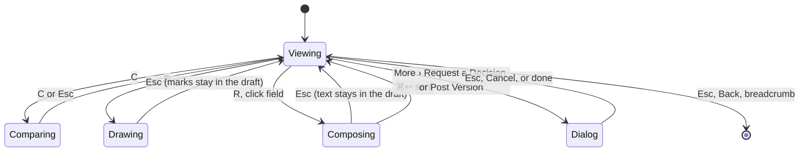
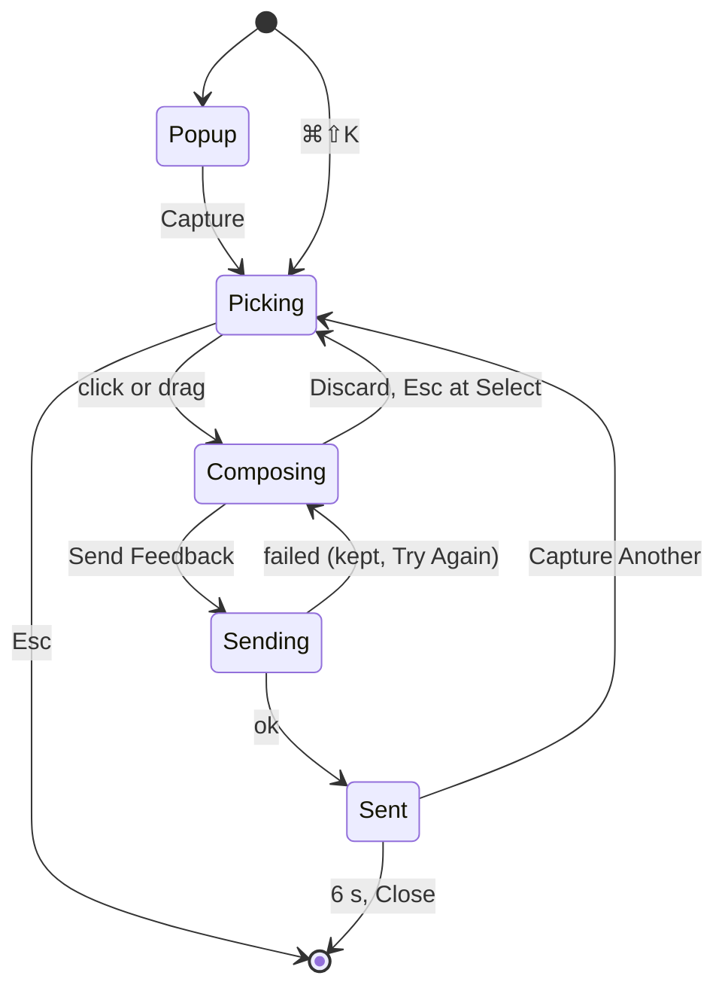
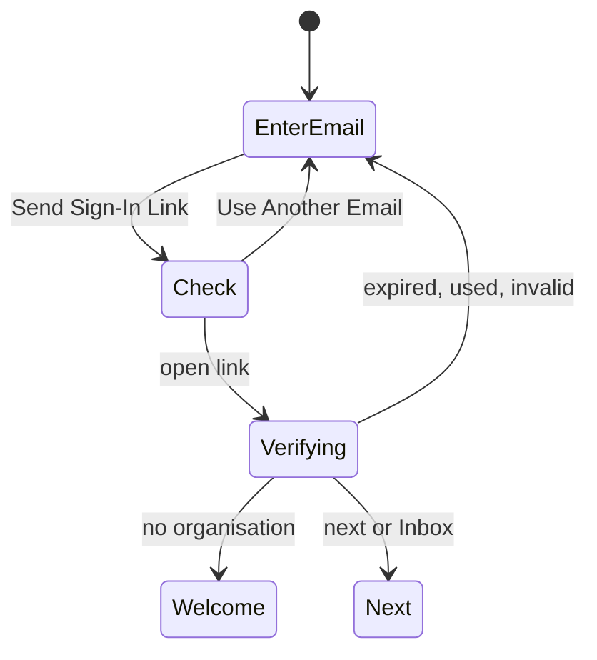

# Interaction

**Scope: release-scoped**, except "Proposed web extensions to the interaction guidelines", which is lasting: product-wide rules that move to `snapmark-web/docs/ux/interaction-guidelines.md` in milestone 1, once the owner accepts them.

Rules cited: the accepted guidelines in `docs/ux/interaction-guidelines.md` (CAP, EDT, NTE, KEY, FBK, WIN, WRD, ACC, EX), the proposed web rules below (WEB-1 to WEB-30), and the Laws of UX by name. Pattern choices cite uxpatterns.dev (through the `ux-patterns` skill).

## Mac rules on the web

How each accepted rule binds outside the Mac app. Every accepted rule is either bound below or named Mac-only here. Mac-only (they stay with the Mac app): CAP-1 to CAP-13, WIN-3, WIN-6, WIN-8, REC-1, REC-2, KEY-1 (global ⌃⇧ capture keys), WRD-8 (session names), NTE-1 (the editor's "General comment" box: the web composer and the compose panel have no such box), NTE-8 (the References heading), EX-3 (Esc on Select closes the Mac editor), EX-7, EX-8 (Quit and Move to Trash), EX-10, EX-11.

| Rule                         | Binding on the web and in the extension                                                                                                                                                                                                                                                                                                                                                                                                                                                                                                                                                                                                                    |
| ---------------------------- | ---------------------------------------------------------------------------------------------------------------------------------------------------------------------------------------------------------------------------------------------------------------------------------------------------------------------------------------------------------------------------------------------------------------------------------------------------------------------------------------------------------------------------------------------------------------------------------------------------------------------------------------------------------- |
| EDT-1 to EDT-8               | The extension's drawing and the web's Draw on Screenshot use the same renderer (`snapmark-kit/annotations`) and behave exactly like the Mac editor: shapes start at the pointer, ghost after a tool key, drawing tools always draw, Select works like Preview, ⌘Z / ⇧⌘Z, swap on second press, remove red and highlight yellow, chrome in Snapmark's palette                                                                                                                                                                                                                                                                                               |
| NTE-2, NTE-3, NTE-4          | Placing a reference in the extension puts the cursor in its note; the note asks "What about 1?"                                                                                                                                                                                                                                                                                                                                                                                                                                                                                                                                                            |
| NTE-6                        | Comments and notes render a Markdown subset as you type                                                                                                                                                                                                                                                                                                                                                                                                                                                                                                                                                                                                    |
| NTE-5                        | The compose panel's notes grow to fit their text, the panel scrolls, and Discard Feedback and Send Feedback stay in view                                                                                                                                                                                                                                                                                                                                                                                                                                                                                                                                   |
| NTE-7                        | A card is a yellow speech bubble whose tail points at what it is about; you type on the card (same renderer)                                                                                                                                                                                                                                                                                                                                                                                                                                                                                                                                               |
| KEY-2                        | Bound as "browser keys keep their browser meaning": no shortcut takes a key Chrome or the OS owns (WEB-8). On the web a row deletes with ⌫, the web binding of FBK-4 (the Mac session window uses ⌘⌫; ⌘⌫ is not free on a text-heavy page)                                                                                                                                                                                                                                                                                                                                                                                                                 |
| KEY-3                        | Single-key tools (C, 1 to 7) in drawing mode, and single-key page shortcuts (J, K, R, A …), never fire while typing                                                                                                                                                                                                                                                                                                                                                                                                                                                                                                                                        |
| KEY-4                        | **Not bound.** ⌘1 to ⌘9 switch Chrome tabs (owner, 2026-09-28). The extension and web use single keys only. Recorded for conformance                                                                                                                                                                                                                                                                                                                                                                                                                                                                                                                       |
| KEY-5                        | Esc steps back one level (WEB-3)                                                                                                                                                                                                                                                                                                                                                                                                                                                                                                                                                                                                                           |
| KEY-6                        | One source for every key: the `?` shortcuts list, the ⌘K command menu and tooltips read the same table                                                                                                                                                                                                                                                                                                                                                                                                                                                                                                                                                     |
| KEY-7                        | No plain ⌥-letter shortcuts on the web either                                                                                                                                                                                                                                                                                                                                                                                                                                                                                                                                                                                                              |
| FBK-1                        | A visible change is its own message: a sent comment appears in the thread, a dismissed Inbox row disappears                                                                                                                                                                                                                                                                                                                                                                                                                                                                                                                                                |
| FBK-2                        | Toasts only for results off screen (WEB-4)                                                                                                                                                                                                                                                                                                                                                                                                                                                                                                                                                                                                                 |
| FBK-3                        | Errors read event · consequence · action (WEB-14)                                                                                                                                                                                                                                                                                                                                                                                                                                                                                                                                                                                                          |
| FBK-4, FBK-5                 | Act at once with Undo; ask first only for what cannot be undone (WEB-5). Access and mail rank above FBK-4: Revoke Device, Remove from Organisation and Send Invitations ask first even though "sign in again" or "invite again" exists (R3 over FBK-4; recorded so review does not reopen it)                                                                                                                                                                                                                                                                                                                                                              |
| FBK-6                        | Nothing under 400 ms; progress from 1 s (WEB-13)                                                                                                                                                                                                                                                                                                                                                                                                                                                                                                                                                                                                           |
| FBK-7                        | A toast is never the only copy (WEB-4)                                                                                                                                                                                                                                                                                                                                                                                                                                                                                                                                                                                                                     |
| WIN-1, WRD-2                 | Every icon-only control has a Tooltip "Name (key)"                                                                                                                                                                                                                                                                                                                                                                                                                                                                                                                                                                                                         |
| WIN-2                        | The extension's floating toolbar on a customer page shows names in tooltips on hover and focus; on touch it is not used                                                                                                                                                                                                                                                                                                                                                                                                                                                                                                                                    |
| WIN-4                        | Esc acts on the top surface only (WEB-3)                                                                                                                                                                                                                                                                                                                                                                                                                                                                                                                                                                                                                   |
| WIN-5                        | The extension's compose panel keeps notes on the right and Send bottom right as the one primary                                                                                                                                                                                                                                                                                                                                                                                                                                                                                                                                                            |
| WIN-7                        | Settings apply at once (WEB-16). In the Mac app WIN-7 is amended to four tabs (General, Capture, Shortcuts, Online); the Online tab's Sign In… is a flow, not a setting                                                                                                                                                                                                                                                                                                                                                                                                                                                                                    |
| WIN-9                        | The extension popup stays short: workspace, environment, Capture, recent                                                                                                                                                                                                                                                                                                                                                                                                                                                                                                                                                                                   |
| WRD-1                        | Web case rule (orchestrator default, owner-decisions.md #19): Title Case for buttons, menu items, tabs, sidebar items, chips, table headers, dialog and page titles and headings; sentence case for field labels, switch labels, placeholders, messages, and headlines written as full sentences. The Mac app keeps WRD-1 (sentence case) for its own strings                                                                                                                                                                                                                                                                                              |
| WRD-3 to WRD-7               | Unchanged                                                                                                                                                                                                                                                                                                                                                                                                                                                                                                                                                                                                                                                  |
| EX-1, EX-2, EX-4, EX-5, EX-6 | Bound unchanged: Remove and Highlight ignore the picked colour; single-key tools (switch off in Keyboard Shortcuts, never in text); redactions cannot move; references keep one size; Pen strokes are pointer only                                                                                                                                                                                                                                                                                                                                                                                                                                         |
| ACC-1, ACC-3 to ACC-6        | Bound unchanged                                                                                                                                                                                                                                                                                                                                                                                                                                                                                                                                                                                                                                            |
| ACC-2                        | **Departs: a proposed web exception, for the owner (owner-decisions.md #12).** ACC-2 says "Focus always shows as a 2 pt blue ring." On the web the ring is 2 pt in the `focus` token colour (neutral in the pinned tokens, not blue) and shows on keyboard focus only (`:focus-visible`, WEB-9), not after a pointer click. Reason: the owner's calm rule (no blue outlines, nothing lit after a click); WCAG 2.4.7 is still met because every keyboard focus shows the ring. Proposed wording: "Focus shows as a 2 pt ring in the focus colour on keyboard focus." The design system's "after a click too" goes to the exceptions register when it exists |

## Wireflows

Release-scoped. Every arrow starts at a control.

### J1 Point at an element, draw, say what you expect (extension)

| From control                  | Action                       | To screen or state                                                      | Notes                                                                                                                    |
| ----------------------------- | ---------------------------- | ----------------------------------------------------------------------- | ------------------------------------------------------------------------------------------------------------------------ |
| Chrome toolbar icon, or ⌘⇧K   | click / key                  | Popup (signed in) or straight to Picker (shortcut)                      | Shortcut skips the popup (Flow)                                                                                          |
| Popup Capture                 | click, ↩                     | Picker overlay                                                          | Popup closes; the page stays as it was (WEB-30)                                                                          |
| Picker: element under pointer | hover                        | element outlined, chip shows region › module › component · `file:line`  | Code location from React/Next fibers or Vue/Nuxt `__file`, `data-snapmark-module` (decisions.json)                       |
| Picker: ↑ / ↓                 | key                          | parent / first child outlined                                           | Precision without aiming (Fitts's Law)                                                                                   |
| Picker: element               | click, ↩                     | Drawing + Compose, screenshot of the viewport with the element outlined |                                                                                                                          |
| Picker: page                  | drag                         | area selected; Drawing + Compose                                        | Region from the area's centre landmark                                                                                   |
| Picker Esc                    | key                          | overlay closed                                                          |                                                                                                                          |
| Drawing toolbar tool          | click, C / 1–7               | tool chosen                                                             | EDT-6                                                                                                                    |
| Compose kind                  | click, ←/→                   | Change Request or Comment                                               | Default Change Request                                                                                                   |
| Compose Module                | type, pick                   | module set (prefilled from `data-snapmark-module`)                      | Members may create a new module inline                                                                                   |
| Compose Send Feedback         | click, ⌘↩                    | Sending (button busy) → Sent confirmation                               | Optimistic is not used here: the link needs the server's number                                                          |
| Compose Discard               | click, Esc (KEY-5 last step) | Picker                                                                  | Marks and text kept for this tab until Discard is pressed twice or the page changes; Undo (⌘Z) restores the last discard |
| Sent Open                     | click                        | Feedback view in a new tab                                              |                                                                                                                          |
| Sent Capture Another          | click, ⌘⇧K                   | Picker                                                                  |                                                                                                                          |

### J1 Point at it from a Mac session (Mac app, J7 shares it)

| From control          | Action    | To screen or state                        | Notes                                                           |
| --------------------- | --------- | ----------------------------------------- | --------------------------------------------------------------- |
| ⌃⇧1…⌃⇧5               | key       | Mac editor (unchanged)                    | Mac rules apply                                                 |
| Editor Add to Session | click, ⌘↩ | screenshot in the shared session          | Each reference becomes one feedback online; sync silent (FBK-1) |
| Menu bar header       | glance    | "Synced" or "Offline · 3 changes waiting" |                                                                 |

### J2 Compare, vote, approve (web)

| From control                         | Action          | To screen or state                                                                              | Notes                                                                                     |
| ------------------------------------ | --------------- | ----------------------------------------------------------------------------------------------- | ----------------------------------------------------------------------------------------- |
| Inbox row "Dana asked you to decide" | click, ↩        | Feedback view, decision card in view, Compare open on the request's versions                    | `?compare=1,2#decision-<id>`                                                              |
| Version tab                          | click, [ / ]    | that version in the centre                                                                      |                                                                                           |
| Compare toggle                       | click, C        | two versions side by side, zoom and pan linked                                                  | uxpatterns `image-gallery` compare variant: side by side, the owner's "side by side" (J2) |
| Compare version Select (left, right) | choose          | other pair                                                                                      |                                                                                           |
| Decision card version option         | click, ↑/↓      | option chosen                                                                                   | RadioGroup                                                                                |
| Decision card Vote                   | click, V then ↩ | vote recorded, tally updates in place                                                           | Optimistic (WEB-6)                                                                        |
| Composer Comment                     | type, ⌘↩        | comment appears on the shown version                                                            |                                                                                           |
| Footer Approve v1                    | click, A        | Approve recorded; acceptance line updates; if accepted: "Decided" flag, decision request closes |                                                                                           |
| Footer More › Request a Decision     | click           | Request a Decision dialog                                                                       |                                                                                           |
| Dialog Request Decision              | click, ⌘↩       | dialog closes; decision card at the top of the thread; Inbox items for the people asked         |                                                                                           |
| Footer More › Post Version           | click           | Post Version dialog                                                                             |                                                                                           |
| Dialog Post Version                  | click, ⌘↩       | new version tab, chosen                                                                         |                                                                                           |

### J3 The copilot fetches and claims (MCP, reflected in the UI)

| From control                          | Action     | To screen or state                                                               | Notes                                                                      |
| ------------------------------------- | ---------- | -------------------------------------------------------------------------------- | -------------------------------------------------------------------------- |
| (MCP) `list_feedback`, `get_feedback` | agent call | nothing changes in the UI                                                        | Read is never shown (Selective Attention); logged in the audit trail       |
| (MCP) `claim`                         | agent call | row and header: status "In Progress", "Ben via Claude"                           | Live (WEB-11); refused with the reason when Needs Answer or Needs Decision |
| (MCP) `ask`                           | agent call | Question entry by "Ben via Claude", flag Needs Answer, Inbox item for the author |                                                                            |
| (MCP) `reply`                         | agent call | Comment entry by "Ben via Claude"                                                | Needs the Reply scope                                                      |
| Header More › Unclaim                 | click      | status back to Open                                                              | Only the person whose copilot claimed it, and admins                       |

### J4 Implementation reported, reviewed, accepted

| From control                                | Action     | To screen or state                                                                                                                                       | Notes                                                                       |
| ------------------------------------------- | ---------- | -------------------------------------------------------------------------------------------------------------------------------------------------------- | --------------------------------------------------------------------------- |
| (MCP) `report_implementation`               | agent call | new version tab "v2 Implementation · PR #212", status Implemented, item moves to In Review, Inbox review request to the author and the decision's voters | Needs the Report Implementations scope                                      |
| Inbox row "Ben via Claude implemented this" | click, ↩   | Feedback view on v2                                                                                                                                      |                                                                             |
| Compare                                     | C          | v0 and v2 side by side                                                                                                                                   |                                                                             |
| Footer Approve v2 (primary)                 | click, A   | Accepted; item moves to Done; acceptance line "Accepted · approved by Priya"                                                                             |                                                                             |
| Footer Request Changes                      | click, ⇧R  | composer asks "What should change?"; Request Changes sends with the text                                                                                 | Status back to Open; Inbox item for the person whose copilot implemented it |

### J5 Check where the code is

| From control              | Action            | To screen or state                               | Notes                                         |
| ------------------------- | ----------------- | ------------------------------------------------ | --------------------------------------------- |
| Feedback view Details tab | click             | anchor and version stamp                         | Unknown fields say "Not found" in plain words |
| Details `file:line`       | click Copy (icon) | copied; toast "Copied src/cart/CartTotal.tsx:42" | EX-9 binding (WEB-23)                         |
| Details PR or commit      | click             | GitHub in a new tab                              | WEB-22                                        |

### J6 React from the phone

| From control               | Action           | To screen or state                                                       | Notes                                               |
| -------------------------- | ---------------- | ------------------------------------------------------------------------ | --------------------------------------------------- |
| Email link                 | tap              | Phone feedback view (sign in first if needed, then straight back)        |                                                     |
| Phone Inbox row            | tap              | Phone feedback view                                                      |                                                     |
| Screenshot                 | tap              | full-screen viewer, pinch to zoom; Close returns                         |                                                     |
| Reply field                | tap, type, Send  | comment appears                                                          | Keyboard pushes the bar up; the field stays in view |
| Action bar Approve         | tap              | Approve recorded                                                         |                                                     |
| Action bar Request Changes | tap              | reply field focused with "What should change?"; Send sends the objection |                                                     |
| Action bar Vote            | tap              | sheet with the versions (RadioGroup) and Vote                            | Only while a decision request is open               |
| Back (top bar)             | tap, system back | Phone Inbox at the same scroll                                           |                                                     |

### J7 Share a Mac session and keep it in sync

| From control                       | Action   | To screen or state                                                                        | Notes                                       |
| ---------------------------------- | -------- | ----------------------------------------------------------------------------------------- | ------------------------------------------- |
| Mac Settings › Online Sign In…     | click    | device code panel + browser `/device`                                                     |                                             |
| Browser Allow                      | click    | Mac app: "Signed in as …"                                                                 |                                             |
| Session window Share to Workspace… | click    | sheet: Workspace pop-up and the manifest line (what leaves the Mac, who sees it)          |                                             |
| Sheet Share                        | click, ↩ | status "Syncing 12 changes" → "Synced"                                                    |                                             |
| (offline) any edit                 |          | status "Offline · 3 changes waiting"                                                      | Nothing blocks (design-system offline rule) |
| (back online)                      |          | "Syncing 3 changes" → "Synced"                                                            |                                             |
| (conflict)                         |          | the note shows the last write; online thread entry "Edited elsewhere" with the other text | Nothing typed is lost (design 7)            |
| Session window View Online         | click    | web Session view                                                                          |                                             |

### J8 Join the waitlist; operator invites

| From control                   | Action          | To screen or state                                   | Notes                                                       |
| ------------------------------ | --------------- | ---------------------------------------------------- | ----------------------------------------------------------- |
| Landing Work email             | type            |                                                      |                                                             |
| Landing Join the Waitlist      | click, ↩        | Waitlist confirmation                                | Already on the list: the same confirmation (no enumeration) |
| Operator Waitlist row checkbox | click, X, Space | row selected; header shows "3 selected" and Invite 3 | uxpatterns `table` with selection                           |
| Invite 3                       | click           | confirm dialog "Invite 3 people?"                    | Invitations email; cannot be unsent, so it asks (FBK-5)     |
| Confirm Send Invitations       | click           | rows show "Invited"; terminal prints the emails      |                                                             |

### J9 Guest text stays data

| From control   | Action | To screen or state                                                 | Notes                                           |
| -------------- | ------ | ------------------------------------------------------------------ | ----------------------------------------------- |
| Guest Comment  | ⌘↩     | entry with a Guest chip                                            | The chip shows wherever the text shows (WEB-25) |
| (MCP) any read |        | guest text returned quoted with author, role and `untrusted: true` | Design 10                                       |

### J10 Set up the team

| From control                      | Action    | To screen or state                                                       | Notes                                                              |
| --------------------------------- | --------- | ------------------------------------------------------------------------ | ------------------------------------------------------------------ |
| Invitation email Set Up Your Team | click     | Sign in (email prefilled)                                                |                                                                    |
| Sign-in link                      |           | Welcome                                                                  |                                                                    |
| Welcome Create Organisation       | click, ↩  | workspace Open, first-use empty state                                    |                                                                    |
| Empty state Invite People         | click     | Invite People dialog                                                     |                                                                    |
| Dialog Send Invitations           | click, ⌘↩ | Members › Invitations tab with the new rows                              |                                                                    |
| ⌘K "Environments"                 | ↩         | Workspace settings › Environments                                        |                                                                    |
| Add Environment                   | click     | dialog: Kind, Name, Address patterns                                     |                                                                    |
| Dialog Save                       | click, ⌘↩ | row added; a test field "Try an address" shows which environment matches | Postel's Law: accepts `omr.com`, `https://omr.com/`, `*.omr.ninja` |

### J11 Connect and revoke a device

| From control                   | Action       | To screen or state                                                            | Notes                                                   |
| ------------------------------ | ------------ | ----------------------------------------------------------------------------- | ------------------------------------------------------- |
| Extension Sign In              | click        | browser tab `/authorize`                                                      |                                                         |
| Consent Allow                  | click, ↩     | "You can close this tab" and the tab closes itself; popup shows the workspace | Read only unless a scope was switched on                |
| Account › Devices scope Switch | click, Space | applies at once                                                               | WEB-16                                                  |
| Device Revoke                  | click        | confirm dialog                                                                | Cannot be undone; the device must sign in again (FBK-5) |
| Confirm Revoke                 | click        | row removed; the device's next call fails with "Signed out"                   |                                                         |

## State Tables

Release-scoped. Every table has default, loading, empty, partial, error and disabled-with-reason, plus permission and live states where they apply. Words here are the final words; screens.md gives their message keys.

### Landing

| State                    | Entry or trigger | What the user sees                                                            | Words                                                                                            | Actions with key                   | Exit         |
| ------------------------ | ---------------- | ----------------------------------------------------------------------------- | ------------------------------------------------------------------------------------------------ | ---------------------------------- | ------------ |
| Default                  | open `/`         | hero with the form, four outcome sections, how-it-works, closing form, footer | see screens.md Landing words                                                                     | Join the Waitlist (↩ in the field) | confirmation |
| Loading                  | submit           | button busy, field kept                                                       | announced: "Joining the waitlist…" (the button keeps its label)                                  | none                               |              |
| Error: invalid email     | blur or submit   | inline under the field                                                        | "Enter an email address like name@company.com."                                                  | fix, ↩                             |              |
| Error: server            | submit fails     | inline under the button                                                       | "Couldn't add you to the waitlist. Snapmark had a problem. Your email is still here. Try again." | Try Again                          |              |
| Signed in                | session cookie   | header shows Open Snapmark                                                    | "Open Snapmark"                                                                                  |                                    | Inbox        |
| Empty, partial, disabled | not applicable   | static page                                                                   |                                                                                                  |                                    |              |

### Waitlist confirmation

| State        | Entry or trigger | What the user sees                 | Words                                                                                                                                       | Actions with key | Exit    |
| ------------ | ---------------- | ---------------------------------- | ------------------------------------------------------------------------------------------------------------------------------------------- | ---------------- | ------- |
| Default      | after joining    | headline, one paragraph, link home | "You're on the list." · "We invite teams in small groups, so each one gets our full attention. We'll write to {email} when it's your turn." | Back to Home     | Landing |
| Direct visit | no recent join   | same, without the email            | "…We'll write to you when it's your turn."                                                                                                  | Back to Home     |         |

### Sign in, Check your email, Verify

| State                       | Entry or trigger  | What the user sees                                                          | Words                                                                                                                                                          | Actions with key                           | Exit                   |
| --------------------------- | ----------------- | --------------------------------------------------------------------------- | -------------------------------------------------------------------------------------------------------------------------------------------------------------- | ------------------------------------------ | ---------------------- |
| Default                     | `/sign-in`        | title, Email field (focused), Send Sign-In Link                             | "Sign In to Snapmark"                                                                                                                                          | ↩ sends                                    | Check                  |
| Loading                     | submit            | button busy                                                                 | announced: "Sending the sign-in link…" (the button keeps its label)                                                                                            |                                            |                        |
| Error: invalid email        | blur, submit      | inline                                                                      | "Enter an email address like name@company.com."                                                                                                                |                                            |                        |
| Error: expired link         | `?error=expired`  | Callout above the field                                                     | "This sign-in link has expired. Links work for 15 minutes. Send a new one below."                                                                              | ↩                                          |                        |
| Error: used link            | `?error=used`     | Callout                                                                     | "This sign-in link was already used. Each link works once. Send a new one below."                                                                              |                                            |                        |
| Error: invalid link         | `?error=invalid`  | Callout                                                                     | "This sign-in link doesn't work. Send a new one below."                                                                                                        |                                            |                        |
| Error: rate limit           | 5 links in 10 min | inline                                                                      | "Too many links in a short time. Wait a minute, then send again."                                                                                              |                                            |                        |
| Check: default              | after send        | title, the email, the local hint (console mail only)                        | "Check Your Email" · "We sent a sign-in link to {email}. It works once, for 15 minutes." · "Running locally: the link is in the terminal where Snapmark runs." | Use Another Email; Send Again (after 30 s) | Sign in                |
| Check: disabled with reason | under 30 s        | Send Again greyed                                                           | "Send again in {n} s"                                                                                                                                          |                                            |                        |
| Verify: loading             | open the link     | centred Spinner after 400 ms                                                | "Signing you in…"                                                                                                                                              |                                            | next, Welcome or Inbox |
| Unknown email               | not invited       | same Check screen (no enumeration); the email says how to join the waitlist |                                                                                                                                                                |                                            |                        |
| Empty, partial              | not applicable    |                                                                             |                                                                                                                                                                |                                            |                        |

### Invitation

One address, `/invite/<token>`, two variants (sitemap F1): an **organisation invitation** (an admin invites you into an organisation) and a **waitlist invitation** (an operator invites you to set up your own team; no organisation exists yet). Every state has a way on: a callout carries its link, and the auth card's logo links home (sitemap F12).

| State                                 | Entry or trigger                                 | What the user sees                           | Words                                                                                                                      | Actions with key                       | Exit                                        |
| ------------------------------------- | ------------------------------------------------ | -------------------------------------------- | -------------------------------------------------------------------------------------------------------------------------- | -------------------------------------- | ------------------------------------------- |
| Default, signed out                   | `/invite/<token>`                                | inviter, organisation, role; email prefilled | "{inviter} invited you to {organisation} as {role, select, …}."                                                            | Continue with Email (sends a link)     | Check, then back here                       |
| Default, signed in, same email        |                                                  | the same with Join                           |                                                                                                                            | Join {organisation} (↩)                | Inbox, or the invited workspace for a guest |
| Waitlist, signed out                  | waitlist token                                   | title "Set Up Your Team", email prefilled    | "Sign in with {email} to name your organisation and first workspace."                                                      | Continue with Email                    | Check, then back here                       |
| Waitlist, signed in, same email       |                                                  | title "Set Up Your Team"                     | "Sign in with {email} to name your organisation and first workspace."                                                      | Set Up Your Team (↩)                   | `/welcome`                                  |
| Waitlist, already has an organisation | signed in, owns or belongs to one                | Callout, and the primary stays               | "You already have an organisation, {organisation}. This invitation can set up one more team."                              | Set Up Your Team; Go to {organisation} | `/welcome` or that Inbox                    |
| Wrong account                         | signed in as another email (either variant)      | Callout                                      | "This invitation is for {email}. You're signed in as {current}."                                                           | Sign Out and Continue                  | Sign in                                     |
| Already a member                      | organisation variant                             | Callout                                      | "You're already in {organisation}."                                                                                        | Go to {organisation}                   | Inbox                                       |
| Expired                               | 7 days (either variant)                          | Callout                                      | "This invitation has expired. Ask {inviter} to send a new one."                                                            | Go to Snapmark                         | `/` or the Inbox                            |
| Revoked                               | an admin or operator revoked it (either variant) | Callout                                      | "This invitation was withdrawn. Ask the person who sent it for a new one."                                                 | Go to Snapmark                         | `/` or the Inbox                            |
| Invalid                               | unknown token                                    | 404 page                                     | "This page doesn't exist, or you don't have access."                                                                       | Go to Snapmark                         |                                             |
| Disabled: no free seat                | organisation variant; seat taken after sending   | Callout                                      | "{organisation} has no free seat for {role, select, …} right now. Ask {inviter} to free one, or to invite you as a guest." |                                        |                                             |
| Loading                               | Join or Set Up Your Team                         | button busy, label kept                      | announced: "Joining {organisation}…"                                                                                       |                                        |                                             |
| Error                                 | Join fails                                       | inline                                       | "Couldn't join {organisation}. Snapmark had a problem. You're not in yet. Try again."                                      | Try Again                              |                                             |

### Welcome (first run)

| State               | Entry or trigger               | What the user sees                        | Words                                                                                                                       | Actions with key    | Exit           |
| ------------------- | ------------------------------ | ----------------------------------------- | --------------------------------------------------------------------------------------------------------------------------- | ------------------- | -------------- |
| Default             | first sign-in, no organisation | headline, two fields, Create Organisation | "A home for your team's decisions." · "Name your organisation and the first product you'll review. You can add more later." | ↩ in the last field | workspace Open |
| Error: empty field  | submit                         | inline per field                          | "Give your organisation a name." · "Give your workspace a name."                                                            |                     |                |
| Error: slug taken   |                                | inline under the address preview          | "{slug} is taken. Try {suggestion}."                                                                                        |                     |                |
| Loading             | submit                         | button busy                               | announced: "Creating {name}…"                                                                                               |                     |                |
| Error: server       |                                | inline                                    | "Couldn't create {name}. Snapmark had a problem. Your names are still here. Try again."                                     |                     |                |
| Has an organisation | visit `/welcome`               | redirect to Inbox                         |                                                                                                                             |                     |                |

### Device consent (`/authorize`, `/device`)

| State                    | Entry or trigger | What the user sees                                                                | Words                                                                                                                                                                                                                                                                                                                            | Actions with key      | Exit                              |
| ------------------------ | ---------------- | --------------------------------------------------------------------------------- | -------------------------------------------------------------------------------------------------------------------------------------------------------------------------------------------------------------------------------------------------------------------------------------------------------------------------------- | --------------------- | --------------------------------- |
| Device code (Mac)        | `/device`        | the code to confirm, prefilled                                                    | "Confirm the code shown on your Mac."                                                                                                                                                                                                                                                                                            | Continue (↩)          | consent                           |
| Default                  | valid request    | client name, device, what it can read, three write switches off, the safety lines | "Allow {client} to use your Snapmark account?" · "{client} on {device} can read feedback in every workspace you can see." · "It may also:" Reply in threads · Post versions · Report implementations · "It can never approve or request changes. Text people write, guests included, reaches it as data, never as instructions." | Allow (↩), Deny (Esc) | device; "You can close this tab." |
| Loading                  | Allow            | button busy                                                                       | announced: "Connecting {client}…"                                                                                                                                                                                                                                                                                                |                       |                                   |
| Allowed                  |                  | message; the tab closes itself where the browser lets it                          | "{client} is connected. You can close this tab."                                                                                                                                                                                                                                                                                 | Go to Devices         |                                   |
| Denied                   | Deny             | message                                                                           | "{client} was not connected."                                                                                                                                                                                                                                                                                                    |                       |                                   |
| Expired request          | 10 min           | Callout                                                                           | "This request has expired. Start again from {client}."                                                                                                                                                                                                                                                                           |                       |                                   |
| Code mismatch            | wrong code       | inline                                                                            | "This code doesn't match any waiting device. Check the code on your Mac."                                                                                                                                                                                                                                                        |                       |                                   |
| Empty, partial, disabled | not applicable   |                                                                                   |                                                                                                                                                                                                                                                                                                                                  |                       |                                   |

### App shell (sidebar, ⌘K)

| State                     | Entry or trigger           | What the user sees                                                                                                                   | Words                                                                                                          | Actions with key  | Exit            |
| ------------------------- | -------------------------- | ------------------------------------------------------------------------------------------------------------------------------------ | -------------------------------------------------------------------------------------------------------------- | ----------------- | --------------- |
| Default                   | any app page               | sidebar 248 px: organisation switcher, Search ⌘K, Inbox (count), My Work, workspace sections, Settings, avatar                       |                                                                                                                | ⌘K, G I, G M, `?` |                 |
| Loading                   | first load                 | sidebar skeleton (labels known, counts as dots) after 400 ms                                                                         |                                                                                                                |                   |                 |
| One organisation          | member of one organisation | the switcher shows the organisation name; its menu holds only that organisation (creating a second organisation is not in release 1) |                                                                                                                |                   |                 |
| Guest                     | role guest                 | only invited workspaces; Settings hidden (never available to guests)                                                                 |                                                                                                                |                   |                 |
| Collapsed                 | ⌘\ or the collapse button  | 56 px rail with icons and tooltips                                                                                                   |                                                                                                                | ⌘\                |                 |
| Command menu open         | ⌘K                         | Modal with search, groups: Go To, Feedback, Actions on This Page, Settings                                                           | "Search or jump to…"                                                                                           | ↑/↓, ↩, Esc       | the chosen page |
| Command menu empty result | no match                   | one line                                                                                                                             | "Nothing matches \"{q}\". Search feedback by number, like #42."                                                |                   |                 |
| Command menu error        | search fails               | one line                                                                                                                             | "Couldn't search. Snapmark had a problem. Try again."                                                          | ↩ retries         |                 |
| Offline                   | browser offline            | Banner on top of the main column                                                                                                     | "Offline. You can read what's loaded. Replying and reviewing are off until you're back. Your drafts are kept." |                   |                 |
| Session expired           | 401                        | sign-in with `next`; drafts kept                                                                                                     | "Your session ended. Sign in to continue."                                                                     |                   |                 |
| Phone (< 640 px)          |                            | top bar with menu button; sidebar as a Drawer from the left                                                                          |                                                                                                                |                   |                 |

### Inbox

| State                | Entry or trigger                         | What the user sees                                                                                                                                                             | Words                                                                                                                                                                                                  | Actions with key                             | Exit          |
| -------------------- | ---------------------------------------- | ------------------------------------------------------------------------------------------------------------------------------------------------------------------------------ | ------------------------------------------------------------------------------------------------------------------------------------------------------------------------------------------------------ | -------------------------------------------- | ------------- |
| Default              | `/<org>/inbox`                           | header "Inbox", kind chips (All, Decisions, Reviews, Questions, Mentions, Answers; a filter, URL `kind`), rows newest first with overdue decisions on top; New rows have a dot | reason lines: "{name} asked you to decide" · "{name} implemented this" · "{name} via {client} implemented this" · "{name} asked a question" · "{name} mentioned you" · "{name} answered your question" | J/K, ↩ open, E dismiss, `?`                  | Feedback view |
| Loading              |                                          | 8 row skeletons after 400 ms                                                                                                                                                   |                                                                                                                                                                                                        |                                              |               |
| Empty                | nothing for you                          | EmptyState                                                                                                                                                                     | "Nothing waits on you." · "Decisions, reviews and questions for you show up here."                                                                                                                     | none (no primary: nothing to do is the goal) |               |
| Empty for a kind     | tab with none                            | one line                                                                                                                                                                       | "No {kind} for you."                                                                                                                                                                                   | All                                          |               |
| Partial              | rows from a workspace you lost access to | those rows are gone; nothing shows a broken item                                                                                                                               |                                                                                                                                                                                                        |                                              |               |
| Error                | load fails                               | inline in the list area                                                                                                                                                        | "Couldn't load your Inbox. Snapmark had a problem. Try again."                                                                                                                                         | Try Again                                    |               |
| Live                 | new item arrives                         | pill at the top "1 new" (rows do not shift)                                                                                                                                    | "{n} new"                                                                                                                                                                                              | click or `.` shows them                      |               |
| Done by acting       | you voted, reviewed or answered          | row leaves the list with a 200 ms fade (none with reduced motion)                                                                                                              |                                                                                                                                                                                                        |                                              |               |
| Dismissed            | E or Dismiss                             | row leaves; toast with Undo                                                                                                                                                    | "Dismissed." · Undo                                                                                                                                                                                    | ⌘Z or Undo within 8 s                        |               |
| Phone                | < 640 px                                 | the same list, larger rows, swipe left to dismiss (also in the row's More)                                                                                                     |                                                                                                                                                                                                        |                                              |               |
| Disabled, permission | not applicable (per user)                |                                                                                                                                                                                |                                                                                                                                                                                                        |                                              |               |

### My Work

| State          | Entry or trigger | What the user sees                                                                              | Words                                                                                                                      | Actions with key              | Exit          |
| -------------- | ---------------- | ----------------------------------------------------------------------------------------------- | -------------------------------------------------------------------------------------------------------------------------- | ----------------------------- | ------------- |
| Default        | `/<org>/my-work` | Tabs Asked by Me · Claimed by My Agent; feedback rows across workspaces with the workspace name |                                                                                                                            | J/K, ↩                        | Feedback view |
| Loading        |                  | row skeletons                                                                                   |                                                                                                                            |                               |               |
| Empty, Asked   |                  | EmptyState                                                                                      | "Everything you ask for, in one place." · "Feedback you send from Chrome or your Mac shows up here, with where it stands." | Set Up the Extension          |               |
| Empty, Claimed |                  | EmptyState                                                                                      | "Your agent hasn't claimed anything yet." · "Connect Claude Code or another agent, then ask it to pick up open feedback."  | Connect an Agent (to Devices) |               |
| Error, live    | as Inbox         |                                                                                                 |                                                                                                                            |                               |               |
| Guest          | role guest       | Claimed tab hidden (guests do not use MCP)                                                      |                                                                                                                            |                               |               |

### Workspace lists (Open, Needs Decision, In Review, Done) and one module

| State                                     | Entry or trigger        | What the user sees                                                                                                                                                                 | Words                                                                                                                              | Actions with key                              | Exit          |
| ----------------------------------------- | ----------------------- | ---------------------------------------------------------------------------------------------------------------------------------------------------------------------------------- | ---------------------------------------------------------------------------------------------------------------------------------- | --------------------------------------------- | ------------- |
| Default                                   | list route              | header (workspace name, list name, count), filter bar (Search, Module, Page, Kind, Author, Environment; Status on Open), sort, rows                                                | row: thumbnail · title · status chip and flags · Module · Page · author · "Ben via Claude" when claimed · thread count · time      | `/` search, F filters, J/K, ↩                 | Feedback view |
| Loading                                   |                         | row skeletons; the filter bar is live                                                                                                                                              |                                                                                                                                    |                                               |               |
| Empty, first use (Open, no feedback ever) |                         | EmptyState                                                                                                                                                                         | "Your first feedback is one click away." · "Open your product in Chrome, click the Snapmark icon and point at what should change." | Set Up the Extension (primary), Invite People |               |
| Empty, Needs Decision                     |                         | EmptyState                                                                                                                                                                         | "No open decisions." · "When the team weighs options, they collect here."                                                          |                                               |               |
| Empty, In Review                          |                         | EmptyState                                                                                                                                                                         | "Nothing waiting for review." · "When an agent reports a change, it lands here for approval."                                      |                                               |               |
| Empty, Done                               |                         | EmptyState                                                                                                                                                                         | "Finished work shows up here." · "Each item keeps who asked, what was decided and who approved."                                   |                                               |               |
| Empty, filtered                           | filters match nothing   | one line                                                                                                                                                                           | "No feedback matches these filters."                                                                                               | Clear Filters                                 |               |
| Partial                                   | more than 50 rows       | Load More at the end (uxpatterns `load-more`: keeps position, no infinite scroll so the footer is reachable). Load More is not in the URL: a reload starts at the top (sitemap F8) | "Show {count} More"                                                                                                                |                                               |               |
| Error                                     |                         | inline                                                                                                                                                                             | "Couldn't load {list}. Snapmark had a problem. Try again."                                                                         | Try Again                                     |               |
| Live                                      | another person's change | new rows behind a "3 new" pill; a row whose status changed leaves on the next refresh and shows "Moved to In Review" in place until then                                           |                                                                                                                                    |                                               |               |
| Guest                                     | role guest              | same lists for invited workspaces; Approve-only actions absent from rows (rows have none)                                                                                          |                                                                                                                                    |                                               |               |
| Unknown workspace or no access            |                         | 404 page                                                                                                                                                                           |                                                                                                                                    |                                               |               |

### Modules (list)

Browse only. Adding, renaming and deleting a module happen in one place, Workspace Settings › Modules (sitemap F3); the compose panel's "Add module “{name}”" option still creates one where it is used.

| State          | Entry or trigger      | What the user sees                                                                        | Words                                                                                                  | Actions with key                | Exit                                     |
| -------------- | --------------------- | ----------------------------------------------------------------------------------------- | ------------------------------------------------------------------------------------------------------ | ------------------------------- | ---------------------------------------- |
| Default        | `/<org>/<ws>/modules` | Table: Module, Open, Needs Decision, In Review, Last Activity; header link Manage Modules |                                                                                                        | ↩ opens; Manage Modules         | one module; Workspace Settings › Modules |
| Empty          | no modules            | EmptyState                                                                                | "Name the parts of your product." · "Modules group feedback by part, like Checkout Summary or Header." | Manage Modules (members and up) | Workspace Settings › Modules             |
| Loading, error | as lists              |                                                                                           |                                                                                                        |                                 |                                          |
| Guest          |                       | no Manage Modules                                                                         |                                                                                                        |                                 |                                          |

### Feedback view

| State                           | Entry or trigger                                                    | What the user sees                                                                                                                                                                                                                                       | Words                                                                                | Actions with key                 | Exit |
| ------------------------------- | ------------------------------------------------------------------- | -------------------------------------------------------------------------------------------------------------------------------------------------------------------------------------------------------------------------------------------------------- | ------------------------------------------------------------------------------------ | -------------------------------- | ---- |
| Default                         | `/<org>/<ws>/feedback/<n>`                                          | header (breadcrumb, title, number, status, flags, Previous/Next, More), version tabs, toolbar (Compare, Draw on Screenshot, zoom), screenshot with references and the anchor outline, right panel (Thread · Details), footer composer and review buttons | acceptance line, e.g. "Not reviewed yet"                                             | R, A, ⇧R, V, C, D, [ ], J/K, Esc | list |
| Loading                         |                                                                     | header skeleton, image placeholder at the screenshot's ratio, thread skeleton                                                                                                                                                                            |                                                                                      |                                  |      |
| Image loading                   |                                                                     | thumbnail blurred up to the full image                                                                                                                                                                                                                   |                                                                                      |                                  |      |
| Image failed                    | signed URL fails                                                    | in the image area                                                                                                                                                                                                                                        | "Couldn't load the screenshot. The feedback and thread are fine. Try again."         | Try Again                        |      |
| Compare                         | C                                                                   | two panes with version Selects; linked zoom and pan; references on both                                                                                                                                                                                  | "Compare" toggle pressed                                                             | C or Esc exits                   |      |
| Drawing                         | D (desktop)                                                         | toolbar over the image; marks join the draft comment; composer shows "{n} marks"                                                                                                                                                                         |                                                                                      | C, 1–7, ⌘Z, Esc                  |      |
| Composing                       | R or click the field                                                | composer grows; Comment becomes primary                                                                                                                                                                                                                  | placeholder "Comment on v{n}…"                                                       | ⌘↩ sends, Esc leaves the field   |      |
| Request Changes, no text        | ⇧R with an empty composer                                           | composer focused with the prompt                                                                                                                                                                                                                         | placeholder "What should change in v{n}?" · button "Request Changes"                 | ⌘↩                               |      |
| Implementation awaiting review  | status Implemented, v{n} shown                                      | Approve v{n} is the primary                                                                                                                                                                                                                              | "Approve v{n}"                                                                       | A                                |      |
| Accepted                        |                                                                     | status chip Accepted; acceptance line names approvers                                                                                                                                                                                                    | "Accepted · approved by {names}"                                                     |                                  |      |
| Objection open                  |                                                                     | acceptance line                                                                                                                                                                                                                                          | "{n} objection open · {name}: “{first line}”"                                        |                                  |      |
| Decision open                   |                                                                     | decision card at the top of the thread; Vote primary in the card if you haven't voted                                                                                                                                                                    |                                                                                      | V                                |      |
| Question open                   |                                                                     | flag Needs Answer; the question entry has Answer                                                                                                                                                                                                         |                                                                                      |                                  |      |
| Claimed                         | In Progress                                                         | header line                                                                                                                                                                                                                                              | "In Progress · {name} via {client}"                                                  | Unclaim (More)                   |      |
| Claim refused (shown to people) | copilot tried while flagged                                         | thread entry                                                                                                                                                                                                                                             | "{name} via {client} couldn't claim this: it needs an answer first."                 |                                  |      |
| Empty thread                    | no entries                                                          | one line in the thread                                                                                                                                                                                                                                   | "No comments yet."                                                                   |                                  |      |
| Guest                           | role guest                                                          | Approve and Request Changes shown, `aria-disabled`, with the reason; Comment and Vote stay; Footer More shows Draw on Screenshot only (A31: comment, draw, vote)                                                                                         | "Guests can comment, draw and vote. Approving and requesting changes need a member." |                                  |      |
| Live                            | others act                                                          | new entries append; "2 new" pill if scrolled up; header chip changes with a thread line "Status changed to Implemented by Ben via Claude"                                                                                                                |                                                                                      |                                  |      |
| Newer version while drafting    | a version is posted while your composer holds text for an older one | inline note above the composer                                                                                                                                                                                                                           | "v{n} was just posted. Your comment will go on v{old}."                              | Move to v{n}                     |      |
| Pending write                   | your entry sending                                                  | entry shows at once, a quiet clock icon                                                                                                                                                                                                                  |                                                                                      |                                  |      |
| Failed write                    | entry fails                                                         | entry stays with an inline error                                                                                                                                                                                                                         | "Couldn't post your comment. Snapmark had a problem. Your text is kept. Try again."  | Try Again, Delete                |      |
| Offline                         |                                                                     | review buttons and Comment `aria-disabled` with reason; composer stays usable (draft)                                                                                                                                                                    | "Offline. Your comment is kept here and can be sent when you're back."               |                                  |      |
| Not found or no access          |                                                                     | 404 page                                                                                                                                                                                                                                                 | "This feedback doesn't exist, or you don't have access."                             | Go to Inbox                      |      |
| Phone                           | < 640 px                                                            | Phone feedback view (below)                                                                                                                                                                                                                              |                                                                                      |                                  |      |

### Phone feedback view

| State                         | Entry or trigger                          | What the user sees                                                                                                                                                                                           | Words                                                                                | Actions with key | Exit |
| ----------------------------- | ----------------------------------------- | ------------------------------------------------------------------------------------------------------------------------------------------------------------------------------------------------------------ | ------------------------------------------------------------------------------------ | ---------------- | ---- |
| Default                       | phone                                     | top bar (Back, "#42", More), screenshot full width (tap to zoom), title, status, acceptance line, version chips (horizontal scroll), thread, reply field, fixed bottom bar: Approve · Request Changes · Vote |                                                                                      | taps             | Back |
| Vote absent                   | no open decision                          | the bar shows Approve and Request Changes only                                                                                                                                                               |                                                                                      |                  |      |
| Approve primary               | implementation awaiting review            | Approve filled                                                                                                                                                                                               |                                                                                      |                  |      |
| Guest                         |                                           | bar shows Approve and Request Changes aria-disabled (W-15), Vote (when open) and the reply field, with the guest line above the bar (A31; owner-decisions.md #15)                                            | "Guests can comment, draw and vote. Approving and requesting changes need a member." |                  |      |
| Zoomed                        | tap image                                 | ZoomViewer: full screen; pinch, plus Zoom In, Zoom Out and Fit buttons (44 px) and double-tap, so every zoom has a single-pointer route (WCAG 2.5.1); Close                                                  | "Zoom In", "Zoom Out", "Fit", "Close"                                                |                  |      |
| Desktop-only tap              | Draw on Screenshot, Post Version, Compare | Draw on Screenshot shows the Desktop-only message ("This works on a larger screen."), never hidden (WEB-10); Post Version and Compare are not offered; Details opens a sheet                                 |                                                                                      |                  |      |
| Loading, error, offline, live | as desktop                                |                                                                                                                                                                                                              |                                                                                      |                  |      |

### Desktop-only message (phone)

| State   | Entry or trigger                                                        | What the user sees            | Words                                                                           | Actions with key | Exit          |
| ------- | ----------------------------------------------------------------------- | ----------------------------- | ------------------------------------------------------------------------------- | ---------------- | ------------- |
| Default | any settings route, Welcome on a phone, or a phone visit to `/operator` | EmptyState in the main column | "This works on a larger screen." · "Open this page on your computer to {task}." | Back             | previous page |

### Request a Decision (dialog)

| State                   | Entry or trigger             | What the user sees                                                                                                                                                                            | Words                                                                                           | Actions with key                | Exit          |
| ----------------------- | ---------------------------- | --------------------------------------------------------------------------------------------------------------------------------------------------------------------------------------------- | ----------------------------------------------------------------------------------------------- | ------------------------------- | ------------- |
| Default                 | More › Request a Decision    | Modal 560 px: Versions (CheckboxGroup, shown version and the newest preselected), People to ask (multi-select of members and invited guests), Due date (optional DatePicker), Note (Textarea) | "Request a Decision"                                                                            | ⌘↩ Request Decision, Esc Cancel | Feedback view |
| Disabled with reason    | fewer than 2 versions ticked | Request Decision `aria-disabled`                                                                                                                                                              | "Choose at least two versions."                                                                 |                                 |               |
| Only one version exists | v0 only                      | the item is still in More; the dialog shows a Callout                                                                                                                                         | "A decision needs at least two versions. Post a mockup or alternative first." with Post Version |                                 |               |
| Already open            | a decision request is open   | More item disabled with reason                                                                                                                                                                | "A decision is already open on this feedback."                                                  |                                 |               |
| Loading                 | submit                       | busy                                                                                                                                                                                          | announced: "Requesting the decision…"                                                           |                                 |               |
| Error                   |                              | inline                                                                                                                                                                                        | "Couldn't request the decision. Snapmark had a problem. Your choices are kept. Try again."      |                                 |               |
| Guest                   | role guest                   | item not in More                                                                                                                                                                              |                                                                                                 |                                 |               |

### Decision card (in the thread)

| State             | Entry or trigger   | What the user sees                                                                                          | Words                                                              | Actions with key | Exit |
| ----------------- | ------------------ | ----------------------------------------------------------------------------------------------------------- | ------------------------------------------------------------------ | ---------------- | ---- |
| Open, not voted   |                    | title line, people asked (Avatars), due date, versions as options with thumbnails and tallies, Vote primary | "{opener} asked {names} to decide · Due {date}"                    | ↑/↓, ↩ Vote      |      |
| Open, voted       |                    | your choice ticked; Change Vote                                                                             | "You voted for v{n}."                                              |                  |      |
| Overdue           | due passed         | the due date in warn text with an icon                                                                      | "Overdue since {date}"                                             |                  |      |
| Closed, accepted  | a version accepted | collapsed summary                                                                                           | "Decided: v{n}, approved by {name}. Votes: v1 3 · v2 1."           | Show Votes       |      |
| Closed by opener  | Close Request      | summary                                                                                                     | "Closed by {name} without a decision."                             |                  |      |
| Not asked, member |                    | can still vote (votes are signals)                                                                          |                                                                    |                  |      |
| Error             | vote fails         | inline under the card                                                                                       | "Couldn't save your vote. Your vote isn't counted yet. Try again." |                  |      |

### Post Version (dialog)

| State        | Entry or trigger                        | What the user sees                                                          | Words                                                           | Actions with key | Exit    |
| ------------ | --------------------------------------- | --------------------------------------------------------------------------- | --------------------------------------------------------------- | ---------------- | ------- |
| Default      | More › Post Version, "+" after the tabs | Modal: Kind (Mockup, Alternative), Image (drop, paste or Choose File), Note | "Post Version"                                                  | ⌘↩ Post Version  | new tab |
| Disabled     | no image                                | button `aria-disabled`                                                      | "Add an image first."                                           |                  |         |
| File refused | not PNG, JPEG or WebP, or over 20 MB    | inline                                                                      | "This file can't be used. Use a PNG, JPEG or WebP under 20 MB." |                  |         |
| Uploading    |                                         | progress on the image area                                                  | "Uploading… {percent} %"                                        | Cancel           |         |
| Error        |                                         | inline                                                                      | "Couldn't upload the image: the connection dropped. Try again." |                  |         |
| Guest        |                                         | not offered                                                                 |                                                                 |                  |         |

### Sessions and Session view

| State          | Entry or trigger            | What the user sees                                                                                                                        | Words                                       | Actions with key        | Exit          |
| -------------- | --------------------------- | ----------------------------------------------------------------------------------------------------------------------------------------- | ------------------------------------------- | ----------------------- | ------------- |
| Default list   | `/<org>/<ws>/sessions`      | Table: Session, Screenshots, Feedback, Shared by, Last Sync                                                                               |                                             | ↩                       | Session view  |
| Default view   | session                     | header (name, "Shared from {device} by {name}", "Last sync {time}"), one block per screenshot: image with references, feedback rows below |                                             | J/K between screenshots | Feedback view |
| Stale          | last sync over 1 day        | warn line in the header                                                                                                                   | "Last sync {date}. The Mac may be offline." |                         |               |
| Empty          | session with no screenshots | one line                                                                                                                                  | "No screenshots in this session yet."       |                         |               |
| Loading, error | as lists                    |                                                                                                                                           |                                             |                         |               |

### Workspace settings (General, Repos, Environments, Route Rules, Modules) and Organisation settings (General, Workspaces)

| State              | Entry or trigger         | What the user sees                                                                      | Words                                                                                        | Actions with key                          | Exit |
| ------------------ | ------------------------ | --------------------------------------------------------------------------------------- | -------------------------------------------------------------------------------------------- | ----------------------------------------- | ---- |
| Default            | settings route           | page title, Tabs, one primary Add {object}, Table of rows                               |                                                                                              | ↩ edit row, ⌫ delete row (Undo)           |      |
| Empty              | no rows                  | EmptyState per page (screens.md)                                                        |                                                                                              | Add {object}                              |      |
| Adding             | Add {object}             | Modal with fields, Save                                                                 |                                                                                              | ⌘↩ Save, Esc Cancel                       |      |
| Field saved        | name field Enter or blur | "Saved" beside the field for 2 s                                                        | "Saved"                                                                                      |                                           |      |
| Field invalid      |                          | inline                                                                                  | per field (screens.md)                                                                       |                                           |      |
| Row deleted        | More › Delete            | row gone; toast with Undo                                                               | "Deleted {name}." · Undo                                                                     | ⌘Z                                        |      |
| Delete workspace   | owner only               | confirm Modal, type the name                                                            | "Delete {workspace}? Its feedback, versions and sessions are deleted. This can't be undone." | Delete Workspace (danger), Cancel default |      |
| Member (not admin) | role member              | General, Repos, Environments, Route Rules read-only with a line; Modules editable (add) | "Only admins can change this."                                                               |                                           |      |
| Guest              |                          | settings not in navigation; direct URL 404                                              |                                                                                              |                                           |      |
| Loading, error     |                          | skeleton rows; inline error with Try Again                                              |                                                                                              |                                           |      |
| Phone              |                          | Desktop-only message                                                                    |                                                                                              |                                           |      |

### Members and invitations

| State                         | Entry or trigger                | What the user sees                                                           | Words                                                                                                               | Actions with key       | Exit            |
| ----------------------------- | ------------------------------- | ---------------------------------------------------------------------------- | ------------------------------------------------------------------------------------------------------------------- | ---------------------- | --------------- |
| Default                       | `/<org>/settings/members`       | seat line, Tabs Members · Invitations, Invite People (primary), Table        | "{used} of {total} seats used · {guests} of {guestLimit} guests" · "Seats are granted by Snapmark during the beta." |                        |                 |
| Invite dialog                 | Invite People                   | Emails (tag input), Role (Select), Workspaces (for guests), Send Invitations |                                                                                                                     | ⌘↩                     | Invitations tab |
| Disabled with reason: no seat | all seats used                  | Member and Admin options `aria-disabled` in the Role select                  | "No free seat. Guests need none."                                                                                   |                        |                 |
| Disabled: guest limit         | 5 guests per seat reached       | Guest option disabled                                                        | "Guest limit reached: 5 per seat."                                                                                  |                        |                 |
| Error: bad email              |                                 | the tag marked, inline                                                       | "{text} isn't an email address."                                                                                    |                        |                 |
| Change role                   | row Select                      | applies at once; the row shows the new role                                  |                                                                                                                     |                        |                 |
| Remove member                 | More › Remove from Organisation | confirm                                                                      | "Remove {name} from {organisation}? They lose access at once. You can invite them again."                           | Remove, Cancel default |                 |
| Last owner                    |                                 | Remove and Change Role disabled with reason                                  | "Every organisation needs an owner."                                                                                |                        |                 |
| Invitations empty             |                                 | one line                                                                     | "No open invitations."                                                                                              |                        |                 |
| Member (not admin)            |                                 | the list read-only; no Invite People                                         | "Only admins can invite people."                                                                                    |                        |                 |
| Loading, error                |                                 | skeleton; inline error                                                       |                                                                                                                     |                        |                 |

### Account pages (Profile, Sign-In Methods, Devices, Notifications)

| State                   | Entry or trigger     | What the user sees                                                                       | Words                                                                                                                                          | Actions with key       | Exit |
| ----------------------- | -------------------- | ---------------------------------------------------------------------------------------- | ---------------------------------------------------------------------------------------------------------------------------------------------- | ---------------------- | ---- |
| Profile default         |                      | Name, Avatar, Email (read-only in release 1)                                             |                                                                                                                                                |                        |      |
| Sign-in methods default |                      | one row: Email link · {email} · "Your only sign-in method"                               | "Your only sign-in method can't be removed."                                                                                                   |                        |      |
| Devices default         |                      | Table: Device, Kind, Scopes (Switches), Last Used, Revoke                                |                                                                                                                                                |                        |      |
| Devices empty           |                      | EmptyState                                                                               | "Connect your browser, Mac or agent." · "The Chrome extension, the Mac app and agents like Claude Code sign in from their own Sign In button." |                        |      |
| Device stale            | not used for 30 days | Last Used in muted text                                                                  | "Last used {date}"                                                                                                                             |                        |      |
| Revoke                  |                      | confirm                                                                                  | "Revoke {device}? It stops working at once and must sign in again."                                                                            | Revoke, Cancel default |      |
| Notifications default   |                      | Switches: Mentions, Decision requests, Review requests, Answers (on); Daily digest (off) | "Emails at once" · "Daily digest"                                                                                                              |                        |      |
| Loading, error          |                      |                                                                                          |                                                                                                                                                |                        |      |

### Extension popup

| State                       | Entry or trigger                   | What the user sees                                                                                                                         | Words                                                                              | Actions with key | Exit            |
| --------------------------- | ---------------------------------- | ------------------------------------------------------------------------------------------------------------------------------------------ | ---------------------------------------------------------------------------------- | ---------------- | --------------- |
| Signed out                  | no token                           | logo, one line, Sign In                                                                                                                    | "Sign in to point at what should change."                                          | ↩ Sign In        | browser consent |
| Default                     | signed in                          | Workspace (Select, "Organisation › Workspace"), environment line, bridge line (localhost only), Capture (primary), Recently Sent (up to 5) | "Capture" tooltip "Capture ({shortcut})"                                           | ↩ Capture        | picker          |
| Unknown environment         | no pattern matches                 | the line with a link                                                                                                                       | "{host} matches no environment in {workspace}." · "Add Environment"                |                  | web settings    |
| Restricted page             | `chrome://`, Web Store, PDF viewer | Capture disabled with reason                                                                                                               | "Chrome doesn't let extensions capture this page."                                 |                  |                 |
| Guest                       | role guest in that workspace       | Capture disabled with reason                                                                                                               | "Guests can comment, draw and vote. Ask an admin to make you a member to capture." |                  |                 |
| Bridge: connected           | localhost, Mac app answers         | line                                                                                                                                       | "From your Mac: {repo} · {branch} · {worktree}"                                    |                  |                 |
| Bridge: Mac app not running | localhost, no answer               | line                                                                                                                                       | "Mac app not running. Open Snapmark on your Mac to add the repo and branch."       |                  |                 |
| Bridge: off                 | bridge switched off in the Mac app | line                                                                                                                                       | "Localhost bridge is off in the Mac app's settings."                               |                  |                 |
| Bridge: no repo found       | Mac app found no folder            | line                                                                                                                                       | "Your Mac found no repo serving {host}. A dev server in Docker can't be traced."   |                  |                 |
| Loading                     | workspaces loading                 | Select skeleton                                                                                                                            |                                                                                    |                  |                 |
| Error                       | API unreachable                    | Callout                                                                                                                                    | "Can't reach Snapmark. Is it running on {address}?"                                | Try Again        |                 |
| Token revoked               | 401                                | back to Signed out with a line                                                                                                             | "You were signed out."                                                             |                  |                 |
| Empty recent                | nothing sent                       | the section is hidden (NTE-8 binding)                                                                                                      |                                                                                    |                  |                 |

### Extension picker overlay

| State                   | Entry or trigger        | What the user sees                                                    | Words                                                                   | Actions with key                                                    | Exit |
| ----------------------- | ----------------------- | --------------------------------------------------------------------- | ----------------------------------------------------------------------- | ------------------------------------------------------------------- | ---- |
| Default                 | Capture                 | dimmed page edge; hint bar top centre                                 | "Click an element, or drag an area. ↑ selects the parent. Esc cancels." | ↑ ↓ ↩ Esc                                                           |      |
| Hover                   | pointer over an element | 2 px outline in the remove-red role with a light wash; chip beside it | "{region} › {module} › {component} · {file}:{line}"                     |                                                                     |      |
| Hover, no code location | no framework data       | chip without the file                                                 | "{region} › {selector}"                                                 |                                                                     |      |
| Area drag               | drag                    | area outline with live size                                           | "{w} × {h}"                                                             | Esc cancels the drag (CAP-8 binding: a click or sliver starts over) |      |
| Iframe or shadow root   | element inside          | outline on the frame, chip says what it can't see                     | "Inside a frame. Snapmark points at the frame."                         |                                                                     |      |

### Extension drawing and compose

| State                     | Entry or trigger                  | What the user sees                                                                        | Words                                                                                          | Actions with key   | Exit |
| ------------------------- | --------------------------------- | ----------------------------------------------------------------------------------------- | ---------------------------------------------------------------------------------------------- | ------------------ | ---- |
| Default                   | element picked                    | screenshot in an overlay, drawing toolbar on top, compose panel 360 px on the right       | see screens.md                                                                                 | C 1–7, ⌘Z, ⌘↩, Esc |      |
| Code found                |                                   | "Where" section lists region, module, component, file, repo, branch, environment, version |                                                                                                |                    |      |
| Code not found            |                                   | the plain fallback line                                                                   | "No code location found. The agent will search by page, selector and text."                    |                    |      |
| Repo unknown on localhost | bridge off or Mac app not running | Repo row                                                                                  | "Unknown. Open the Mac app to add it."                                                         |                    |      |
| Module new                | typed name not in the list        | option "Add module “{name}”" (members)                                                    |                                                                                                |                    |      |
| Disabled                  | empty Details and no marks        | Send `aria-disabled`                                                                      | "Write what you expect, or draw on the screenshot."                                            |                    |      |
| Sending                   | Send                              | button busy; panel locked                                                                 | announced: "Sending the feedback…"                                                             |                    |      |
| Send failed               |                                   | Callout in the panel, everything kept                                                     | "Couldn't send the feedback. Snapmark had a problem. Your marks and text are kept. Try again." | Try Again          |      |
| Upload slow               | over 1 s                          | progress in the button                                                                    | announced: "Sending the feedback… {percent} %"                                                 |                    |      |

### Extension sent confirmation

| State   | Entry or trigger | What the user sees                                                 | Words                          | Actions with key             | Exit |
| ------- | ---------------- | ------------------------------------------------------------------ | ------------------------------ | ---------------------------- | ---- |
| Default | sent             | small panel bottom right of the page, 6 s, stays on hover or focus | "Sent to {workspace} as #{n}." | Open, Capture Another, Close |      |
| Gone    | timeout          | the item stays in the popup's Recently Sent (FBK-7)                |                                |                              |      |

### Mac app: Settings › Online tab

| State               | Entry or trigger    | What the user sees               | Words                                                                                                                                            | Actions with key           | Exit         |
| ------------------- | ------------------- | -------------------------------- | ------------------------------------------------------------------------------------------------------------------------------------------------ | -------------------------- | ------------ |
| Signed out          |                     | heading, one line, Sign In…      | "Share sessions with your team, and let the Chrome extension find your repos."                                                                   | Sign In…                   | device panel |
| Waiting for browser | Sign In…            | the code, Open Browser, Cancel   | "Enter This Code in Your Browser: {code}"                                                                                                        | ↩ Open Browser, Esc Cancel |              |
| Signed in           |                     | "Signed In as {email}", Sign Out |                                                                                                                                                  |                            |              |
| Bridge on (default) |                     | Switch with its label and status | "Localhost Bridge" · "Tells the Chrome extension which repo a localhost page comes from." · status "Extension connected" / "Extension not found" |                            |              |
| Error               | device flow expired | inline                           | "The code expired. Sign in again."                                                                                                               | Sign In…                   |              |

### Mac app: Share to Workspace sheet and sync status

| State            | Entry or trigger    | What the user sees                                                                                                                                                                           | Words                                                                                                                                                                                                                             | Actions with key                                                                                      | Exit |
| ---------------- | ------------------- | -------------------------------------------------------------------------------------------------------------------------------------------------------------------------------------------- | --------------------------------------------------------------------------------------------------------------------------------------------------------------------------------------------------------------------------------- | ----------------------------------------------------------------------------------------------------- | ---- |
| Not signed in    | Share to Workspace… | sheet says why                                                                                                                                                                               | "Sign in to Snapmark Online first."                                                                                                                                                                                               | Open Settings…                                                                                        |      |
| Sheet default    |                     | Workspace pop-up (Organisation › Workspace); the manifest line saying what leaves the Mac and who can see it; the stays line; Share (the one primary), Cancel (focused when the sheet opens) | "Share “{session}” to a Workspace" · "{count} screenshots and their notes from “{session}” go to {organisation} › {workspace}, where {people} people can see them." · "After Stop Sharing, the online copy stays in {workspace}." | ↩ on the focused button, Esc Cancel (external write: review before it leaves, DS `external-write.md`) |      |
| Synced           |                     | session window footer, menu bar header suffix                                                                                                                                                | "Synced · {time}"                                                                                                                                                                                                                 | View Online                                                                                           |      |
| Syncing          |                     | footer                                                                                                                                                                                       | "Syncing {n} Changes"                                                                                                                                                                                                             |                                                                                                       |      |
| Offline          |                     | footer                                                                                                                                                                                       | "Offline · {n} Changes Waiting"                                                                                                                                                                                                   |                                                                                                       |      |
| Edited elsewhere | conflict            | callout under the note in the editor                                                                                                                                                         | "Edited elsewhere. The other text is kept in the thread online."                                                                                                                                                                  | View Online                                                                                           |      |
| Not shared       |                     | footer                                                                                                                                                                                       | "Not Shared"                                                                                                                                                                                                                      | Share to Workspace…                                                                                   |      |
| Stop sharing     | menu                | confirm sheet                                                                                                                                                                                | "Stop sharing “{session}”? The online copy stays in {workspace}. New changes stay on this Mac."                                                                                                                                   | Stop Sharing, Cancel default                                                                          |      |

### Operator pages

| State                 | Entry or trigger | What the user sees                                                          | Words                                                                                                 | Actions with key                 | Exit |
| --------------------- | ---------------- | --------------------------------------------------------------------------- | ----------------------------------------------------------------------------------------------------- | -------------------------------- | ---- |
| Waitlist default      |                  | status chips (Waiting, Invited, Joined, All), search, Table with checkboxes |                                                                                                       | X select, ⇧X range, ⌘A all       |      |
| Waitlist selection    | rows ticked      | header: "{n} selected", Invite {n} (primary), Clear                         |                                                                                                       |                                  |      |
| Waitlist empty        |                  | one line                                                                    | "No one is waiting."                                                                                  |                                  |      |
| Invite confirm        | Invite {n}       | Modal                                                                       | "Invite {n} people? Each gets an email to set up their team. Invitations can be revoked, not unsent." | Send Invitations, Cancel default |      |
| Invitations default   |                  | Table: Email, Kind (waitlist or organisation), Sent by, Sent, Status        |                                                                                                       | Resend, Revoke (row More)        |      |
| Organisations default |                  | Table                                                                       |                                                                                                       | ↩ opens                          |      |
| Organisation default  |                  | read-only facts, members, workspaces, Seats with Change Seats               |                                                                                                       |                                  |      |
| Change seats          |                  | NumberInput in a Modal; reason field                                        | "Seats for {organisation}" · "Reason (kept in the audit log)"                                         | ⌘↩ Save                          |      |
| Seats below used      |                  | inline                                                                      | "{used} seats are in use. Remove members first, or keep at least {used}."                             |                                  |      |
| Feature Flags default |                  | Table: Flag, Description, Everyone (Switch), Organisations (count, Edit)    |                                                                                                       |                                  |      |
| Usage default         |                  | four Statistics tiles and a daily Table                                     |                                                                                                       |                                  |      |
| Not an operator       |                  | 404                                                                         |                                                                                                       |                                  |      |
| Loading, error        |                  | skeletons; inline errors                                                    |                                                                                                       |                                  |      |

### 404 page

The 404 renders inside the shell of the area the person may see, so they keep their way back (sitemap F11). Someone who may not see an area gets the plain page, so a link never reveals that the area exists.

| State                | Entry or trigger                                                             | What the user sees                        | Words                                                | Actions with key                                       | Exit                 |
| -------------------- | ---------------------------------------------------------------------------- | ----------------------------------------- | ---------------------------------------------------- | ------------------------------------------------------ | -------------------- |
| App                  | unknown or forbidden app route, signed in                                    | message in the app shell (sidebar kept)   | "This page doesn't exist, or you don't have access." | Go to Inbox                                            | Inbox                |
| Operator             | unknown operator route, operator                                             | message in the operator shell             | the same                                             | Back to Waitlist                                       | `/operator/waitlist` |
| Public or signed out | unknown public route; any route signed out; `/operator/*` for a non-operator | plain centred page with the public header | the same                                             | Go to Snapmark (signed out) or Go to Inbox (signed in) |                      |

## State Diagrams

### Feedback view surfaces

### Extension capture

### Sign-in

## Elements x Interactions

| Screen        | Element                      | Click                                                                              | Double-click                | Drag                 | Drop onto                                                       | Hover                                                                                    | Right-click / More                                          | Keys                                      | Selection                                                                                                 | Rules                |
| ------------- | ---------------------------- | ---------------------------------------------------------------------------------- | --------------------------- | -------------------- | --------------------------------------------------------------- | ---------------------------------------------------------------------------------------- | ----------------------------------------------------------- | ----------------------------------------- | --------------------------------------------------------------------------------------------------------- | -------------------- |
| Shell         | Sidebar item                 | go to the page                                                                     | nothing                     | nothing              | nothing                                                         | soft fill; Tooltip when collapsed                                                        | nothing (browser menu)                                      | G + letter; ↑/↓ inside the sidebar        | single (current page lit by a neutral mark, never the `info` blue and not colour alone: weight and a bar) | WEB-2, WIN-1         |
| Shell         | Workspace section header     | collapse or expand                                                                 | nothing                     | nothing              | nothing                                                         | soft fill; More button shows                                                             | More: Workspace Settings, Copy Link                         | ← collapse, → expand                      | none                                                                                                      | WEB-27               |
| Shell         | Organisation switcher        | opens Dropdown                                                                     | nothing                     | nothing              | nothing                                                         | soft fill                                                                                | nothing                                                     | ↩ opens, ↑/↓, ↩                           | single                                                                                                    | WEB-21               |
| Lists         | Feedback row                 | open Feedback view                                                                 | nothing (one click opens)   | nothing              | nothing                                                         | soft fill; Copy Link button shows                                                        | More (on hover, focus and touch): Copy Link, Move to Module | J/K focus, ↩ open                         | single focus; no multi-select in release 1                                                                | WEB-27               |
| Lists         | Filter chip                  | opens its Popover                                                                  | nothing                     | nothing              | nothing                                                         | soft fill                                                                                | nothing                                                     | F then the chip; ⌫ clears it when focused | multi values inside                                                                                       | WEB-1, WEB-12        |
| Inbox         | Inbox row                    | open the feedback                                                                  | nothing                     | nothing              | nothing                                                         | Dismiss button shows                                                                     | More: Dismiss, Open in New Tab                              | J/K, ↩, E                                 | single focus                                                                                              | WEB-5, WEB-27        |
| Feedback view | Version tab                  | show that version                                                                  | nothing                     | nothing              | nothing                                                         | Tooltip: kind, author, date, PR; on touch the same facts are a line in the Details sheet | More on the tab: Copy Link, Delete Version (own, not v0)    | [ ], ←/→ when focused                     | single                                                                                                    | WEB-1                |
| Feedback view | Screenshot (Viewing)         | selects the reference or mark under the pointer, which highlights its thread entry | zoom to 100 % at that point | pan when zoomed      | nothing                                                         | references show their note in a Tooltip                                                  | nothing (browser menu)                                      | +/−/0 zoom, arrows pan                    | single                                                                                                    | WEB-21               |
| Feedback view | Reference on screenshot      | scrolls the thread to its entry                                                    | nothing                     | nothing              | nothing                                                         | Tooltip with the note's first line                                                       | nothing                                                     | Tab cycles references                     | single                                                                                                    | NTE-4                |
| Feedback view | Screenshot (Drawing)         | per tool (EDT-1 to EDT-4)                                                          | edit a card's text          | draw or move (EDT-3) | an image file: refused with "Use Post Version to add an image." | ghost of the shape (EDT-2)                                                               | nothing                                                     | C, 1–7, ⌘Z, ⇧⌘Z, ⌫, arrows                | Select tool: single, ⇧ add, ⌘A                                                                            | EDT-1 to EDT-8, EX-6 |
| Feedback view | Thread entry                 | nothing (text selectable)                                                          | selects a word              | selects text         | nothing                                                         | Reply-to and More buttons show                                                           | More: Copy Link, Edit (own, 15 min), Delete (own, Undo)     | Tab reaches the buttons                   | none                                                                                                      | WEB-5, WEB-27        |
| Feedback view | Composer                     | focus                                                                              | selects a word              | selects text         | image file: refused with the same line                          | nothing                                                                                  | browser text menu                                           | ⌘↩ send, Esc leave, @ mentions            | text                                                                                                      | WEB-17               |
| Feedback view | Decision option              | choose it                                                                          | nothing                     | nothing              | nothing                                                         | soft fill                                                                                | nothing                                                     | ↑/↓, Space, ↩ votes                       | single (radio)                                                                                            | WEB-6                |
| Post Version  | Image drop zone              | opens the file picker                                                              | nothing                     | nothing              | an image: accepted; anything else refused inline                | soft fill                                                                                | nothing                                                     | ↩ opens the picker, ⌘V pastes             | single file                                                                                               | WEB-14               |
| Settings      | Table row                    | opens its edit Modal                                                               | nothing                     | nothing              | nothing                                                         | More shows                                                                               | More: Edit, Delete                                          | ↑/↓, ↩ edit, ⌫ delete (Undo)              | single focus                                                                                              | WEB-16, WEB-5        |
| Settings      | Switch                       | toggles at once                                                                    | nothing                     | nothing              | nothing                                                         | soft fill                                                                                | nothing                                                     | Space                                     |                                                                                                           | WEB-16               |
| Operator      | Waitlist row                 | toggles its checkbox                                                               | nothing                     | nothing              | nothing                                                         | soft fill                                                                                | More: Invite, Remove                                        | X, ⇧X, ⌘A, ↑/↓                            | multi                                                                                                     | WEB-27               |
| Extension     | Page element (picker)        | picks it                                                                           | nothing                     | starts an area       | nothing                                                         | outline and chip                                                                         | nothing (the page's menu is suppressed while picking)       | ↑/↓ parent and child, ↩, Esc              | single                                                                                                    | WEB-30, CAP-8        |
| Extension     | Toolbar tool                 | choose tool                                                                        | nothing                     | nothing              | nothing                                                         | Tooltip "Box (2) · press again for Ellipse"                                              | nothing                                                     | C, 1–7                                    | single                                                                                                    | EDT-6, WIN-1         |
| Extension     | Popup Recently Sent row      | opens the feedback in a new tab                                                    | nothing                     | nothing              | nothing                                                         | soft fill                                                                                | nothing                                                     | ↑/↓, ↩                                    | single                                                                                                    | WEB-22               |
| All           | Empty area of a list or page | nothing                                                                            | nothing                     | nothing              | nothing                                                         | nothing                                                                                  | nothing                                                     | Esc as WEB-3                              | clears row focus                                                                                          | WEB-3                |

Differences from one element type to another: none on purpose. A Settings row opens a Modal on click while a Feedback row opens a page; both are "click opens the object" (WEB-21 decides page or dialog by size of the work). Recorded for conformance.

## Action Behaviour

| Action                                    | Pointer route                                 | Keyboard route                        | Menu route                    | Save                  | Leave                                                                   | Undo                                                                                         | Guideline                                                      |
| ----------------------------------------- | --------------------------------------------- | ------------------------------------- | ----------------------------- | --------------------- | ----------------------------------------------------------------------- | -------------------------------------------------------------------------------------------- | -------------------------------------------------------------- |
| Join the waitlist                         | Join the Waitlist                             | ↩ in the field                        | none                          | on submit             | the field keeps its text until sent                                     | operator removes                                                                             | FBK-3                                                          |
| Send sign-in link                         | Send Sign-In Link                             | ↩                                     | none                          | on submit             |                                                                         | send again                                                                                   | FBK-6                                                          |
| Join organisation                         | Join {organisation}                           | ↩                                     | none                          | at once               |                                                                         | Leave Organisation (Settings › General)                                                      | FBK-5                                                          |
| Create organisation                       | Create Organisation                           | ↩                                     | none                          | on submit             | fields kept on error                                                    | none in release 1                                                                            | FBK-3                                                          |
| Allow a device                            | Allow                                         | ↩                                     | none                          | at once               | Deny                                                                    | Revoke                                                                                       | FBK-5, WEB-5                                                   |
| Switch organisation                       | switcher                                      | ⌘K "Switch to …"                      | ⌘K                            | none                  |                                                                         | switch back                                                                                  | WEB-2                                                          |
| Open command menu                         | Search in sidebar                             | ⌘K / Ctrl+K                           |                               |                       | Esc                                                                     |                                                                                              | WEB-7                                                          |
| Open feedback                             | row                                           | ↩                                     | ⌘K "#42"                      |                       | Back, Esc                                                               |                                                                                              | WEB-2                                                          |
| Next / previous feedback                  | header arrows                                 | J / K                                 | ⌘K                            |                       |                                                                         |                                                                                              | WEB-2                                                          |
| Filter a list                             | chip Popover                                  | F, then ↑/↓ and Space                 | ⌘K "Filter by …"              | URL at once           | Back leaves the list                                                    | Clear Filters                                                                                | WEB-1                                                          |
| Dismiss Inbox item                        | Dismiss                                       | E                                     | row More                      | at once               |                                                                         | Undo toast, ⌘Z                                                                               | WEB-5                                                          |
| Switch version                            | tab                                           | [ ]                                   | tab More                      | URL                   |                                                                         |                                                                                              | WEB-1                                                          |
| Compare                                   | Compare toggle                                | C                                     | ⌘K "Compare"                  | URL                   | C, Esc                                                                  |                                                                                              | WEB-1, WEB-3                                                   |
| Draw on screenshot                        | Draw on Screenshot                            | D                                     | ⌘K                            | in the draft          | Esc; draft kept                                                         | ⌘Z per mark; Discard Marks                                                                   | EDT-5, WEB-17                                                  |
| Comment                                   | Comment                                       | R, then ⌘↩                            | ⌘K "Comment"                  | on send; draft before | draft kept                                                              | Delete (own) with Undo                                                                       | WEB-6, WEB-17                                                  |
| Approve                                   | Approve v{n}                                  | A                                     | ⌘K "Approve v{n}"             | at once (optimistic)  |                                                                         | Withdraw Approval (on your entry's More)                                                     | WEB-6, FBK-4                                                   |
| Request changes                           | Request Changes                               | ⇧R, text, ⌘↩                          | ⌘K                            | on send               | draft kept                                                              | Withdraw Objection                                                                           | WEB-6                                                          |
| Vote                                      | Vote (card)                                   | V, ↑/↓, ↩                             | ⌘K "Vote"                     | at once               |                                                                         | Change Vote while open                                                                       | WEB-6                                                          |
| Ask a question                            | More › Ask a Question                         | ⌘K "Ask a Question"                   | More                          | on send               | draft kept                                                              | Delete while unanswered (Undo)                                                               | WEB-5                                                          |
| Answer                                    | Answer on the question                        | Tab to Answer, ↩                      | entry More                    | on send               | draft kept                                                              | Edit (15 min)                                                                                |                                                                |
| Request a decision                        | More › Request a Decision                     | ⌘K                                    | More                          | on submit             | Esc closes, choices lost (short-form exception, owner-decisions.md #16) | Close Request                                                                                | WEB-21                                                         |
| Close a decision                          | card More › Close Request                     | ⌘K                                    | card More                     | at once               |                                                                         | toast "Closed the decision request." with Undo for 8 s; Undo reopens it with every vote kept | FBK-4: closing ends other people's voting, so it can be undone |
| Post a version                            | More › Post Version, "+"                      | ⌘K                                    | More                          | on submit             | Esc asks nothing; the image is dropped                                  | Delete Version (own) with Undo                                                               | WEB-5                                                          |
| Copy link                                 | row/entry/version More, header More           | Y (feedback; ⌘⇧C is Chrome's Inspect) | More, ⌘K                      |                       |                                                                         |                                                                                              | WEB-23                                                         |
| Move to module                            | header More, Details                          | ⌘K "Move to Module"                   | More                          | at once               |                                                                         | move back; Undo toast                                                                        | WEB-5                                                          |
| Unclaim                                   | header More                                   | ⌘K                                    | More                          | at once               |                                                                         | the copilot claims again                                                                     |                                                                |
| Delete feedback                           | header More › Delete Feedback (author, admin) | ⌘K                                    | More                          | at once               |                                                                         | Undo toast 8 s, then kept 30 days (tombstone) and restorable by admins                       | WEB-5, FBK-4                                                   |
| Invite people                             | Invite People                                 | ⌘K "Invite People"                    |                               | on send               | dialog Esc                                                              | Revoke                                                                                       | FBK-5                                                          |
| Change role                               | row Select                                    | Space, ↑/↓                            |                               | at once               |                                                                         | change back                                                                                  | WEB-16                                                         |
| Remove member                             | row More                                      | ⌫ on the row                          | More                          | after confirm         |                                                                         | invite again                                                                                 | FBK-5                                                          |
| Add repo, environment, route rule, module | Add {object}                                  | ⌘K "Add …"                            |                               | on Save               | Esc                                                                     | Delete with Undo                                                                             | WEB-16                                                         |
| Edit a name                               | the field                                     | ↩ commits, Esc reverts                |                               | on ↩ or blur          | blur commits                                                            | ⌘Z in the field                                                                              | WEB-16                                                         |
| Delete workspace                          | General › Delete Workspace (owner)            |                                       |                               | after typed confirm   |                                                                         | none                                                                                         | FBK-5                                                          |
| Change device scopes                      | Switch                                        | Space                                 |                               | at once               |                                                                         | switch back                                                                                  | WEB-16                                                         |
| Revoke device                             | Revoke                                        |                                       | row More                      | after confirm         |                                                                         | sign in again                                                                                | FBK-5                                                          |
| Notification setting                      | Switch                                        | Space                                 |                               | at once               |                                                                         | switch back                                                                                  | WEB-16                                                         |
| Capture (extension)                       | Capture                                       | ⌘⇧K                                   |                               |                       | Esc                                                                     |                                                                                              | WEB-30                                                         |
| Send feedback (extension)                 | Send Feedback                                 | ⌘↩                                    |                               | on send               | Discard keeps a copy until a second Discard                             | ⌘Z after Discard                                                                             | FBK-4, WEB-17                                                  |
| Share session (Mac)                       | Share to Workspace…                           | ↩ in the sheet                        | Session › Share to Workspace… | at once               |                                                                         | Stop Sharing                                                                                 | WIN-9                                                          |
| Invite from waitlist                      | Invite {n}                                    | X to select                           | row More                      | after confirm         |                                                                         | Revoke (Invitations)                                                                         | FBK-5                                                          |
| Change seats                              | Change Seats                                  | ⌘↩                                    |                               | on Save               |                                                                         | change back                                                                                  | audit logged                                                   |
| Toggle flag                               | Switch                                        | Space                                 |                               | at once               |                                                                         | switch back                                                                                  | WEB-16                                                         |
| Sign out                                  | avatar › Sign Out                             | ⌘K "Sign Out"                         |                               |                       |                                                                         | sign in                                                                                      |                                                                |

## Feedback

| Action                         | Feedback                                                                                                                                               | Reason                                                                        | Where shown             |
| ------------------------------ | ------------------------------------------------------------------------------------------------------------------------------------------------------ | ----------------------------------------------------------------------------- | ----------------------- |
| Comment, answer, question sent | visible: the entry appears at once                                                                                                                     | FBK-1                                                                         | thread                  |
| Approve, Request Changes, Vote | visible: entry plus the acceptance line or tally updates                                                                                               | FBK-1                                                                         | right panel             |
| Accepted                       | visible: status chip, a thread line "Accepted · approved by {name}"                                                                                    | Peak-End Rule: the end of the loop is seen                                    | header, thread          |
| Feedback sent (extension)      | visible: sent panel with the link; also kept in Recently Sent                                                                                          | Off the web app; FBK-2 and FBK-7                                              | page, popup             |
| Dismiss, delete, move          | visible change plus a toast with Undo                                                                                                                  | Undo needs a handle (WEB-5)                                                   | toast                   |
| Copy link or path              | toast "Copied link to #42."                                                                                                                            | The clipboard can't show it (EX-9)                                            | toast                   |
| Settings switch                | silent: the switch is the message                                                                                                                      | FBK-1                                                                         | the switch              |
| Name field saved               | visible: "Saved" beside the field for 2 s                                                                                                              | The field looks the same before and after                                     | beside the field        |
| Invitations sent               | visible: rows in the Invitations tab                                                                                                                   | FBK-1                                                                         | table                   |
| Waitlist invites sent          | visible: rows "Invited"                                                                                                                                | FBK-1                                                                         | table                   |
| Device allowed                 | visible page; the tab closes                                                                                                                           |                                                                               | consent page            |
| Revoke                         | visible: row removed                                                                                                                                   | after confirm                                                                 | table                   |
| Someone else's change          | visible in place (live), never a toast                                                                                                                 | Selective Attention: toasts for others' actions train people to ignore toasts | thread, list pill       |
| Copilot claimed, implemented   | visible in place plus an Inbox item for the people concerned                                                                                           |                                                                               | row, header, Inbox      |
| Sync (Mac)                     | a quiet status line always: "Synced · {time}" in the footer and "· Synced" after the menu bar header, as the Words say; louder only offline or syncing | FBK-1                                                                         | footer, menu bar header |
| Failure of a write             | visible inline at the item, kept until resolved; a toast only when the item is off screen, and then it stays until closed                              | FBK-3, FBK-7                                                                  | item; toast             |
| Loading over 1 s               | skeleton or progress where you look                                                                                                                    | FBK-6                                                                         | in place                |

## Errors

| Event                                 | Consequence                                                                | Action                                               |
| ------------------------------------- | -------------------------------------------------------------------------- | ---------------------------------------------------- |
| Snapmark doesn't answer (any write)   | The change was not saved; your text is kept.                               | Try Again (button at the item)                       |
| Offline                               | Replies and reviews wait; reading what's loaded works.                     | Reconnect; the banner goes and the buttons come back |
| Session ended                         | You're signed out; your draft is kept.                                     | Sign in; you return to the same page                 |
| Sign-in link expired                  | The link no longer works.                                                  | Send a new one                                       |
| Sign-in link used                     | The link no longer works.                                                  | Send a new one                                       |
| Invitation expired                    | You can't join with it.                                                    | Ask the inviter to send a new one                    |
| No free seat (invite)                 | A member or admin can't be invited now.                                    | Invite as a guest, or ask Snapmark for more seats    |
| Screenshot didn't load                | The image is missing; the thread is fine.                                  | Try Again                                            |
| Image upload failed (Post Version)    | The version wasn't posted.                                                 | Try Again; the file stays chosen                     |
| File refused                          | The file can't be used.                                                    | Choose a PNG, JPEG or WebP under 20 MB               |
| Vote didn't save                      | Your vote isn't counted.                                                   | Try Again                                            |
| Claim refused (copilot)               | The copilot can't start; the feedback needs an answer or a decision first. | Answer the question or close the decision            |
| Extension: page can't be captured     | Chrome blocks extensions on this page.                                     | Open the product in a normal tab                     |
| Extension: Snapmark unreachable       | Nothing was sent; marks and text are kept.                                 | Start Snapmark, then Try Again                       |
| Extension: Mac app not running        | Repo and branch stay unknown for localhost pages.                          | Open the Mac app; the line updates by itself         |
| Extension: signed out (token revoked) | Capture is off.                                                            | Sign In                                              |
| Mac: device code expired              | Sign-in stopped.                                                           | Sign In… again                                       |
| Mac: edited elsewhere                 | The last edit is kept; the other text is saved in the online thread.       | View Online to compare                               |
| Operator: seats below used            | Seats were not changed.                                                    | Remove members first, or keep at least {used}        |
| Not found or no access                | Nothing to show.                                                           | Go to Inbox                                          |

## MCP activity in the UI

The copilot never has its own UI. What people see when it acts (design 7, 10; A2, A3, A14, A28):

| MCP call                                           | What appears                                                                                                          | Where                      | Who is told                                                        |
| -------------------------------------------------- | --------------------------------------------------------------------------------------------------------------------- | -------------------------- | ------------------------------------------------------------------ |
| `list_workspaces`, `list_feedback`, `get_feedback` | nothing                                                                                                               | audit log only             | nobody                                                             |
| `claim`                                            | status In Progress; "In Progress · {person} via {client}"                                                             | row, header, a thread line | nobody (visible in lists)                                          |
| `claim` refused (flags)                            | thread line "{person} via {client} couldn't claim this: it needs an answer first."                                    | thread                     | nobody                                                             |
| `ask(question)`                                    | Question entry by "{person} via {client}", flag Needs Answer                                                          | thread, row chip           | Inbox and email to the feedback's author                           |
| `reply`                                            | Comment entry by "{person} via {client}"                                                                              | thread                     | mentions only                                                      |
| `post_version(mockup or alternative)`              | new version tab "v{n} {Kind} · {person} via {client}"                                                                 | version tabs, thread line  | Inbox for open decision voters                                     |
| `report_implementation(commit, pr?, capture?)`     | new version tab "v{n} Implementation · PR #{pr}", commit and after-screenshot; status Implemented; moves to In Review | tabs, header, lists        | Inbox and email review request to the author and earlier approvers |
| any write without the scope                        | nothing in the UI; the agent gets "This device can't reply. Turn on Reply in Devices."                                |                            |                                                                    |

**Attribution.** Every copilot entry shows the person's Avatar with a small agent badge, the name "{person} via {client}" ("Ben via Claude"), and the client from the device token (Claude Code, Codex, Cursor). It is never a separate user, never in member lists, and never has Approve (WEB-24).

**Untrusted text.** Guest entries carry a "Guest" Chip in the web app, the phone view, the session view and emails. People's text renders as a Markdown subset with no raw HTML; links show their address. In MCP responses, every human text is quoted with author, role and `untrusted: true` (design 10). The UI never shows a scary warning; the marking is quiet and constant (WEB-25).

## Live updates

Server-sent events (design 8.4). What updates by itself and how:

- **Thread:** new entries append; your reading position never moves. Scrolled up: a "{n} new" pill at the bottom of the thread. A typing indicator is not shown (no presence in release 1).
- **Header:** status, flags and the acceptance line change in place, with one thread line saying who changed it.
- **Lists and Inbox:** new rows wait behind a "{n} new" pill at the top; nothing shifts under the pointer (layout shift under 0.1). Counts in the sidebar update at once.
- **Versions:** a new tab appears at the end, not selected; if you are writing, the inline note offers to move your draft.
- **Reconnect:** after a drop, the view refetches once and shows nothing unless something changed.

## Proposed web extensions to the interaction guidelines

**A proposal for the owner, lasting, product-wide** (web app, extension, any later web surface). Each starts `(proposed)`; nothing here is a promise until accepted. One rule per line, with its reason (the Law of UX by name).

- **WEB-1 (proposed).** Every filter, sort, tab, version and comparison lives in the URL; dialogs, menus and focus do not. _Why:_ Jakob's Law: a copied link, a reload and Back show exactly what was seen.
- **WEB-2 (proposed).** Back always works and is the browser's: opening an object pushes a history entry, changing a filter or tab replaces it, and returning restores filters, scroll and the focused row. _Why:_ Mental Model: Back means "where I was", never "the step before I clicked a chip".
- **WEB-3 (proposed).** Esc steps back one level on the web: it closes the top popover, menu or dialog, then leaves drawing or the composer, then leaves Compare, and from a detail page it returns to the list the page was opened from. That last step is Back (a history pop, never a new entry), so WEB-2 holds; with no list in the history it goes to the list that matches the status (owner-decisions.md #23). One press never closes two things. _Why:_ Mental Model, as KEY-5 and WIN-4 on the Mac.
- **WEB-4 (proposed).** A toast is only for a result off screen (copied, sent from the extension, a background failure) or to carry Undo; every toast is a sentence and ends with a full stop ("Copied link to #42.", "Dismissed."); one at a time, the newest replaces the last, it pauses on hover or focus, and a failure stays until closed. A visible change needs no message. _Why:_ Selective Attention: a toast for every success trains people to ignore toasts (FBK-1, FBK-2, FBK-7).
- **WEB-5 (proposed).** Removing acts at once with an Undo toast (8 s) and, where it exists, a place to recover from; ask first only before what cannot be undone (revoke a device, remove a member, send invitations, delete a workspace), naming the action on the button with Cancel focused. _Why:_ Paradox of the Active User, and Cognitive Bias for the safe default (FBK-4, FBK-5). An Undo toast on a visible removal bends the design system's toast rule ("never for anything visible on screen"): on the web there is no ⌘Z history for lists, so the toast is the Undo handle. Proposed exception, owner-decisions.md #6. Closing a decision request also acts at once with Undo, because it ends other people's voting.
- **WEB-6 (proposed).** Your own small writes (comment, vote, approve, dismiss, switch) show at once with a quiet pending mark; a failure keeps the item in place with an inline error and Try Again, and never loses text. _Why:_ Doherty Threshold: the result is seen within 0.1 s.
- **WEB-7 (proposed).** ⌘K (Ctrl+K elsewhere) opens one command menu on every page: go to any page, open feedback by number or title, run any action of the current page, each with its key shown. _Why:_ Flexibility and efficiency of use; Hick's Law is beaten by typing (uxpatterns `command-palette`).
- **WEB-8 (proposed).** Single-key shortcuts (J, K, R, A, E, `?`) work only when focus is not in a text field, are listed in `?` and ⌘K from one source, can be turned off per person, and never take a key the browser or OS owns. The list to check: ⌘1–⌘9, ⌘W, ⌘T, ⌘L, ⌘N, ⌘⇧C and ⌥⌘C (Chrome Inspect), ⌥⌘I and ⌥⌘J (DevTools), ⌘D, ⌘F, ⌘P, ⌘R. So Copy Link is `Y` (as GitHub's permalink key), not ⌘⇧C. ⌘K stays the command menu; on Windows and Linux Ctrl+K moves Chrome's focus to the address bar, and the page takes it only while focus is in the page, as Slack and Linear do (decided knowingly). The extension's capture key ⌘⇧K (Ctrl+Shift+K elsewhere) has no Chrome default and stays changeable at `chrome://extensions/shortcuts`. _Why:_ Flow for frequent users without breaking Jakob's Law (KEY-3, KEY-6).
- **WEB-9 (proposed).** Opening a surface moves focus into it (the first field, else the primary); closing returns focus to the control that opened it; a page change moves focus to the page heading; the focus ring shows on keyboard focus only, 2 pt in the `focus` token colour, never on open or after a click. _Why:_ Cognitive Load: you always know where typing goes; and the owner's calm rule (no blue outlines on open). This departs from ACC-2 ("always ... a 2 pt blue ring") and is written as a proposed web exception for the owner (see "Mac rules on the web", ACC-2; owner-decisions.md #12).
- **WEB-10 (proposed).** On a phone (under 640 px or a coarse pointer): one column, the sidebar becomes a drawer, a list and its detail are two screens, the main actions sit in a fixed bottom bar above the safe area, every target is at least 44 px, and creating, drawing and settings show a plain "works on a larger screen" message instead of hiding the control. Every gesture has a single-pointer route (WCAG 2.5.1): pinch zoom also has Zoom In, Zoom Out and Fit buttons and double-tap. _Why:_ Fitts's Law and thumb reach; A18: the phone is for reacting.
- **WEB-11 (proposed).** Other people's changes arrive by themselves and never move what you are reading: thread entries append, new list rows wait behind a "{n} new" pill, and a change to what you are looking at says who made it. _Why:_ Selective Attention and Doherty Threshold, without layout shift.
- **WEB-12 (proposed).** An empty state has a headline that names the outcome, one line on what fills it, and at most one next action; empty because nothing exists yet differs from empty because of filters, which offers Clear Filters. _Why:_ Paradox of the Active User: the empty screen teaches (uxpatterns `empty-states`); A30 for the headline.
- **WEB-13 (proposed).** Nothing shows for waits under 400 ms; after that a skeleton in the final layout appears, and from 1 s progress where you look; refreshing keeps the last data visible; a full-page spinner only while a sign-in link is checked. _Why:_ Doherty Threshold (FBK-6).
- **WEB-14 (proposed).** An error appears at the thing that failed and reads event · consequence · action; a page that fails keeps the shell and offers Try Again; not found and no access look the same. _Why:_ Peak-End Rule (FBK-3); and safety: a link never reveals what exists.
- **WEB-15 (proposed).** A control that cannot act now stays visible, focusable and `aria-disabled`, with the reason in its Tooltip and, on touch, in a line beside it; it is hidden only when the person can never use it (operator links, guest-only absent features). _Why:_ Mental Model (CAP-6 on the Mac).
- **WEB-16 (proposed).** Settings apply at once: switches and selects on change, a text field on Enter or blur with "Saved" beside it for 2 s; a new object is added through a dialog with Save; there is no page-wide Save button. _Why:_ Jakob's Law, as macOS settings and WIN-7.
- **WEB-17 (proposed).** Unsent text and marks are kept per object in the browser until sent or cleared, so leaving a page never asks and never loses work. _Why:_ Zeigarnik Effect: unfinished work is waiting where you left it; guideline principle 5 ("Nothing is lost").
- **WEB-18 (proposed).** Offline shows one banner, keeps what is loaded readable, marks writes `aria-disabled` with the reason and keeps drafts; an ended session sends you to sign in and back to the same page with the draft intact. _Why:_ design-system connection states: never lose the user's work to a state.
- **WEB-19 (proposed).** Keys show in the person's platform style (⌘ on a Mac, Ctrl elsewhere) in tooltips, menus, ⌘K and the shortcuts list, never as captions on controls, except "Search ⌘K" in the sidebar. _Why:_ Aesthetic-Usability Effect and the owner's calm rule (captions count as clutter).
- **WEB-20 (proposed).** One filled accent button per region, and it marks the next move for this state (Approve when an implementation awaits review, Vote while you have not voted, else Comment); every other action is a default or light button. _Why:_ Von Restorff Effect; design anti-goal "one obvious next action".
- **WEB-21 (proposed).** An object with a URL and longer work gets a full page; a short focused form or a confirmation gets a dialog (Modal); filters and pickers get a Popover; desktop uses no side drawer for content. A dialog adds no history entry on desktop: Esc closes it, and Back leaves the page. On touch, a full-screen viewer or a bottom sheet pushes one entry, so the system Back closes it first. Tabs are for a screen's own sections; a filter uses chip toggles; choosing one value uses a segmented control. An explanation a person needs is a line of text, never only a Tooltip. _Why:_ uxpatterns `modal-vs-drawer`: "if the task is long or needs a stable URL, use a full page"; Flow.
- **WEB-22 (proposed).** Links inside Snapmark open in the same tab; links out (a PR, a commit, the customer page) open a new tab and show an outward icon. _Why:_ Jakob's Law; you never lose your place in Snapmark.
- **WEB-23 (proposed).** Copy actions confirm with a toast naming what was copied ("Copied link to #42."). _Why:_ the clipboard cannot show that it changed (EX-9).
- **WEB-24 (proposed).** Anything a copilot did reads "{person} via {client}" with the person's avatar and an agent badge, never as a user of its own, and no copilot entry ever carries Approve or Request Changes. _Why:_ Mental Model: the agent acts for a person (design 3, 10).
- **WEB-25 (proposed).** Text people write renders as a Markdown subset with no raw HTML and links that show their address; entries by guests carry a Guest chip everywhere they appear. _Why:_ safety for agents and readers (design 10, A28), kept quiet so it is read (Selective Attention).
- **WEB-26 (proposed).** Times show relative under 24 hours ("5 min ago"), then as a date; the full time is in a Tooltip; due dates are always absolute. _Why:_ Cognitive Load.
- **WEB-27 (proposed).** In lists, a click on a row opens it; row actions shown on hover also show on focus and in a More menu, and are always visible on touch; checkboxes appear only where bulk actions exist. _Why:_ Law of Similarity: one row behaves one way; and no hover-only action (design-system touch rule).
- **WEB-28 (proposed).** Light and dark follow the system setting, with no theme switch in the product. _Why:_ design-system decision (owner, 2026-10-26).
- **WEB-29 (proposed).** With reduced motion on, nothing slides, fades or zooms; changes appear. Other motion stays within 120 to 240 ms and explains a change. _Why:_ Cognitive Load (ACC-5).
- **WEB-30 (proposed).** Overlays the extension draws on someone else's page live in a shadow root, never change or inherit the page's styles, take keys only while open, close on Esc, and never appear in the screenshot. _Why:_ Mental Model: the screenshot shows the page as you saw it (CAP-2); Flow on the page you review.

## Open Questions

Moved to `owner-decisions.md`: Esc on a feedback page returns to the list (#23), web offline blocks writes and keeps drafts (#8), single-key shortcuts on by default (#32). The spec follows each recommended default until the owner answers.
