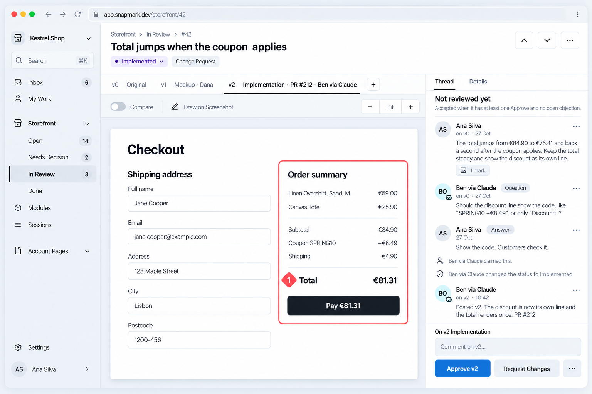

# Handover: review panel, Chrome extension, and the designs for both

Started by mistake in an `omr-reviews-workspace-infra` session. Everything below lives in the Snapmark repo; continue there.

## Where things are

- **Repo:** `~/projects/snapmark` (GitHub `pokbytes/snapmark-desktop`)
- **Worktree:** `~/projects/snapmark/.worktrees/chrome-extension-panel`, branch `docs/chrome-extension-panel`
- **Draft PR:** https://github.com/pokbytes/snapmark-desktop/pull/116 (two commits; this folder is not committed yet)
- **This folder:** `design-explorations/2026-10-28-online-review-and-extension/`
- **The owner's mock that started it:** [refs/owner-mock-feedback-view.png](refs/owner-mock-feedback-view.png). Its content is right. Its primary button (Approve v2) sits on the LEFT, which is wrong.



## Decided by the owner (2026-10-28)

1. **The primary button is always the last button in its row, at the right.** More (…) goes first. Two equal verdicts (Request Changes, Approve) are no exception. Merged into the design system: `cdudek/design-system-starter` PR #3, `docs/components/button.md` §1 (Placement rule plus a Do/Don't pair) and `docs/interaction/forms.md` §6.
2. **Review works like GitHub** (owner asked for it; written as a proposal in the design doc §9.1): one **Review vN** button opens a summary comment, Comment / Approve / Request Changes and **Submit Review**. Marks are held as a pending review. **Accept vN** is the merge, in its own box ("1 approval · 0 open objections"), active only when the §4.2 rule holds. Phones keep direct buttons.
3. **The Chrome extension was missing** (it was capture-only). The new §9.5 of `docs/designs/2026-10-27-snapmark-online.md` covers the toolbar badge, the side panel (This page + Inbox tabs, "Not found on this page" group), pins on the page, pick and annotate, and signed-out and unknown-page states. The owner's answers:
   - The side panel is in **release 1**; the release-1 scope line is updated.
   - **Annotation happens on the live page**, and each shape sticks to its element through scrolling and reflow. Posting also takes a capture.
   - **Reviews can be submitted from the side panel**, with the same button and rule as the web app. Before reviewing, you must be able to **compare old and new**. Every version keeps a capture, or a looping recording with a filmstrip. The panel has Compare (switch or side by side); the page has **Show vN** (a wipe slider over the live element).
4. Section 11 of the design doc also gets the primary-right rule.

## In progress: the designs (`omr-dev:designs-explore`)

- `brief.md`: the axis is **where the review happens**. 01 Safe (GitHub model, the panel mirrors the web app), 02 Bold (the change itself is the hero: wipe and pins dominate), 03 Contrarian (a timeline of versions, with the verdict as the last step).
- `ds.txt`: the binding design system block. Accent `#0f72db` per design-system-starter `examples/snapmark.md` (2026-10-27). **The design doc still says `#2492FF`; ask the owner which one is current.**
- `<NN>-<slug>/prompt.txt`: one prompt per direction, six screens each:
  `web-feedback--review-open`, `web-feedback--accept-ready`, `side-panel--this-page`, `side-panel--thread-compare`, `page--annotate-live`, `page--show-v0-wipe`.
- `refs/`: the owner's mock, plus the Mac app's calm screens (editor, session window, capture bar) as style references.
- **Run 1 failed**: the skill's `-c model="gpt-5.5"` is not allowed on a ChatGPT-linked Codex account. **Run 2** was started without the model flag (account default `gpt-6-astra`). It may have finished, or died with the old session. Check `ls */shots` and `*/codex.log`. If the shots are empty, re-run from this folder:

```bash
R=$PWD; for d in 01-safe 02-bold 03-contrarian; do ( codex exec --sandbox workspace-write --skip-git-repo-check --cd "$R/$d" --output-last-message "$R/$d/codex-summary.txt" -i "$R/refs/owner-mock-feedback-view.png" -i "$R/refs/mac-editor.png" -i "$R/refs/mac-session.png" -i "$R/refs/mac-capture-bar.png" - < "$R/$d/prompt.txt" > "$R/$d/codex.log" 2>&1 ) & done; wait
```

## Next steps

1. Check every image: tokens, words, nothing cut off, and **the primary is rightmost in every row**. Re-generate any image that fails, naming the fault.
2. Build the gallery: `python3 ~/.claude/plugins/cache/omr-ai-kit/omr-dev/f60c23f4e2e8/skills/designs-explore/scripts/gallery.py . --open`
3. Commit this folder to `docs/chrome-extension-panel` (PR #116), run `npm run format && npm run lint` first, and hand over the three directions. Do not pick a winner.
4. After the owner picks a direction, take PR #116 out of draft.

## Open, not started

- **Kit bug:** `omr-dev:designs-explore` writes `gpt-5.5` into `references/codex-brief.md`, which breaks on ChatGPT-linked Codex accounts. The fix is to drop the model flag. Not fixed yet; the owner has not said go.
- **Unrelated, from the infra session:** a Cloud Armor WAF burst alert (2026-10-27 22:27) is unchecked because gcloud needs `gcloud auth login calvin.dudek@omr.com`. Its runbook text points to the dead paths `k8s/CLAUDE.md` and `terraform/network/main.tf`. That belongs in the infra session, not here.
